# Audit tổng – 2026-11-14 12:47 UTC · 37a971b

**Trung bình 92.5** (lần trước 91.2) · 199 mục · đạt ≥ 90: **137** · dưới chuẩn: **32** · chưa đo: **30**
App 90 · Web 95.9 · Add-on 91.6 · Native ∅

Độ phủ: Chức năng 188/199 · Lỗi JS 169/199 · Rỗng/lỗi/tải 91/130 · Back/Thoát 29/65 · Tương phản 169/199 · Chạm ≥44 169/199 · Bố cục 169/199 · i18n 15 142/199 · Hiệu năng 160/199 · Độ đẹp 136/199

∅ = chưa đo (không tính điểm) · – = không áp dụng. Công thức: docs/QUALITY-SWEEP.md.

| # | Mục | Điểm | Δ | Chức năng | Lỗi JS | Rỗng/lỗi/tải | Back/Thoát | Tương phản | Chạm ≥44 | Bố cục | i18n 15 | Hiệu năng | Độ đẹp | Ảnh | Lỗi chính |
|--:|---|--:|--:|--:|--:|--:|--:|--:|--:|--:|--:|--:|--:|---|---|
| 1 | [#/usage/interested](items/app_usage_interested.md) | **76** | +2 | 100 | 100 | 100 | – | 100 | 28 | 40 | 13 | 58 | 79 | 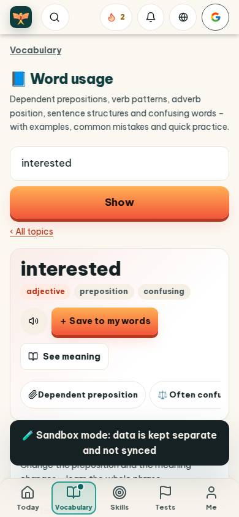 | [tap] main#view>p.small>a – "‹ All topics" vùng chạm 71×18 < 44px [tap] section.card.us-hero>div.us-acts>a.btn.sm – "See meaning" vùng chạm 144×36 < 44px [tap] section.card.us-hero>nav.us-jump>a – "Dependent preposition" vùng chạm 205×36 < 44px |
| 2 | [#/read](items/app_read.md) | **78** | 0 | 100 | 100 | 100 | 100 | 100 | 36 | 70 | 13 | 50 | 72 | 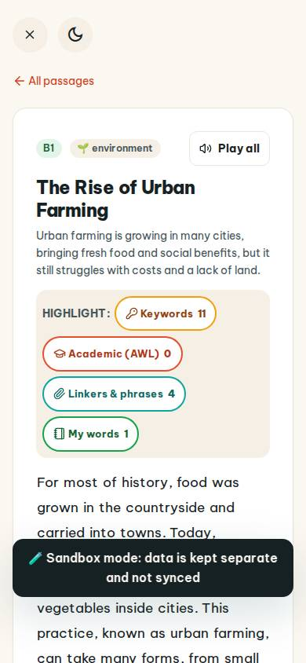 | [tap] main#view>a.small – "All passages" vùng chạm 107×18 < 44px [tap] button#readAloud – "Play all" vùng chạm 103×36 < 44px [tap] div#hlBar>button.hl-chip.kw – "Keywords 11" vùng chạm 130×34 < 44px |
| 3 | [#/model/t1-travel](items/app_model_t1-travel.md) | **79** | 0 | 100 | 100 | 100 | – | 100 | 36 | 85 | 13 | 50 | 77 | 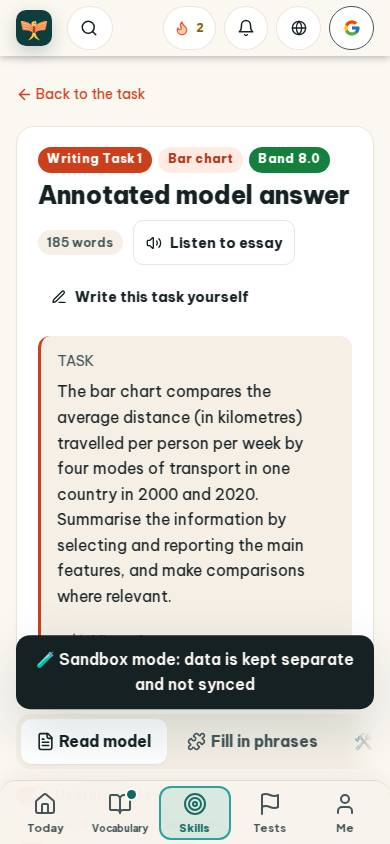 | [tap] article#annot>p>span.an-ch – "gained in popularity" vùng chạm 157×20 < 44px [tap] main#view>a.small – "Back to the task" vùng chạm 132×18 < 44px [tap] button#readM – "Listen to essay" vùng chạm 162×36 < 44px |
| 4 | [#/toeic](items/app_toeic.md) | **79** | -1 | 100 | 100 | 100 | – | 90 | 76 | 85 | 13 | 50 | 72 | 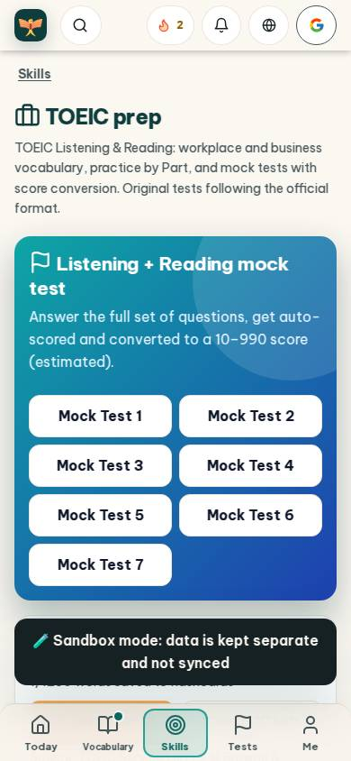 | [contrast] a[data-ext-cta="rail"] [tap] div.card>div.row>a.btn.sm – "View all 10 sets" vùng chạm 168×36 < 44px [tap] main#view>div.tabs>a – "Test 1" vùng chạm 73×39 < 44px |
| 5 | [#/topic/office-email](items/app_topic_office-email.md) | **79** | 0 | 100 | 100 | 100 | – | 90 | 68 | 85 | 13 | 50 | 74 | 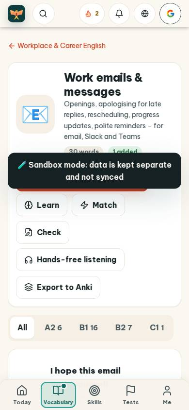 | [contrast] .word-row:nth-child(19) > div:nth-child(2) > .ex.small > mark [tap] main#view>a.small – "Workplace & Career English" vùng chạm 205×18 < 44px [tap] div#lvTabs>button – "All" vùng chạm 50×41 < 44px |
| 6 | [Add-on › tab mới](items/ext_newtab.md) | **79** | -2 | 100 | 100 | ∅ | – | 100 | 20 | 40 | ∅ | ∅ | 61 | 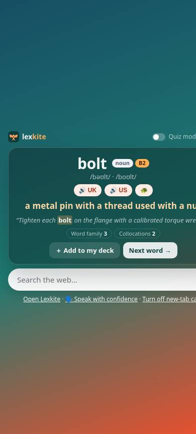 | [tap] article#ntCard>div.spks>button.spk – "🔊 UK" vùng chạm 56×24 < 44px [tap] button#ntSlow – "🐢" vùng chạm 35×24 < 44px [tap] button#ntEx – "“Tighten each bolt on the flange with a " vùng chạm 387×19 < 44px |
| 7 | [#/listen](items/app_listen.md) | **80** | +10 | 100 | 100 | 100 | 100 | 100 | 68 | 70 | 13 | 50 | 72 | 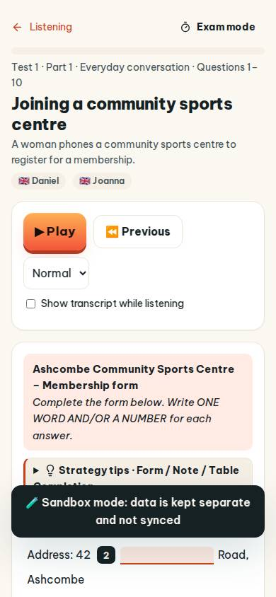 | [tap] div.lq-notes>div.lq-item.lq-gap>input.gap – "" vùng chạm 132×25 < 44px [tap] main#view>div.row.between>a.btn.sm – "Exam mode" vùng chạm 133×36 < 44px [tap] select#lRate – "0.8× 0.9× Normal 1× 1.1×" vùng chạm 93×38 < 44px |
| 8 | [#/library](items/app_library.md) | **81** | -1 | 100 | 100 | 100 | – | 90 | 68 | 100 | 13 | 50 | 75 | 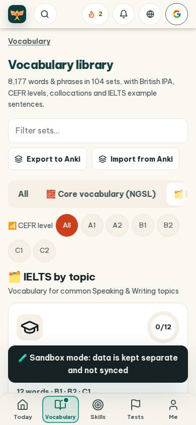 | [contrast] a[data-ext-cta="rail"] [tap] button#libAnkiOut – "Export to Anki" vùng chạm 157×36 < 44px [tap] button#libAnkiIn – "Import from Anki" vùng chạm 174×36 < 44px |
| 9 | [/admin.html](items/web_admin.html.md) | **81** | 0 | 100 | 75 | – | – | 90 | 84 | 100 | ∅ | 100 | 30 | 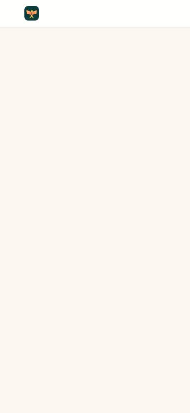 | [js] firebase is not defined [contrast] .adm-tag [tap] a.adm-skip[Bỏ qua tới nội dung] – "Skip to content" vùng chạm 133×39 < 44px |
| 10 | [/L/credits.html](items/web_L_credits.html.md) | **81** | 0 | 100 | 100 | – | – | 100 | 76 | 85 | 13 | 100 | 58 | 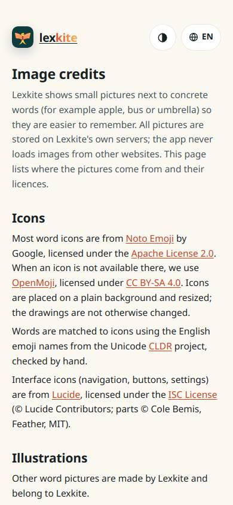 | [tap] tr>td>a – "DVI-VGA-Adapter.jpg" vùng chạm 142×20 < 44px [tap] main.doc>div.lg>a.brand – "lexkite" vùng chạm 109×36 < 44px [tap] div.tbx>div.lsw>button.lsw-b – "EN" vùng chạm 67×36 < 44px |
| 11 | [#/toefl](items/app_toefl.md) | **82** | +1 | 100 | 100 | 100 | – | 100 | 100 | 85 | 13 | 50 | 74 | 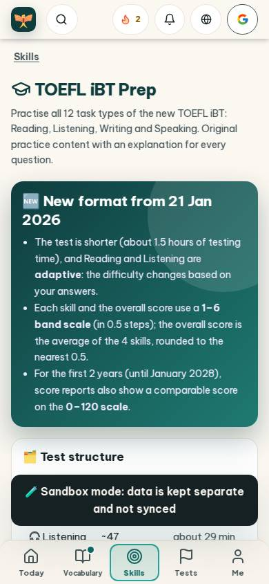 | [layout] main#view>div.grid.g2>div.card.hero-main – nội dung tràn ngang 60px bị cắt [i18n] ar: thiếu dịch «Reading» · thiếu dịch «Listening» [i18n] de: thiếu dịch «Reading» · thiếu dịch «Listening» |
| 12 | [#/toeic-sw](items/app_toeic-sw.md) | **82** | -1 | 100 | 100 | 100 | – | 90 | 92 | 100 | 13 | 50 | 77 | 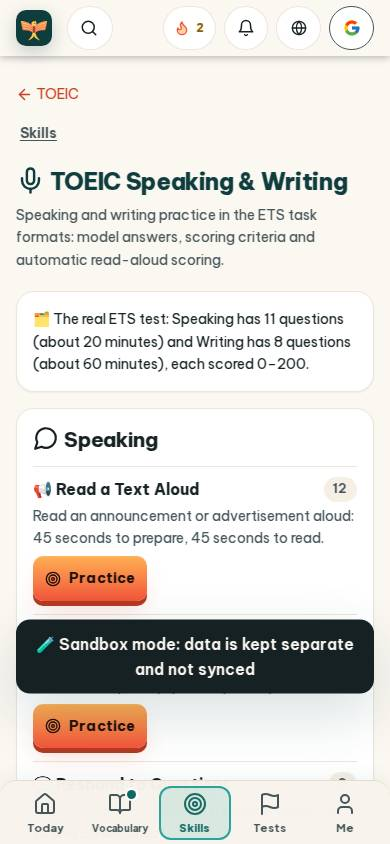 | [contrast] a[data-ext-cta="rail"] [tap] main#view>a.small – "TOEIC" vùng chạm 66×18 < 44px [i18n] ar: thiếu dịch «Speaking» · thiếu dịch «Writing» |
| 13 | [#/task1](items/app_task1.md) | **83** | +1 | 100 | 100 | 100 | 100 | 100 | 60 | 100 | 13 | 50 | 79 | 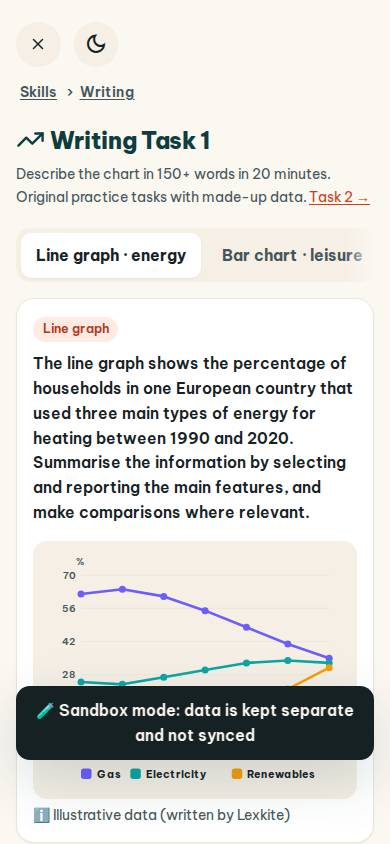 | [tap] main#view>div.tabs.fade-end>button – "Line graph · energy" vùng chạm 180×41 < 44px [tap] button#tBtn – "Start timer" vùng chạm 133×36 < 44px [tap] div.row.between>div.row>button.btn.sm – "Rewrite selected sentence" vùng chạm 247×36 < 44px |
| 14 | [#/toeic-r](items/app_toeic-r.md) | **83** | 0 | 100 | 100 | 100 | 100 | 100 | 76 | 100 | 13 | 50 | 72 | 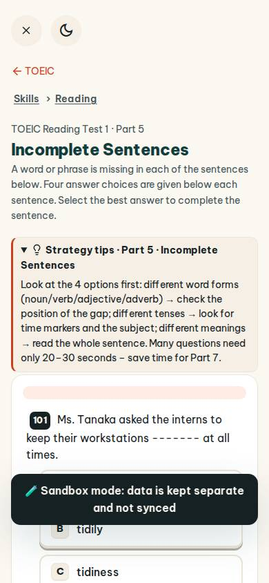 | [tap] main#view>a.small – "TOEIC" vùng chạm 66×18 < 44px [tap] main#view>details.qtip>summary – "Strategy tips · Part 5 · Incomplete Sent" vùng chạm 1025×35 < 44px [tap] div.row>div.row>a.btn.sm – "Part 6" vùng chạm 73×36 < 44px |
| 15 | [#/topic/ngsl1](items/app_topic_ngsl1.md) | **83** | +2 | 100 | 100 | 100 | – | 100 | 68 | 85 | 13 | 60 | 83 | 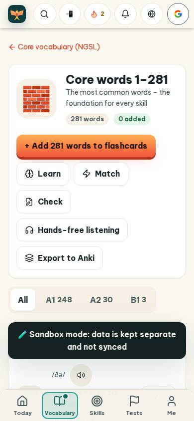 | [tap] main#view>a.small – "Core vocabulary (NGSL)" vùng chạm 188×18 < 44px [tap] div#lvTabs>button – "All" vùng chạm 50×41 < 44px [tap] div>div.row>a.w – "the" vùng chạm 30×27 < 44px |
| 16 | [#/cambridge](items/app_cambridge.md) | **84** | +1 | 100 | 100 | 100 | – | 100 | 100 | 100 | 13 | 50 | 79 | 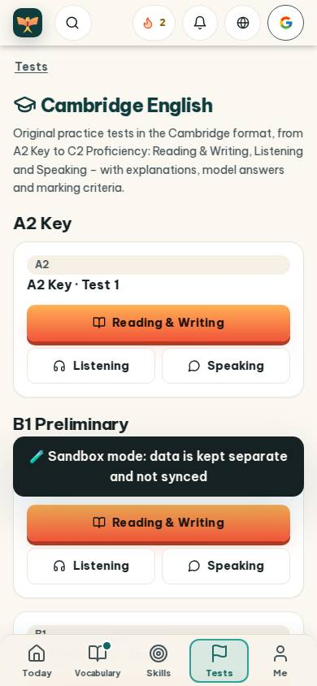 | [i18n] ar: thiếu dịch «Listening» · thiếu dịch «Speaking» [i18n] de: thiếu dịch «Listening» · thiếu dịch «Speaking» [i18n] es: thiếu dịch «Listening» · thiếu dịch «Speaking» |
| 17 | [#/dict/sustainable](items/app_dict_sustainable.md) | **84** | +1 | 100 | 100 | 100 | – | 100 | 76 | 100 | 13 | 61 | 77 | 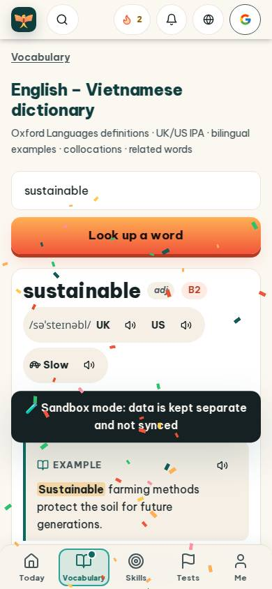 | [tap] div.card>div.wc-chips>button.chip.wc-chip – "sustainable development" vùng chạm 216×36 < 44px [tap] button#addPhr – "＋ Save your own phrase / structure" vùng chạm 293×36 < 44px [tap] button#relRetry – "↻ Try again" vùng chạm 112×36 < 44px |
| 18 | [#/method](items/app_method.md) | **84** | 0 | 100 | 100 | 100 | – | 90 | 76 | 85 | 47 | 50 | 81 | 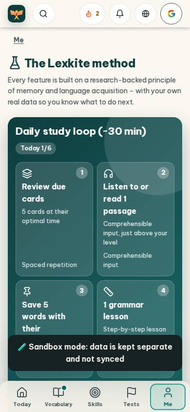 | [contrast] a[data-ext-cta="rail"] [tap] div.card>div.row.between>a.small – "Target 90% →" vùng chạm 96×22 < 44px [tap] div.card>div.tiny.muted>a – "See the full path →" vùng chạm 125×18 < 44px |
| 19 | [#/review](items/app_review.md) | **84** | -1 | 100 | 100 | 100 | 100 | 100 | 60 | 100 | 13 | 72 | 72 | 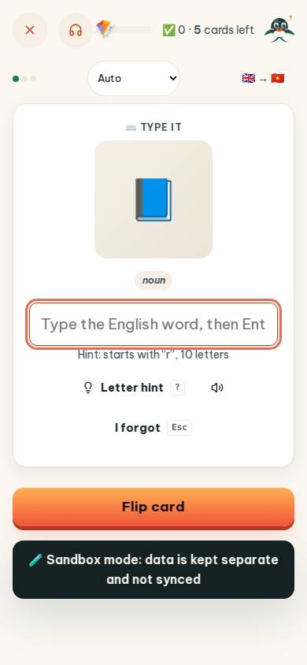 | [tap] select#rmSel – "Auto Flip card Type it Listen & pick" vùng chạm 118×28 < 44px [tap] button#toggleRev – "🇬🇧 → 🇻🇳" vùng chạm 80×36 < 44px [tap] button#rmLet – "Letter hint ?" vùng chạm 156×36 < 44px |
| 20 | [#/deck](items/app_deck.md) | **86** | +1 | 100 | 100 | 100 | – | 100 | 52 | 40 | 100 | 79 | 75 | 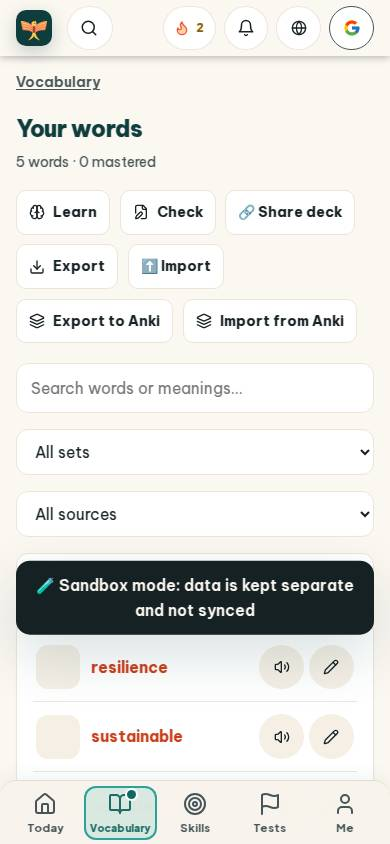 | [tap] div.page-head>div.row>a.btn.sm – "Learn" vùng chạm 94×36 < 44px [tap] button#shareBtn – "🔗 Share deck" vùng chạm 130×36 < 44px [tap] button#exportBtn – "Export" vùng chạm 102×36 < 44px |
| 21 | [#/grammar](items/app_grammar.md) | **86** | 0 | 100 | 100 | 100 | 100 | 100 | 84 | 40 | 100 | 50 | 74 | 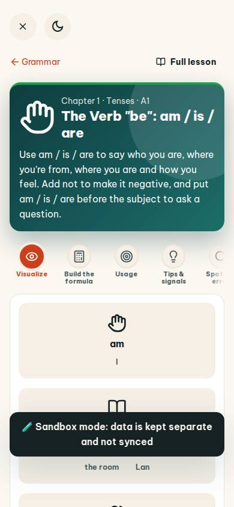 | [tap] main#view>div.row.between>a.small – "Grammar" vùng chạm 87×22 < 44px [tap] main#view>div.row.between>a.btn.sm – "Full lesson" vùng chạm 127×36 < 44px [layout] main#view>div.card.hero-main – nội dung tràn ngang 60px bị cắt |
| 22 | [#/mock](items/app_mock.md) | **86** | 0 | 100 | 100 | 100 | 100 | 100 | 100 | 100 | 13 | 78 | 72 | 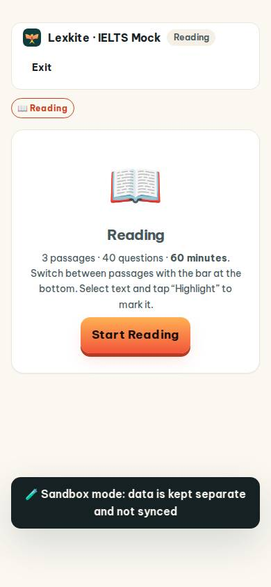 | [i18n] ar: thiếu dịch «Reading» [i18n] de: thiếu dịch «Reading» [i18n] es: thiếu dịch «Reading» |
| 23 | [#/practice](items/app_practice.md) | **86** | +1 | 100 | 100 | 100 | 100 | 100 | 100 | 100 | 13 | 80 | 72 | 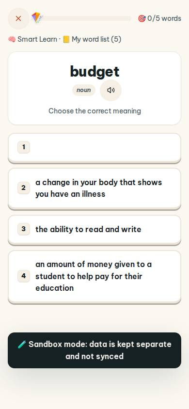 | [i18n] ar: thiếu dịch «noun» [i18n] de: thiếu dịch «noun» [i18n] es: thiếu dịch «noun» |
| 24 | [#/practice/learn](items/app_practice_learn.md) | **86** | +1 | 100 | 100 | 100 | 100 | 100 | 100 | 100 | 13 | 79 | 72 | 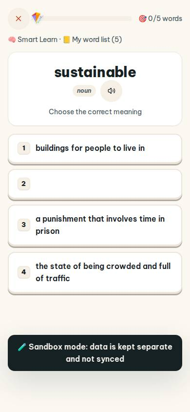 | [i18n] ar: thiếu dịch «noun» [i18n] de: thiếu dịch «noun» [i18n] es: thiếu dịch «noun» |
| 25 | [#/speaking](items/app_speaking.md) | **86** | 0 | 100 | 100 | 100 | 100 | 100 | 68 | 55 | 100 | 50 | 72 | 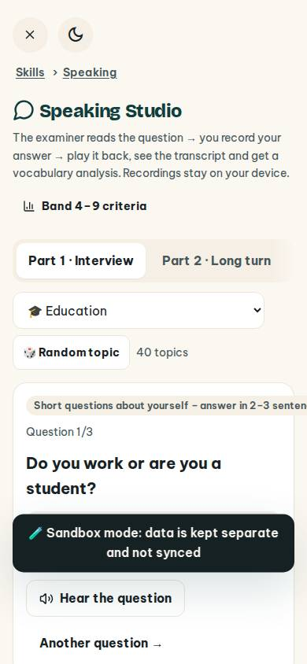 | [tap] div.row.between>div>a.btn.sm – "Band 4–9 criteria" vùng chạm 184×36 < 44px [tap] main#view>div.tabs>button – "Part 1 · Interview" vùng chạm 164×41 < 44px [tap] button#spRand – "🎲 Random topic" vùng chạm 149×36 < 44px |
| 26 | [/L/schools.html](items/web_L_schools.html.md) | **86** | +8 | 100 | 100 | – | – | 100 | 84 | 85 | 13 | 100 | ∅ | 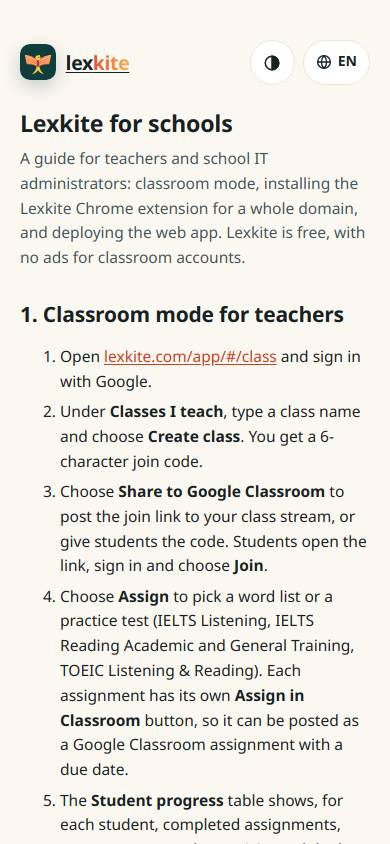 | [tap] main.doc>div.lg>a.brand – "lexkite" vùng chạm 109×36 < 44px [tap] div.tbx>div.lsw>button.lsw-b – "EN" vùng chạm 67×36 < 44px [layout] html – trang rộng 767px > 390px (cuộn ngang) |
| 27 | [#/dictation](items/app_dictation.md) | **87** | 0 | 100 | 100 | 100 | 100 | 100 | 84 | 55 | 100 | 50 | 72 | 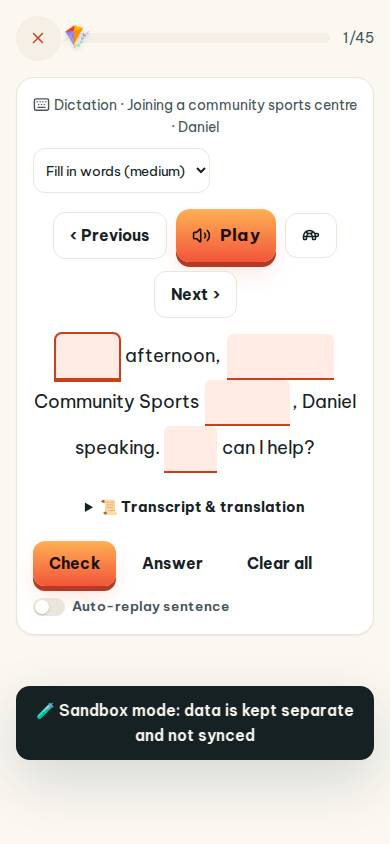 | [tap] button#dSlow – "Play slowly" vùng chạm 52×40 < 44px [tap] details#dTr>summary – "📜 Transcript & translation" vùng chạm 630×23 < 44px [layout] button#dNext – "Next ›" rớt xuống đứng một mình ở dòng cuối của div.study-wrap>div.card.q-card>div.row.center |
| 28 | [#/ideas](items/app_ideas.md) | **88** | 0 | 100 | 100 | 100 | – | 90 | 68 | 85 | 100 | 50 | 77 | 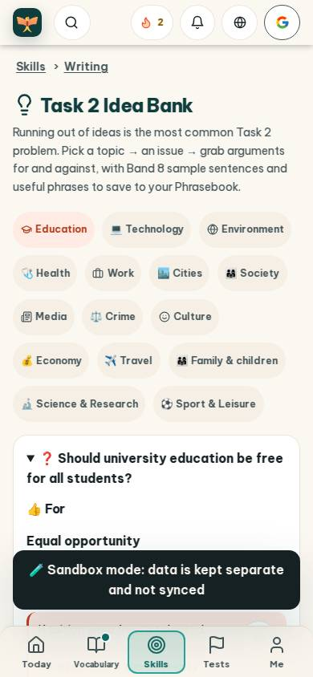 | [contrast] a[data-ext-cta="rail"] [tap] main#view>div.row>a.chip.lv – "Education" vùng chạm 102×24 < 44px [tap] main#view>div.row>a.chip – "💻 Technology" vùng chạm 111×24 < 44px |
| 29 | [#/write](items/app_write.md) | **88** | 0 | 100 | 100 | 100 | 100 | 100 | 44 | 85 | 100 | 50 | 72 | 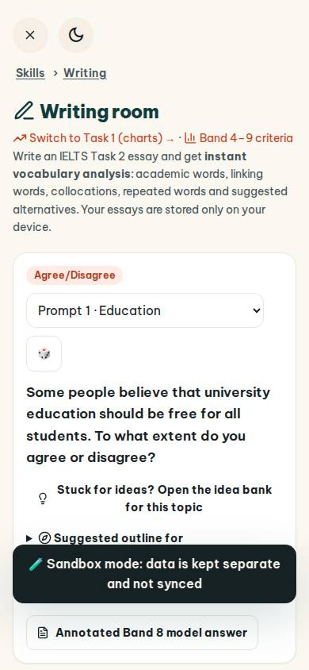 | [tap] button#rndP – "🎲" vùng chạm 43×36 < 44px [tap] div.stack>div.card>a.btn.sm – "Stuck for ideas? Open the idea bank for " vùng chạm 422×36 < 44px [tap] div.card>details>summary.small – "Suggested outline for Agree/Disagree" vùng chạm 663×22 < 44px |
| 30 | [/L/privacy.html](items/web_L_privacy.html.md) | **88** | +1 | 100 | 100 | – | – | 100 | 84 | 85 | 100 | 100 | 38 |  | [tap] main.doc>div.lg>a.brand – "lexkite" vùng chạm 109×36 < 44px [tap] div.tbx>div.lsw>button.lsw-b – "EN" vùng chạm 67×36 < 44px [layout] main.doc>table – nội dung tràn ngang 20px bị cắt: "Where it is stored", "On your device (browser storage, app sto", "Firebase Authentication |
| 31 | [/L/terms.html](items/web_L_terms.html.md) | **88** | +7 | 100 | 100 | – | – | 100 | 84 | 100 | 13 | 100 | ∅ |  | [tap] main.doc>div.lg>a.brand – "lexkite" vùng chạm 109×36 < 44px [tap] div.tbx>div.lsw>button.lsw-b – "EN" vùng chạm 67×36 < 44px [i18n] ar: lang="en" |
| 32 | [#/listening](items/app_listening.md) | **89** | -1 | 100 | 100 | 100 | – | 100 | 84 | 85 | 100 | 50 | 75 | 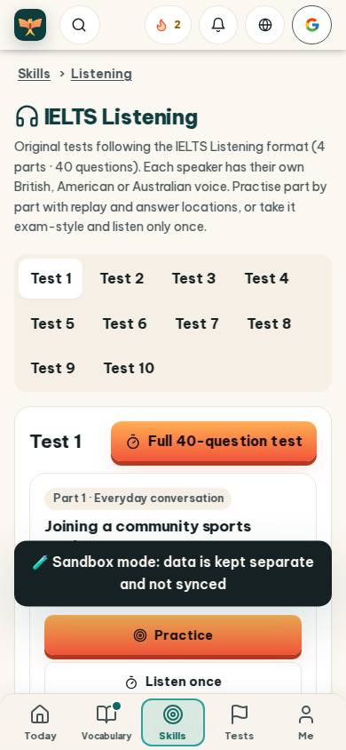 | [tap] main#view>div.tabs>a – "Test 1" vùng chạm 73×39 < 44px [tap] div.card>div.card-acts>a.btn.sm – "Listen once" vùng chạm 195×36 < 44px [layout] main#view>div.tabs>a – "Test 10" rớt xuống đứng một mình ở dòng cuối của main#view>div.tabs |
| 33 | [#/confidence](items/app_confidence.md) | **90** | -1 | 100 | 100 | 100 | – | 90 | 100 | 85 | 100 | 50 | 83 | 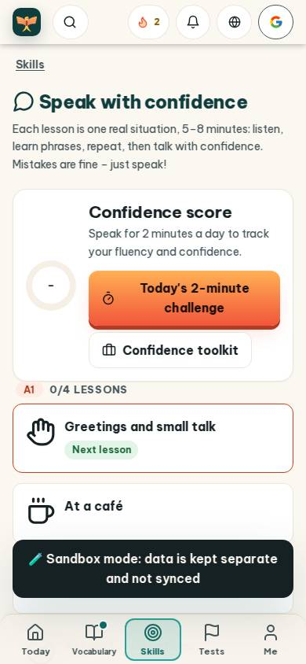 | [contrast] a[data-ext-cta="rail"] [layout] div>div.ring>b – nhãn "–" đứng trơ một mình cả hàng (khung 64px) [perf] LCP 6052 ms · CLS 0.0031 · TBT 28 ms |
| 34 | [#/courses](items/app_courses.md) | **90** | -2 | 100 | 100 | 100 | – | 90 | 100 | 100 | 100 | 43 | 75 | 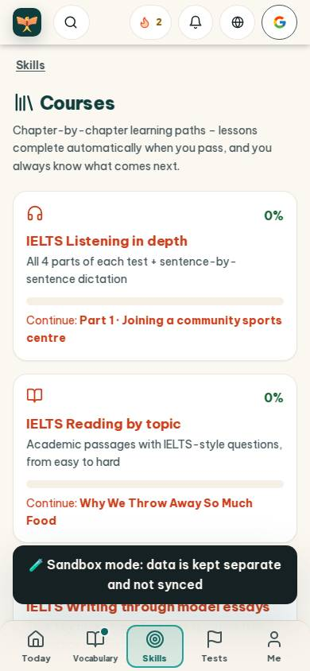 | [contrast] a[data-ext-cta="rail"] [perf] LCP 16752 ms · CLS 0.0031 · TBT 439 ms [beauty] Dark toast banner obscures third course card |
| 35 | [#/fix](items/app_fix.md) | **90** | 0 | 100 | 100 | 100 | – | 100 | 68 | 85 | 100 | 61 | 75 | 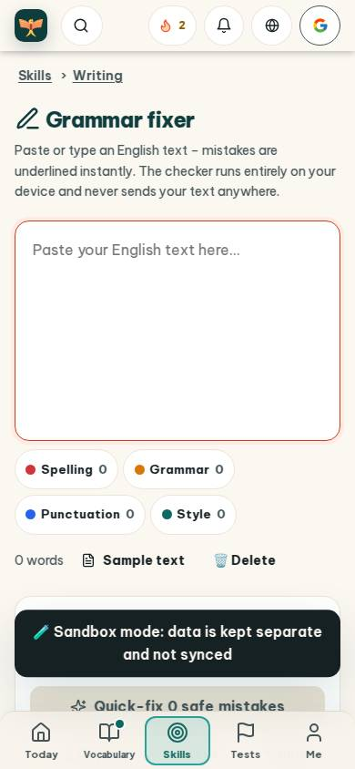 | [tap] button#fxSample – "Sample text" vùng chạm 140×36 < 44px [tap] button#fxClear – "🗑️ Delete" vùng chạm 95×36 < 44px [tap] button#fxCopy – "📋 Copy corrected text" vùng chạm 181×36 < 44px |
| 36 | [#/home](items/app_home.md) | **90** | 0 | 100 | 100 | 100 | – | 100 | 100 | 43 | 100 | 75 | 84 | 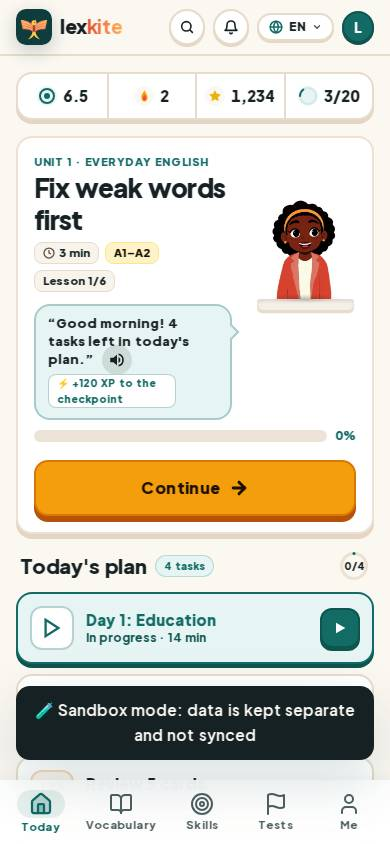 | [layout] main.w-full.min-h-screen>div.px-4.py-4>section.[border-radius:16px].p-4 – nội dung tràn ngang 12px bị cắt: "div.w-[116px].h-[156px]>span.tsl [layout] div#v2-pathlist>div.relative.w-full>div.absolute.start-[88px] – nội dung tràn ngang 24px bị cắt: "div.absolute.end-1>span.tslot.tslot-m>span [layout] span#xpPill – nội dung tràn ngang 120px bị cắt |
| 37 | [#/letters](items/app_letters.md) | **90** | 0 | 100 | 100 | 100 | 100 | 100 | 68 | 100 | 100 | 50 | 72 | 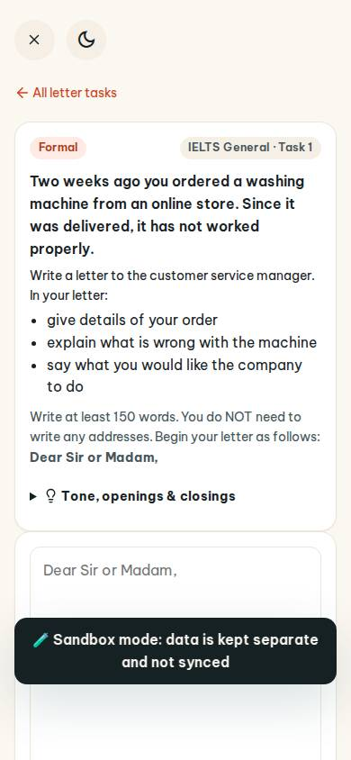 | [tap] main#view>a.small – "All letter tasks" vùng chạm 117×18 < 44px [tap] div.card>details>summary.small – "Tone, openings & closings" vùng chạm 979×22 < 44px [tap] button#ltTimer – "20:00" vùng chạm 96×36 < 44px |
| 38 | [#/roleplay](items/app_roleplay.md) | **90** | -1 | 100 | 100 | 100 | 100 | 100 | 92 | 85 | 100 | 50 | 74 | 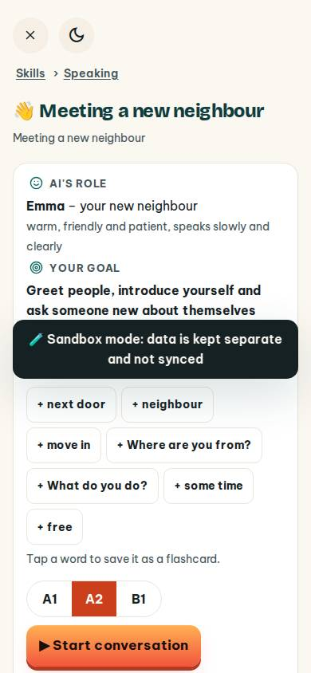 | [tap] div.card>div.rp-chips>button.btn.sm – "+ next door" vùng chạm 113×36 < 44px [layout] div.card>div.rp-chips>button.btn.sm – "+ free" rớt xuống đứng một mình ở dòng cuối của main#view>div.card>div.rp-chips [perf] LCP 6112 ms · CLS 0 · TBT 98 ms |
| 39 | [#/stats](items/app_stats.md) | **90** | +1 | 100 | 100 | 100 | – | 100 | 68 | 55 | 100 | 79 | 83 | 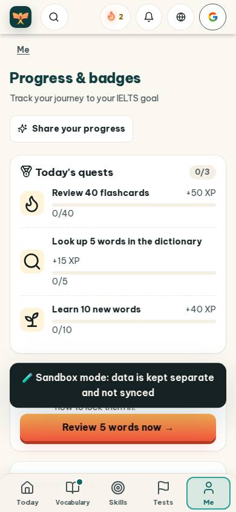 | [tap] main#view>div.page-head>button.btn.sm – "Share your progress" vùng chạm 204×36 < 44px [tap] div#goldenCard>a.btn.primary – "Review 5 words now →" vùng chạm 350×41 < 44px [tap] div.card>div.row.between>a.small – "Why? →" vùng chạm 55×22 < 44px |
| 40 | [#/toefl-p](items/app_toefl-p.md) | **90** | 0 | 100 | 100 | 100 | 100 | 100 | 60 | 100 | 100 | 50 | 72 | 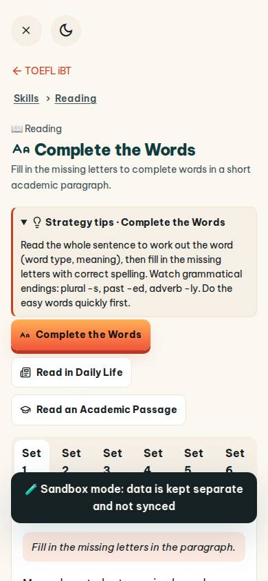 | [tap] div.cw-text>label.cw-slot>input.gap.cw – "Blank 1" vùng chạm 30×22 < 44px [tap] main#view>a.small – "TOEFL iBT" vùng chạm 92×18 < 44px [tap] main#view>details.qtip>summary – "Strategy tips · Complete the Words" vùng chạm 1025×35 < 44px |
| 41 | [#/verb/take](items/app_verb_take.md) | **90** | +1 | 100 | 100 | 100 | – | 100 | 20 | 100 | 100 | 61 | 82 | 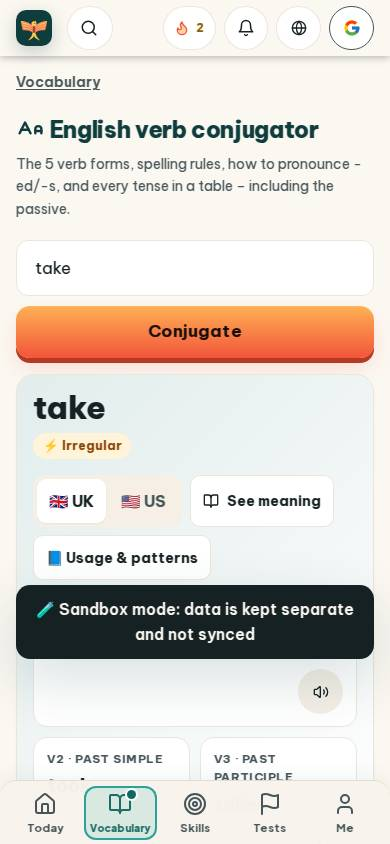 | [tap] div#vbReg>button – "🇬🇧 UK" vùng chạm 69×38 < 44px [tap] div.vb-grid2>div.vb-box>a.small – "Lesson: pronouncing -ed and -s →" vùng chạm 251×18 < 44px [tap] div#vbVoice>button – "Active" vùng chạm 77×38 < 44px |
| 42 | [#/watch](items/app_watch.md) | **90** | 0 | 100 | 100 | 100 | – | 100 | 92 | 85 | 100 | 62 | 67 | 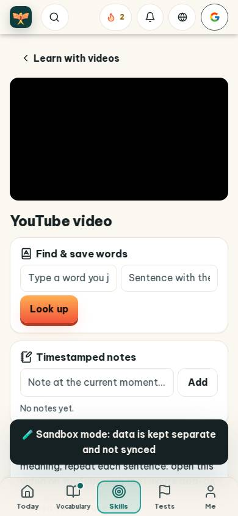 | [tap] a#wtYT – "Open on YouTube" vùng chạm 157×36 < 44px [layout] form#wtSave>button.btn.primary – "Look up" rớt xuống đứng một mình ở dòng cuối của form#wtSave [perf] LCP 5144 ms · CLS 0.0031 · TBT 13 ms |
| 43 | [Add-on › popup](items/ext_popup.md) | **90** | 0 | 100 | 100 | ∅ | – | 90 | 84 | 85 | ∅ | ∅ | 72 | 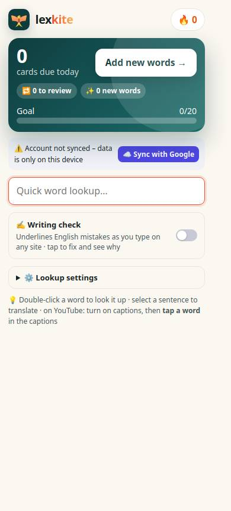 | [contrast] #streak [tap] a#syncNow – "☁️ Sync with Google" vùng chạm 137×27 < 44px [tap] details.pp-set>summary – "⚙️ Lookup settings" vùng chạm 306×21 < 44px |
| 44 | [#/contact](items/app_contact.md) | **91** | 0 | 100 | 100 | 100 | – | 100 | 100 | 70 | 100 | 74 | 76 | 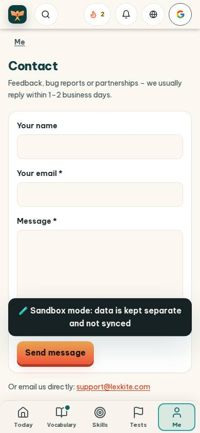 | [layout] form#ctForm>input – "" nằm ngoài màn hình (x -9982…-9954 / 390) [layout] form#ctForm>input – input "" không có nhãn nhìn thấy – người học không biết ô này để làm gì [perf] LCP 4300 ms · CLS 0.0031 · TBT 81 ms |
| 45 | [#/course/ielts-writing](items/app_course_ielts-writing.md) | **91** | -1 | 100 | 100 | 100 | – | 100 | 92 | 100 | 100 | 50 | 75 | 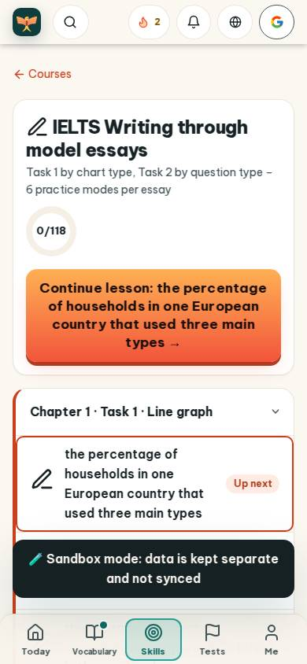 | [tap] main#view>a.small – "Courses" vùng chạm 78×18 < 44px [perf] LCP 16252 ms · CLS 0.0031 · TBT 84 ms [beauty] Generic sans-serif lacks Duolingo's friendly, rounded character |
| 46 | [#/criteria](items/app_criteria.md) | **91** | 0 | 100 | 100 | 100 | – | 100 | 60 | 100 | 100 | 54 | 79 | 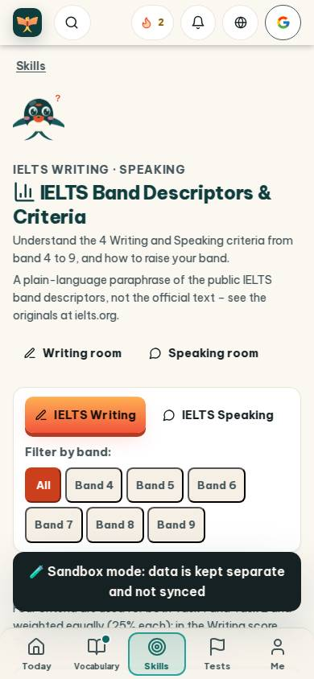 | [tap] div.row.between>div.row>a.btn.sm – "Writing room" vùng chạm 148×36 < 44px [tap] div#skillTabs>button.btn.sm – "IELTS Speaking" vùng chạm 164×36 < 44px [tap] div#bandFilters>button.chip – "All" vùng chạm 41×33 < 44px |
| 47 | [#/listen-test](items/app_listen-test.md) | **91** | -1 | 100 | 100 | 100 | 100 | 100 | 100 | 100 | 100 | 50 | 67 | 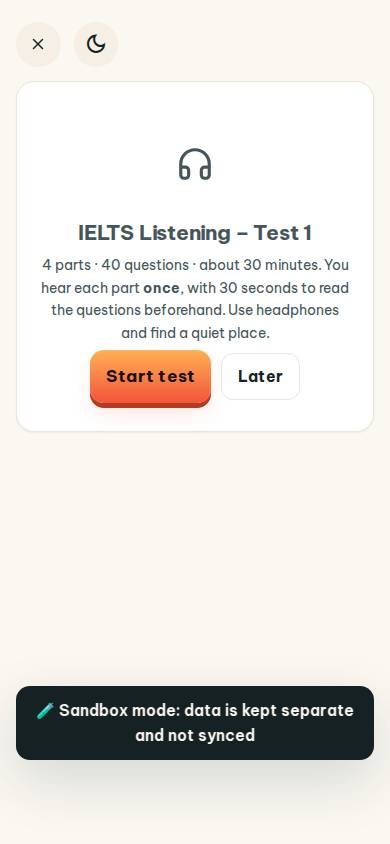 | [perf] LCP 9068 ms · CLS 0 · TBT 10 ms [beauty] Large empty space below the card feels unbalanced. [beauty] Sandbox mode toast looks like a debug overlay, not polished UI. |
| 48 | [#/models](items/app_models.md) | **91** | -1 | 100 | 100 | 100 | – | 90 | 100 | 100 | 100 | 50 | 79 | 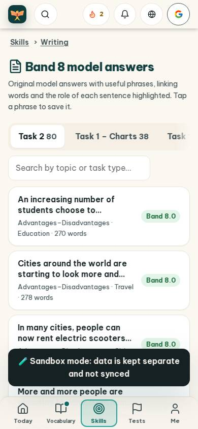 | [contrast] a[data-ext-cta="rail"] [perf] LCP 7036 ms · CLS 0.0031 · TBT 107 ms [beauty] Dark toast notification obscures content and bottom nav |
| 49 | [#/pron](items/app_pron.md) | **91** | +1 | 100 | 100 | 100 | 100 | 100 | 92 | 85 | 100 | 57 | 77 | 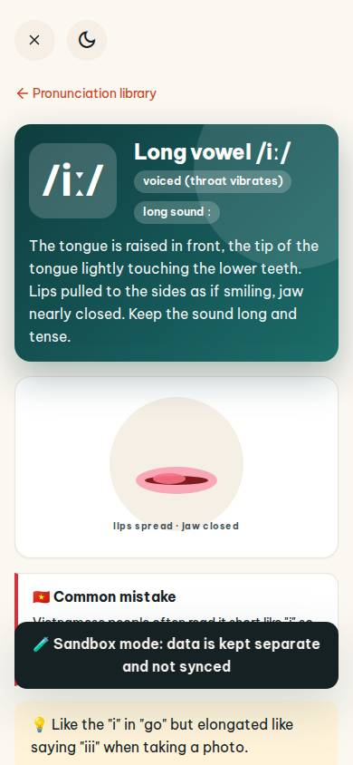 | [tap] main#view>a.small – "Pronunciation library" vùng chạm 160×18 < 44px [layout] div#pHead>div.card.hero-main – nội dung tràn ngang 60px bị cắt [perf] LCP 5504 ms · CLS 0 · TBT 101 ms |
| 50 | [#/rtype](items/app_rtype.md) | **91** | -1 | 100 | 100 | 100 | 100 | 100 | 92 | 100 | 100 | 50 | 72 | 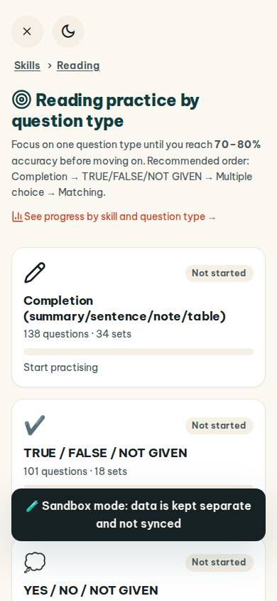 | [tap] div.page-head>div>a.small – "See progress by skill and question type " vùng chạm 293×18 < 44px [perf] LCP 8288 ms · CLS 0 · TBT 12 ms [beauty] Dark toast banner awkwardly overlaps card content |
| 51 | [#/usage](items/app_usage.md) | **91** | +1 | 100 | 100 | 100 | – | 100 | 92 | 85 | 100 | 59 | 78 | 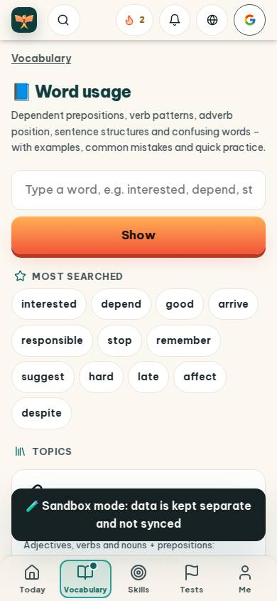 | [tap] main#view>div.us-chips>a – "interested" vùng chạm 106×36 < 44px [layout] main#view>div.us-chips>a – "despite" rớt xuống đứng một mình ở dòng cuối của main#view>div.us-chips [perf] LCP 5368 ms · CLS 0.0031 · TBT 22 ms |
| 52 | [Add-on › app #/home](items/ext_app_home.md) | **91** | 0 | 100 | 100 | ∅ | ∅ | 100 | 44 | 85 | ∅ | ∅ | 86 | 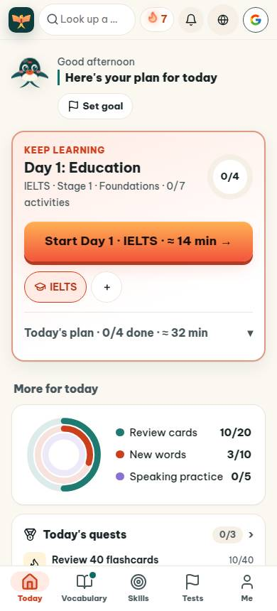 | [tap] div.main>header.topbar>a.brand – "" vùng chạm 36×36 < 44px [tap] button#avatarBtn – "Sign in with Google" vùng chạm 36×36 < 44px [tap] main#view>div.today-head>a.goal-chip – "Set goal" vùng chạm 106×37 < 44px |
| 53 | [/embed/*/](items/web_embed_.md) | **91** | 0 | 100 | 100 | – | – | 100 | 100 | 100 | ∅ | 100 | 47 |  | [beauty] No primary action button, only a text link [beauty] No illustration or character integration [beauty] Generic card layout, lacks Duolingo's playful polish |
| 54 | [/L/test-de-niveau-anglais/*/](items/web_L_test-de-niveau-anglais_.md) | **91** | 0 | 100 | 100 | – | – | 100 | 100 | 100 | 100 | 100 | 46 |  | [beauty] Looks like a default HTML page, not an app UI [beauty] No visual hierarchy or primary action [beauty] No cards, icons, or character integration |
| 55 | [/L/teste-de-nivel-de-ingles/*/](items/web_L_teste-de-nivel-de-ingles_.md) | **91** | -2 | 100 | 100 | – | – | 100 | 100 | 100 | 100 | 100 | 43 |  | [beauty] Looks like a default web page, not a mobile app UI [beauty] No app-like cards, buttons, or interactive elements [beauty] No illustration or character integration |
| 56 | [#/class](items/app_class.md) | **92** | 0 | 100 | 100 | 100 | – | 100 | 92 | 100 | 100 | 63 | 72 |  | [tap] div.card>p.tiny.muted>a – "Guide for schools & IT admins →" vùng chạm 215×18 < 44px [perf] LCP 5100 ms · CLS 0.0031 · TBT 0 ms [beauty] Generic emoji icons (teacher/student) look unpolished |
| 57 | [#/handsfree](items/app_handsfree.md) | **92** | 0 | 100 | 100 | 100 | 100 | 100 | 92 | 100 | 100 | 50 | 77 |  | [tap] button#hfDark – "🌙 Dark screen" vùng chạm 136×36 < 44px [perf] LCP 11312 ms · CLS 0 · TBT 63 ms [beauty] Dark toast banner overlaps primary action area |
| 58 | [#/mediate](items/app_mediate.md) | **92** | 0 | 100 | 100 | 100 | – | 90 | 100 | 100 | 100 | 50 | 81 |  | [contrast] a[data-ext-cta="rail"] [perf] LCP 6280 ms · CLS 0.0031 · TBT 77 ms [beauty] Dark toast banner obscures content and breaks visual flow |
| 59 | [#/phrases](items/app_phrases.md) | **92** | +1 | 100 | 100 | 100 | – | 100 | 100 | 100 | 100 | 50 | 79 |  | [perf] LCP 6800 ms · CLS 0.0031 · TBT 21 ms [beauty] Generic sans-serif typography lacks Duolingo's distinctive playful font. [beauty] Flat, generic icons and lack of character integration feel utilitarian. |
| 60 | [#/reflex](items/app_reflex.md) | **92** | 0 | 100 | 100 | 100 | 100 | 100 | 100 | 100 | 100 | 50 | 72 |  | [perf] LCP 9140 ms · CLS 0 · TBT 96 ms [beauty] Large empty white card looks like a broken or loading placeholder [beauty] No illustration or character integration, feels generic |
| 61 | [#/roleplay/manager](items/app_roleplay_manager.md) | **92** | 0 | 100 | 100 | 100 | 100 | 100 | 92 | 100 | 100 | 51 | 75 |  | [tap] div.card>div.rp-chips>button.btn.sm – "+ on track" vùng chạm 102×36 < 44px [perf] LCP 5936 ms · CLS 0 · TBT 46 ms [beauty] Dark 'Sandbox mode' banner feels like a debug overlay, not polished UI. |
| 62 | [#/settings/ai](items/app_settings_ai.md) | **92** | +1 | 100 | 100 | 100 | – | 90 | 100 | 100 | 100 | 60 | 74 |  | [contrast] a[data-ext-cta="rail"] [perf] LCP 5332 ms · CLS 0.0031 · TBT 56 ms [beauty] Dense text blocks reduce visual hierarchy and scannability. |
| 63 | [#/speak](items/app_speak.md) | **92** | +1 | 100 | 100 | 100 | – | 100 | 100 | 85 | 100 | 50 | 86 |  | [layout] div.flex.flex-col>section.pt-5.pb-6>div.w-[116px].min-h-[132px] – nội dung tràn ngang 20px bị cắt: "div.w-[116px].min-h-[132px]>span.tslot.t [perf] LCP 6028 ms · CLS 0.0022 · TBT 69 ms [beauty] Sandbox mode banner is a raw, dark toast that breaks the light theme |
| 64 | [#/streak](items/app_streak.md) | **92** | 0 | 100 | 100 | 100 | – | 100 | 100 | 85 | 100 | 53 | 82 |  | [layout] span#xpPill – nội dung tràn ngang 113px bị cắt [perf] LCP 5824 ms · CLS 0.0012 · TBT 182 ms [beauty] Calendar grid is cut off by the toast overlay |
| 65 | [#/toeic-test](items/app_toeic-test.md) | **92** | 0 | 100 | 100 | 100 | 100 | 100 | 92 | 85 | 100 | 75 | 72 |  | [tap] button#tTest – "Test sound" vùng chạm 133×36 < 44px [layout] button#tTest – "Test sound" rớt xuống đứng một mình ở dòng cuối của div.study-wrap>div.card.tx-start>div.tx-check [perf] LCP 4256 ms · CLS 0 · TBT 180 ms |
| 66 | [#/tracks](items/app_tracks.md) | **92** | 0 | 100 | 100 | 100 | – | 100 | 100 | 100 | 100 | 50 | 74 |  | [perf] LCP 6888 ms · CLS 0.0033 · TBT 2 ms [beauty] Dark 'Sandbox mode' banner looks like a raw debug overlay, not a designed UI element. [beauty] Top nav mixes app icons (Gmail, globe) with app controls, creating clutter. |
| 67 | [Add-on › app #/review](items/ext_app_review.md) | **92** | 0 | 100 | 100 | ∅ | ∅ | 100 | 76 | 85 | ∅ | ∅ | 79 |  | [tap] select#rmSel – "Auto Flip card Type it Listen & pick" vùng chạm 118×28 < 44px [tap] button#toggleRev – "🇬🇧 → 🇻🇳" vùng chạm 81×36 < 44px [tap] div.card.face>div.row.center>button.btn.sm – "🇺🇸 US" vùng chạm 66×36 < 44px |
| 68 | [/L/blog/*/](items/web_L_blog_.md) | **92** | +8 | 100 | 100 | – | – | 100 | 44 | 96 | 100 | 100 | 72 |  | [tap] ol>li>a – "TOEIC test format at a glance" vùng chạm 198×17 < 44px [tap] ul>li>a – "TOEIC Part 5 practice" vùng chạm 174×29 < 44px [tap] article.post>div.tags>a – "#test-format" vùng chạm 101×32 < 44px |
| 69 | [/L/research/*/](items/web_L_research_.md) | **92** | -1 | 100 | 100 | – | – | 100 | 92 | 85 | 100 | 100 | 60 |  | [tap] section>p>a – "CC BY 4.0" vùng chạm 80×19 < 44px [layout] main#nd>section>div.tbl – nội dung tràn ngang 348px bị cắt: "Typical mistake → correction", "Memory tip", "It has a big affect on me." [beauty] Looks like a default HTML page, not a polished app UI |
| 70 | [/terms.html](items/web_terms.html.md) | **92** | +3 | 100 | 100 | – | – | 100 | 84 | 100 | ∅ | 100 | 58 |  | [tap] main.doc>div.lg>a.brand – "lexkite" vùng chạm 109×36 < 44px [tap] div.tbx>div.lsw>button.lsw-b – "EN" vùng chạm 67×36 < 44px [beauty] No primary action; screen is a static legal text dump |
| 71 | [/viet-thu/*](items/web_viet-thu_.md) | **92** | 0 | 100 | 100 | – | – | 100 | 44 | 100 | ∅ | 100 | 74 |  | [tap] aside#pwa>div.cta-actions>button.btn-hide – "Ẩn" vùng chạm 28×30 < 44px [tap] div.side-box.legend>div.tools>button – "Tô màu" vùng chạm 87×32 < 44px [tap] section#d2>p>mark.ph – "express my dissatisfaction with" vùng chạm 247×20 < 44px |
| 72 | [#/call](items/app_call.md) | **93** | 0 | 100 | 100 | 100 | 100 | 100 | 92 | 100 | 100 | 50 | 82 |  | [tap] main#view>div.call-flt>button.btn.sm – "All" vùng chạm 43×44 < 44px [perf] LCP 6344 ms · CLS 0.0007 · TBT 95 ms [beauty] Character avatars look like generic stock illustrations, not integrated brand mascots. |
| 73 | [#/cbt](items/app_cbt.md) | **93** | -1 | 100 | 100 | 100 | 100 | 100 | 100 | 100 | 100 | 50 | 84 |  | [perf] LCP 6472 ms · CLS 0 · TBT 138 ms [beauty] Dark toast notification obscures content and disrupts layout flow [beauty] Lacks Duolingo's characteristic playful character integration |
| 74 | [#/league](items/app_league.md) | **93** | +1 | 100 | 100 | 100 | – | 100 | 100 | 100 | 100 | 63 | 75 |  | [perf] LCP 5068 ms · CLS 0.0031 · TBT 0 ms [beauty] Generic flat icons lack Duolingo's playful character integration [beauty] Dark toast banner obscures content and breaks visual flow |
| 75 | [#/lesson](items/app_lesson.md) | **93** | -1 | 100 | 100 | 100 | 100 | 100 | 100 | 85 | 100 | 70 | 79 |  | [layout] div#lsnBank>button.lsn-tile.min-h-[44px] – "She's" rớt xuống đứng một mình ở dòng cuối của div#lsnBank [perf] LCP 3916 ms · CLS 0.0007 · TBT 514 ms [beauty] Dark 'Sandbox mode' banner looks like a raw debug overlay, breaking immersion. |
| 76 | [#/mistakes](items/app_mistakes.md) | **93** | 0 | 100 | 100 | 100 | – | 100 | 92 | 100 | 100 | 63 | 78 |  | [tap] button#clearFixed – "Clear fixed mistakes" vùng chạm 175×36 < 44px [perf] LCP 5064 ms · CLS 0.0031 · TBT 19 ms [beauty] Generic, flat UI lacks Duolingo's playful character integration |
| 77 | [#/outcome](items/app_outcome.md) | **93** | 0 | 100 | 100 | 100 | – | 100 | 100 | 100 | 100 | 62 | 77 |  | [perf] LCP 5152 ms · CLS 0.0031 · TBT 24 ms [beauty] Generic sans-serif typography lacks Duolingo's distinctive playful character [beauty] Flat, unbranded icons in top bar and bottom nav feel utilitarian |
| 78 | [#/path](items/app_path.md) | **93** | -2 | 100 | 100 | 100 | – | 90 | 92 | 100 | 100 | 75 | 76 |  | [contrast] a[data-ext-cta="rail"] [tap] div.dp-body>div.dp-unit>a.btn.sm – "⏩ Test out" vùng chạm 109×40 < 44px [perf] LCP 4264 ms · CLS 0.0031 · TBT 161 ms |
| 79 | [#/placement](items/app_placement.md) | **93** | 0 | 100 | 100 | 100 | 100 | 100 | 100 | 100 | 100 | 50 | 82 |  | [perf] LCP 9708 ms · CLS 0 · TBT 10 ms [beauty] Sandbox mode toast feels like a raw dev overlay, not a polished UI element. [beauty] Large empty vertical space below the card creates awkward, unbalanced rhythm. |
| 80 | [#/qstats](items/app_qstats.md) | **93** | +1 | 100 | 100 | 100 | – | 100 | 100 | 100 | 100 | 61 | 75 |  | [perf] LCP 5200 ms · CLS 0.0031 · TBT 3 ms [beauty] Dark toast notification obscures primary content and action buttons [beauty] Generic mailbox icon feels pasted on, not integrated |
| 81 | [#/reading](items/app_reading.md) | **93** | 0 | 100 | 100 | 100 | – | 100 | 92 | 100 | 100 | 50 | 84 |  | [tap] main#view>div.tabs>a – "All 57" vùng chạm 70×39 < 44px [perf] LCP 6020 ms · CLS 0.0031 · TBT 107 ms [beauty] Dark toast notification obscures content and breaks visual flow |
| 82 | [#/report](items/app_report.md) | **93** | -1 | 100 | 100 | 100 | – | 90 | 100 | 100 | 100 | 75 | 72 |  | [contrast] a[data-ext-cta="rail"] [perf] LCP 4220 ms · CLS 0.0031 · TBT 53 ms [beauty] Empty state lacks illustration or character, feels barren |
| 83 | [#/say](items/app_say.md) | **93** | 0 | 100 | 100 | 100 | – | 100 | 100 | 100 | 100 | 62 | 79 |  | [perf] LCP 5132 ms · CLS 0.0007 · TBT 42 ms [beauty] Character avatars look like flat stickers, not integrated illustrations [beauty] Dark sandbox banner feels visually heavy and disconnected from the light theme |
| 84 | [#/settings/ext](items/app_settings_ext.md) | **93** | +1 | 100 | 100 | 100 | – | 100 | 100 | 100 | 100 | 62 | 75 |  | [perf] LCP 5184 ms · CLS 0.0031 · TBT 42 ms [beauty] Large empty beige void dominates center, no primary action [beauty] Generic flat icons, no Duolingo-style character integration |
| 85 | [#/settings/remind](items/app_settings_remind.md) | **93** | +1 | 100 | 100 | 100 | – | 100 | 100 | 100 | 100 | 58 | 77 |  | [perf] LCP 5444 ms · CLS 0.0031 · TBT 105 ms [beauty] Time inputs show truncated text (e.g., '10:00 PI') [beauty] Dark 'Sandbox mode' banner feels like a raw debug overlay |
| 86 | [#/settings/study](items/app_settings_study.md) | **93** | 0 | 100 | 100 | 100 | – | 90 | 100 | 100 | 100 | 56 | 84 |  | [contrast] a[data-ext-cta="rail"] [perf] LCP 5464 ms · CLS 0.0031 · TBT 260 ms [beauty] Generic system sliders lack Duolingo's playful custom styling. |
| 87 | [#/skill](items/app_skill.md) | **93** | -1 | 100 | 100 | 100 | – | 90 | 100 | 85 | 100 | 74 | 87 |  | [contrast] a[data-ext-cta="rail"] [layout] div.flex.flex-col>section.pt-5.pb-6>div.w-[116px].min-h-[132px] – nội dung tràn ngang 20px bị cắt: "div.w-[116px].min-h-[132px]>span.tslot.t [perf] LCP 4280 ms · CLS 0.0012 · TBT 206 ms |
| 88 | [#/welcome](items/app_welcome.md) | **93** | 0 | 100 | 100 | 100 | – | 100 | 100 | 81 | 100 | 75 | 82 |  | [layout] span#xpPill – nội dung tràn ngang 31px bị cắt [layout] div.lv-row>div.grow.lv-tx>div.tiny.muted – chữ bị cắt "…" (115>111px) [perf] LCP 1048 ms · CLS 0.0679 · TBT 1433 ms |
| 89 | [/L/ingilizce-seviye-testi/*/](items/web_L_ingilizce-seviye-testi_.md) | **93** | -3 | 100 | 100 | – | – | 100 | 100 | 100 | 100 | 100 | 57 |  | [beauty] Lacks Duolingo's playful character illustrations and gamified visual elements [beauty] Layout is a plain text document, not a polished app interface [beauty] Generic table styling looks unfinished and raw |
| 90 | [#/goal](items/app_goal.md) | **94** | +1 | 100 | 100 | 100 | – | 100 | 100 | 100 | 100 | 62 | 83 |  | [perf] LCP 5128 ms · CLS 0.0007 · TBT 187 ms [beauty] Dark toast notification obscures content and bottom navigation [beauty] Lack of character/illustration integration compared to Duolingo |
| 91 | [#/paraphrase](items/app_paraphrase.md) | **94** | +1 | 100 | 100 | 100 | 100 | 100 | 100 | 100 | 100 | 75 | 72 |  | [perf] LCP 4280 ms · CLS 0 · TBT 198 ms [beauty] Generic flat buttons lack Duolingo's playful 3D depth and character integration. [beauty] Dark toast notification at the bottom feels utilitarian and clashes with the light theme. |
| 92 | [#/resources](items/app_resources.md) | **94** | +2 | 100 | 100 | 100 | – | 100 | 100 | 100 | 100 | 63 | 81 |  | [perf] LCP 5064 ms · CLS 0.0031 · TBT 0 ms [beauty] Generic line icons lack Duolingo's playful character polish [beauty] Dense paragraph text reduces scannable visual hierarchy |
| 93 | [#/settings/account](items/app_settings_account.md) | **94** | 0 | 100 | 100 | 100 | – | 100 | 100 | 100 | 100 | 78 | 74 |  | [perf] LCP 4040 ms · CLS 0.0031 · TBT 45 ms [beauty] Large empty void between the single card and the bottom banner. [beauty] Sandbox mode banner looks like a raw debug toast, not a polished UI element. |
| 94 | [#/settings/help](items/app_settings_help.md) | **94** | 0 | 100 | 100 | 100 | – | 100 | 100 | 100 | 100 | 78 | 72 |  | [perf] LCP 4056 ms · CLS 0.0031 · TBT 44 ms [beauty] Excessive empty whitespace below the single card [beauty] Generic, flat button styling lacks Duolingo's playful depth |
| 95 | [#/settings/sound](items/app_settings_sound.md) | **94** | +1 | 100 | 100 | 100 | – | 100 | 100 | 100 | 100 | 78 | 74 |  | [perf] LCP 4008 ms · CLS 0.0031 · TBT 42 ms [beauty] Toast notification obscures content and toggle [beauty] Generic native-looking dropdowns lack app polish |
| 96 | [#/style](items/app_style.md) | **94** | +1 | 100 | 100 | 100 | – | 100 | 100 | 100 | 100 | 62 | 81 |  | [perf] LCP 5192 ms · CLS 0.0031 · TBT 2 ms [beauty] Dark toast overlay obscures primary content and action [beauty] Generic sans-serif lacks Duolingo's distinctive character |
| 97 | [#/tests](items/app_tests.md) | **94** | 0 | 100 | 100 | 100 | – | 100 | 84 | 100 | 100 | 78 | 81 |  | [tap] main#view>div.page-head>button.btn.sm – "IELTS · Change" vùng chạm 159×36 < 44px [tap] main#view>details.hub-more>summary – "Other exams" vùng chạm 817×38 < 44px [perf] LCP 4028 ms · CLS 0.0031 · TBT 25 ms |
| 98 | [Add-on › app #/dict/sustainable](items/ext_app_dict_sustainable.md) | **94** | +1 | 100 | 100 | ∅ | ∅ | 100 | 60 | 100 | ∅ | ∅ | 82 |  | [tap] div.main>header.topbar>a.brand – "" vùng chạm 36×36 < 44px [tap] button#avatarBtn – "Sign in with Google" vùng chạm 36×36 < 44px [tap] div.card>div.wc-chips>button.chip.wc-chip – "sustainable development" vùng chạm 206×36 < 44px |
| 99 | [Add-on › app #/settings](items/ext_app_settings.md) | **94** | 0 | 100 | 100 | ∅ | ∅ | 100 | 68 | 100 | ∅ | ∅ | 83 |  | [tap] div.main>header.topbar>a.brand – "" vùng chạm 36×36 < 44px [tap] button#avatarBtn – "Sign in with Google" vùng chạm 36×36 < 44px [tap] button#examChip – "IELTS ▾" vùng chạm 97×36 < 44px |
| 100 | [Add-on › bong bóng tra từ](items/ext_bubble.md) | **94** | 0 | 100 | 100 | ∅ | – | 100 | 100 | 100 | ∅ | ∅ | 72 |  | [beauty] No clear primary action; three competing buttons at bottom [beauty] Generic flat icons; no Duolingo-style character integration [beauty] Card feels like a default web component, not a polished app screen |
| 101 | [/404.html](items/web_404.html.md) | **94** | 0 | 100 | 100 | – | – | 100 | 84 | 100 | ∅ | 100 | 72 |  | [tap] div.top>div.lsw>button.lsw-b – "VI" vùng chạm 63×36 < 44px [tap] main>a.logo – "Lexkite" vùng chạm 127×40 < 44px [beauty] No illustration or character, feels generic |
| 102 | [/L/about/*/](items/web_L_about_.md) | **94** | +1 | 100 | 100 | – | – | 100 | 92 | 100 | 100 | 100 | 64 |  | [tap] ul>li>a – "IELTS" vùng chạm 46×19 < 44px [beauty] Generic web layout, not app-like [beauty] No illustration or character integration |
| 103 | [/L/ielts-writing/*/](items/web_L_ielts-writing_.md) | **94** | 0 | 100 | 100 | – | – | 100 | 100 | 85 | 100 | 100 | 75 |  | [layout] div.tfw.ovf>nav.cats>a – "Vocabulary" lòi ra ngoài div.page.smp>div.tfw.ovf>nav.cats 448px [beauty] Generic web layout, not app-like Duolingo polish [beauty] Character illustration feels pasted, not integrated |
| 104 | [/L/video/*/](items/web_L_video_.md) | **94** | +1 | 100 | 100 | – | – | 100 | 100 | 100 | 100 | 100 | 60 |  | [beauty] No clear primary action button visible [beauty] Title text is excessively long and wraps awkwardly [beauty] Layout feels like a raw web page, not a polished app screen |
| 105 | [/ngu-phap/*](items/web_ngu-phap_.md) | **94** | 0 | 100 | 100 | – | – | 100 | 84 | 100 | ∅ | 100 | 72 |  | [tap] aside#pwa>div.cta-actions>button.btn-hide – "Ẩn" vùng chạm 28×30 < 44px [tap] aside#ext>div.cta-actions>button.btn-hide – "Ẩn" vùng chạm 29×26 < 44px [beauty] Generic web layout, lacks Duolingo's playful character integration |
| 106 | [/phat-am/*](items/web_phat-am_.md) | **94** | 0 | 100 | 100 | – | – | 100 | 84 | 100 | ∅ | 100 | 71 |  | [tap] aside#pwa>div.cta-actions>button.btn-hide – "Ẩn" vùng chạm 28×30 < 44px [tap] aside#ext>div.cta-actions>button.btn-hide – "Ẩn" vùng chạm 29×26 < 44px [beauty] Generic web layout, not a mobile app interface |
| 107 | [#/day/1](items/app_day_1.md) | **95** | +1 | 100 | 100 | 100 | – | 100 | 92 | 100 | 100 | 78 | 83 |  | [tap] main#view>div.row.between>a.btn.sm – "Vocabulary path" vùng chạm 175×36 < 44px [perf] LCP 4056 ms · CLS 0.0031 · TBT 59 ms [beauty] Top nav icons (search, bell, globe) feel generic and cluttered. |
| 108 | [#/handoff](items/app_handoff.md) | **95** | +1 | 100 | 100 | 100 | – | 100 | 100 | 100 | 100 | 78 | 77 |  | [perf] LCP 4056 ms · CLS 0.0031 · TBT 0 ms [beauty] Large empty beige void dominates the screen [beauty] Generic emoji icons look unpolished vs Duolingo |
| 109 | [#/quick](items/app_quick.md) | **95** | +2 | 100 | 100 | 100 | 100 | 100 | 100 | 100 | 100 | 79 | 77 |  | [perf] LCP 3984 ms · CLS 0.0001 · TBT 22 ms [beauty] Dark toast banner obscures primary answer option [beauty] No character or illustration integration |
| 110 | [#/settings/data](items/app_settings_data.md) | **95** | +2 | 100 | 100 | 100 | – | 100 | 100 | 100 | 100 | 79 | 76 |  | [perf] LCP 4000 ms · CLS 0.0031 · TBT 37 ms [beauty] Generic system-style icons lack Duolingo's playful character integration [beauty] Flat white cards on beige background feel low-contrast and utilitarian |
| 111 | [#/settings/look](items/app_settings_look.md) | **95** | 0 | 100 | 100 | 100 | – | 100 | 100 | 100 | 100 | 78 | 82 |  | [perf] LCP 4028 ms · CLS 0.0031 · TBT 38 ms [beauty] Generic system-style dropdown lacks custom polish [beauty] Sandbox banner feels like a raw debug overlay |
| 112 | [#/skills](items/app_skills.md) | **95** | +1 | 100 | 100 | 100 | – | 100 | 100 | 85 | 100 | 82 | 86 |  | [layout] div.flex.flex-col>section.pt-5.pb-6>div.w-[116px].min-h-[132px] – nội dung tràn ngang 20px bị cắt: "div.w-[116px].min-h-[132px]>span.tslot.t [perf] LCP 3792 ms · CLS 0.0001 · TBT 107 ms [beauty] Sandbox mode banner is a harsh, dark block that disrupts the light, friendly theme. |
| 113 | [#/train](items/app_train.md) | **95** | 0 | 100 | 100 | 100 | – | 100 | 92 | 100 | 100 | 83 | 82 |  | [tap] div>h4.text-[22px].tracking-[0em]>a.after:absolute.after:inset-0 – "Listening" vùng chạm 75×21 < 44px [perf] LCP 3720 ms · CLS 0 · TBT 177 ms [beauty] Dark 'Sandbox mode' banner looks like a raw debug toast, breaking visual polish. |
| 114 | [Add-on › app #/me](items/ext_app_me.md) | **95** | +1 | 100 | 100 | ∅ | ∅ | 100 | 68 | 100 | ∅ | ∅ | 84 |  | [tap] div.main>header.topbar>a.brand – "" vùng chạm 36×36 < 44px [tap] button#avatarBtn – "Sign in with Google" vùng chạm 36×36 < 44px [tap] button#examChip – "IELTS ▾" vùng chạm 97×36 < 44px |
| 115 | [Add-on › app #/vocab](items/ext_app_vocab.md) | **95** | 0 | 100 | 100 | ∅ | ∅ | 100 | 68 | 100 | ∅ | ∅ | 86 |  | [tap] div.main>header.topbar>a.brand – "" vùng chạm 36×36 < 44px [tap] button#avatarBtn – "Sign in with Google" vùng chạm 36×36 < 44px [tap] button#examChip – "IELTS ▾" vùng chạm 97×36 < 44px |
| 116 | [/L/blog/category/*/](items/web_L_blog_category_.md) | **95** | -1 | 100 | 100 | – | – | 100 | 100 | 100 | 100 | 100 | 66 |  | [beauty] Embedded screenshots look like raw, low-res pastes, not integrated UI. [beauty] No clear primary action; header CTA is generic and weak. [beauty] Mixed LTR/RTL text creates uneven alignment and rhythm. |
| 117 | [/L/conversations/*](items/web_L_conversations_.md) | **95** | 0 | 100 | 100 | – | – | 100 | 92 | 100 | 100 | 100 | 72 |  | [tap] article.page.wd>p.golink>a – "Learn your first English words in 60 sec" vùng chạm 355×19 < 44px [beauty] Generic web layout, lacks app-like card polish [beauty] Flat emoji icon feels pasted, not integrated |
| 118 | [/L/samples/*](items/web_L_samples_.md) | **95** | 0 | 100 | 100 | – | – | 100 | 76 | 100 | 100 | 100 | 75 |  | [tap] aside#pwa>div.cta-actions>button.btn-hide – "Hide" vùng chạm 39×30 < 44px [tap] div.side-box.legend>div.tools>button – "Highlights" vùng chạm 105×32 < 44px [tap] aside#ext>div.cta-actions>button.btn-hide – "Hide" vùng chạm 41×26 < 44px |
| 119 | [/L/test-na-uroven-angliyskogo/*/](items/web_L_test-na-uroven-angliyskogo_.md) | **95** | 0 | 100 | 100 | – | – | 100 | 100 | 100 | 100 | 100 | 71 |  | [beauty] Generic web layout, no Duolingo-style cards or character [beauty] Plain bullet list feels like a default HTML page [beauty] No clear primary action button in the content area |
| 120 | [/L/words/*](items/web_L_words_.md) | **95** | 0 | 100 | 100 | – | – | 100 | 84 | 100 | 100 | 100 | 72 |  | [tap] article.page.wd>p.golink>a – "Learn your first English words in 60 sec" vùng chạm 355×19 < 44px [tap] ul>li>a – "English level B1: Intermediate" vùng chạm 225×19 < 44px [beauty] Generic web-dictionary layout, not a gamified app screen |
| 121 | [/samples/*](items/web_samples_.md) | **95** | +2 | 100 | 100 | – | – | 100 | 36 | 100 | ∅ | 100 | ∅ |  | [tap] section#d2>p>mark.ph – "It is undeniable that" vùng chạm 147×19 < 44px [tap] section#d3>p>mark.ph – "ordinary workers" vùng chạm 126×19 < 44px [tap] section#d4>p>mark.ph – "A fairer approach" vùng chạm 129×19 < 44px |
| 122 | [/speaking/*](items/web_speaking_.md) | **95** | 0 | 100 | 100 | – | – | 100 | 84 | 100 | ∅ | 100 | 79 |  | [tap] aside#pwa>div.cta-actions>button.btn-hide – "Ẩn" vùng chạm 28×30 < 44px [tap] aside#ext>div.cta-actions>button.btn-hide – "Ẩn" vùng chạm 29×26 < 44px [beauty] Top nav 'Mở app' button feels cramped against logo |
| 123 | [#/call/coffee](items/app_call_coffee.md) | **96** | +1 | 100 | 100 | 100 | 100 | 100 | 100 | 100 | 100 | 81 | 82 |  | [perf] LCP 3848 ms · CLS 0.0007 · TBT 63 ms [beauty] Character illustration feels pasted on, not integrated [beauty] Large empty space below card breaks rhythm |
| 124 | [#/me](items/app_me.md) | **96** | +1 | 100 | 100 | 100 | – | 100 | 100 | 100 | 100 | 82 | 86 |  | [perf] LCP 3756 ms · CLS 0 · TBT 161 ms [beauty] Sandbox mode banner is a harsh, dark block that breaks the light theme harmony. [beauty] Top status bar is dense with small icons, reducing visual clarity. |
| 125 | [#/settings](items/app_settings.md) | **96** | +1 | 100 | 100 | 100 | – | 100 | 100 | 100 | 100 | 79 | 86 |  | [perf] LCP 3964 ms · CLS 0.0031 · TBT 29 ms [beauty] Top navigation bar feels crowded and cluttered. [beauty] Sandbox mode banner is visually heavy and dark. |
| 126 | [#/vocab](items/app_vocab.md) | **96** | +1 | 100 | 100 | 100 | – | 100 | 100 | 100 | 100 | 81 | 84 |  | [perf] LCP 3820 ms · CLS 0.0038 · TBT 78 ms [beauty] Sandbox mode banner is a raw, high-contrast black block that breaks the soft visual theme. [beauty] Character illustration feels slightly pasted on rather than integrated into the card layout. |
| 127 | [/credits.html](items/web_credits.html.md) | **96** | +7 | 100 | 100 | – | – | 100 | 76 | 85 | ∅ | 100 | ∅ |  | [tap] tr>td>a – "DVI-VGA-Adapter.jpg" vùng chạm 142×20 < 44px [tap] main.doc>div.lg>a.brand – "lexkite" vùng chạm 109×36 < 44px [tap] div.tbx>div.lsw>button.lsw-b – "EN" vùng chạm 67×36 < 44px |
| 128 | [/L/blog/etiquette/*/](items/web_L_blog_etiquette_.md) | **96** | 0 | 100 | 100 | – | – | 100 | 100 | 100 | 100 | 100 | 72 |  | [beauty] Generic web layout, not app-like UI [beauty] Thumbnail is a blurry, low-res screenshot [beauty] Weak visual hierarchy on tag pills |
| 129 | [/L/blog/halaman/*/](items/web_L_blog_halaman_.md) | **96** | 0 | 100 | 100 | – | – | 100 | 100 | 100 | 100 | 100 | 72 |  | [beauty] Embedded dashboard screenshot looks like a raw, low-res paste [beauty] Generic sans-serif typography lacks Duolingo's playful character [beauty] Filter pills feel flat and visually disconnected |
| 130 | [/L/blog/kategorie/*/](items/web_L_blog_kategorie_.md) | **96** | 0 | 100 | 100 | – | – | 100 | 100 | 100 | 100 | 100 | 72 |  | [beauty] Embedded screenshot looks like a raw, low-res paste [beauty] Generic blog layout lacks app-like visual hierarchy [beauty] No character or illustration integration |
| 131 | [/L/blog/pagina/*/](items/web_L_blog_pagina_.md) | **96** | 0 | 100 | 100 | – | – | 100 | 100 | 100 | 100 | 100 | 72 |  | [beauty] Embedded app screenshot is low-resolution and blurry [beauty] Generic blog layout lacks Duolingo's playful character integration [beauty] Filter pills feel like default UI, not polished app components |
| 132 | [/L/blog/sayfa/*/](items/web_L_blog_sayfa_.md) | **96** | 0 | 100 | 100 | – | – | 100 | 100 | 100 | 100 | 100 | 72 |  | [beauty] Screenshot is duplicated vertically, creating a broken, cluttered layout. [beauty] Embedded app screenshot is low-resolution and illegible. [beauty] Generic web-blog styling lacks Duolingo's playful character integration. |
| 133 | [/L/blog/schlagwort/*/](items/web_L_blog_schlagwort_.md) | **96** | 0 | 100 | 100 | – | – | 100 | 100 | 100 | 100 | 100 | 72 |  | [beauty] Generic blog tag page, not a polished app screen [beauty] Embedded screenshot looks pasted, low fidelity [beauty] No clear primary action; tags are just a list |
| 134 | [/L/blog/tag/ielts/page/*/](items/web_L_blog_tag_ielts_page_.md) | **96** | 0 | 100 | 100 | – | – | 100 | 100 | 100 | 100 | 100 | 72 |  | [beauty] Generic blog layout, not app-like Duolingo polish [beauty] No clear primary action; filter chips compete [beauty] Card image looks like a pasted screenshot |
| 135 | [/L/blog/tema/*/](items/web_L_blog_tema_.md) | **96** | -1 | 100 | 100 | – | – | 100 | 100 | 100 | 100 | 100 | 77 |  | [beauty] Card image feels like a pasted banner, not integrated UI [beauty] Tag pill row lacks consistent spacing rhythm [beauty] Header icons feel generic compared to Duolingo polish |
| 136 | [/L/blog/the/*/](items/web_L_blog_the_.md) | **96** | 0 | 100 | 100 | – | – | 100 | 100 | 100 | 100 | 100 | 72 |  | [beauty] Generic web-blog layout, not app-like [beauty] No clear primary action; filters compete [beauty] Embedded screenshot looks pasted, low polish |
| 137 | [/L/blog/topik/*/](items/web_L_blog_topik_.md) | **96** | 0 | 100 | 100 | – | – | 100 | 100 | 100 | 100 | 100 | 74 |  | [beauty] Header feels like a web nav, not an app bar [beauty] Filter pills wrap unevenly, breaking rhythm [beauty] Card illustration feels pasted, not integrated |
| 138 | [/L/blog/trang/*/](items/web_L_blog_trang_.md) | **96** | 0 | 100 | 100 | – | – | 100 | 100 | 100 | 100 | 100 | 72 |  | [beauty] Screenshot is duplicated vertically, breaking layout rhythm [beauty] Embedded app screenshot looks pasted, not integrated [beauty] Generic blog layout, lacks Duolingo-style character/illustration |
| 139 | [/L/speaking/*](items/web_L_speaking_.md) | **96** | +1 | 100 | 100 | – | – | 100 | 84 | 100 | 100 | 100 | 79 |  | [tap] aside#pwa>div.cta-actions>button.btn-hide – "Hide" vùng chạm 39×30 < 44px [tap] aside#ext>div.cta-actions>button.btn-hide – "Hide" vùng chạm 41×26 < 44px [beauty] 'questions' label wraps awkwardly to two lines in stat card |
| 140 | [/L/ielts-writing/general-task-1/*](items/web_L_ielts-writing_general-task-1_.md) | **97** | +1 | 100 | 100 | – | – | 100 | 84 | 100 | 100 | 100 | 84 |  | [tap] div.side-box.legend>div.tools>button – "Highlights" vùng chạm 105×32 < 44px [tap] aside#ext>div.cta-actions>button.btn-hide – "Hide" vùng chạm 41×26 < 44px [beauty] Header feels like a web app, not a mobile learning app |
| 141 | [/L/ielts-writing/task-1/*](items/web_L_ielts-writing_task-1_.md) | **97** | +4 | 100 | 100 | – | – | 100 | 84 | 85 | 100 | 100 | ∅ |  | [tap] div.side-box.legend>div.tools>button – "Highlights" vùng chạm 105×32 < 44px [tap] aside#ext>div.cta-actions>button.btn-hide – "Hide" vùng chạm 41×26 < 44px [layout] article.page.smp>section.prompt>div.tbl – nội dung tràn ngang 118px bị cắt: "2010", "2015", "2020" |
| 142 | [/privacy.html](items/web_privacy.html.md) | **97** | +11 | 100 | 100 | – | – | 100 | 84 | 85 | ∅ | 100 | ∅ |  | [tap] main.doc>div.lg>a.brand – "lexkite" vùng chạm 109×36 < 44px [tap] div.tbx>div.lsw>button.lsw-b – "EN" vùng chạm 67×36 < 44px [layout] main.doc>table – nội dung tràn ngang 20px bị cắt: "Where it is stored", "On your device (browser storage, app sto", "Firebase Authentication |
| 143 | [/schools.html](items/web_schools.html.md) | **97** | +12 | 100 | 100 | – | – | 100 | 84 | 85 | ∅ | 100 | ∅ |  | [tap] main.doc>div.lg>a.brand – "lexkite" vùng chạm 109×36 < 44px [tap] div.tbx>div.lsw>button.lsw-b – "EN" vùng chạm 67×36 < 44px [layout] html – trang rộng 767px > 390px (cuộn ngang) |
| 144 | [/L/](items/web_L_.md) | **98** | +3 | 100 | 100 | – | – | 100 | 100 | 85 | 100 | 100 | ∅ |  | [layout] main#main>section.ra.cg – nội dung tràn ngang 23px bị cắt: "main#main>section.ra.cg>div.yc.bj" |
| 145 | [/bye.html](items/web_bye.html.md) | **99** | +5 | 100 | 100 | – | – | 100 | 84 | 100 | ∅ | 100 | ∅ |  | [tap] button#lng – "Tiếng Việt" vùng chạm 89×31 < 44px [tap] main.box>p.links>a – "Keep learning on the web →" vùng chạm 224×22 < 44px |
| 146 | [/L/*/](items/web_L_.md) | **99** | +3 | 100 | 100 | – | – | 100 | 84 | 100 | 100 | 96 | ∅ |  | [tap] ul.az>li>a – "detrimental" vùng chạm 84×19 < 44px [tap] article.page>p.golink>a – "Learn your first English words in 60 sec" vùng chạm 355×19 < 44px |
| 147 | [/L/grammar/*](items/web_L_grammar_.md) | **99** | +4 | 100 | 100 | – | – | 100 | 84 | 100 | 100 | 100 | ∅ |  | [tap] aside#pwa>div.cta-actions>button.btn-hide – "Hide" vùng chạm 39×30 < 44px [tap] aside#ext>div.cta-actions>button.btn-hide – "Hide" vùng chạm 41×26 < 44px |
| 148 | [/L/pronunciation/*](items/web_L_pronunciation_.md) | **99** | +4 | 100 | 100 | – | – | 100 | 84 | 100 | 100 | 100 | ∅ |  | [tap] aside#pwa>div.cta-actions>button.btn-hide – "Hide" vùng chạm 39×30 < 44px [tap] aside#ext>div.cta-actions>button.btn-hide – "Hide" vùng chạm 41×26 < 44px |
| 149 | [/L/vocabulary/*](items/web_L_vocabulary_.md) | **99** | +4 | 100 | 100 | – | – | 100 | 84 | 100 | 100 | 100 | ∅ |  | [tap] aside#pwa>div.cta-actions>button.btn-hide – "Hide" vùng chạm 39×30 < 44px [tap] aside#ext>div.cta-actions>button.btn-hide – "Hide" vùng chạm 41×26 < 44px |
| 150 | [/tu-vung/*](items/web_tu-vung_.md) | **99** | +5 | 100 | 100 | – | – | 100 | 84 | 100 | ∅ | 100 | ∅ |  | [tap] aside#pwa>div.cta-actions>button.btn-hide – "Ẩn" vùng chạm 28×30 < 44px [tap] aside#ext>div.cta-actions>button.btn-hide – "Ẩn" vùng chạm 29×26 < 44px |
| 151 | [/](items/web_.md) | **100** | +7 | 100 | 100 | – | – | 100 | 100 | 100 | ∅ | 100 | ∅ |  |  |
| 152 | [/*/](items/web_.md) | **100** | +7 | 100 | 100 | – | – | 100 | 100 | 100 | ∅ | 100 | ∅ |  |  |
| 153 | [/go/*/](items/web_go_.md) | **100** | +4 | 100 | 100 | – | – | 100 | 100 | 100 | ∅ | 100 | ∅ |  |  |
| 154 | [/L/blog/categoria/*/](items/web_L_blog_categoria_.md) | **100** | +4 | 100 | 100 | – | – | 100 | 100 | 100 | 100 | 100 | ∅ |  |  |
| 155 | [/L/blog/categorie/*/](items/web_L_blog_categorie_.md) | **100** | +4 | 100 | 100 | – | – | 100 | 100 | 100 | 100 | 100 | ∅ |  |  |
| 156 | [/L/blog/chu-de/*/](items/web_L_blog_chu-de_.md) | **100** | +4 | 100 | 100 | – | – | 100 | 100 | 100 | 100 | 100 | ∅ |  |  |
| 157 | [/L/blog/etiket/*/](items/web_L_blog_etiket_.md) | **100** | +4 | 100 | 100 | – | – | 100 | 100 | 100 | 100 | 100 | ∅ |  |  |
| 158 | [/L/blog/etiqueta/*/](items/web_L_blog_etiqueta_.md) | **100** | +4 | 100 | 100 | – | – | 100 | 100 | 100 | 100 | 100 | ∅ |  |  |
| 159 | [/L/blog/kategori/*/](items/web_L_blog_kategori_.md) | **100** | +4 | 100 | 100 | – | – | 100 | 100 | 100 | 100 | 100 | ∅ |  |  |
| 160 | [/L/blog/page/*/](items/web_L_blog_page_.md) | **100** | +4 | 100 | 100 | – | – | 100 | 100 | 100 | 100 | 100 | ∅ |  |  |
| 161 | [/L/blog/seite/*/](items/web_L_blog_seite_.md) | **100** | +4 | 100 | 100 | – | – | 100 | 100 | 100 | 100 | 100 | ∅ |  |  |
| 162 | [/L/blog/tag/*/](items/web_L_blog_tag_.md) | **100** | +4 | 100 | 100 | – | – | 100 | 100 | 100 | 100 | 100 | ∅ |  |  |
| 163 | [/L/blog/topic/*/](items/web_L_blog_topic_.md) | **100** | +4 | 100 | 100 | – | – | 100 | 100 | 100 | 100 | 100 | ∅ |  |  |
| 164 | [/L/englisch-einstufungstest/*/](items/web_L_englisch-einstufungstest_.md) | **100** | +5 | 100 | 100 | – | – | 100 | 100 | 100 | 100 | 100 | ∅ |  |  |
| 165 | [/L/english-level-test/*/](items/web_L_english-level-test_.md) | **100** | +5 | 100 | 100 | – | – | 100 | 100 | 100 | 100 | 100 | ∅ |  |  |
| 166 | [/L/kiem-tra-trinh-do-tieng-anh/*/](items/web_L_kiem-tra-trinh-do-tieng-anh_.md) | **100** | +5 | 100 | 100 | – | – | 100 | 100 | 100 | 100 | 100 | ∅ |  |  |
| 167 | [/L/tes-level-bahasa-inggris/*/](items/web_L_tes-level-bahasa-inggris_.md) | **100** | +7 | 100 | 100 | – | – | 100 | 100 | 100 | 100 | 100 | ∅ |  |  |
| 168 | [/L/test-de-nivel-de-ingles/*/](items/web_L_test-de-nivel-de-ingles_.md) | **100** | +6 | 100 | 100 | – | – | 100 | 100 | 100 | 100 | 100 | ∅ |  |  |
| 169 | [/video/*/](items/web_video_.md) | **100** | +6 | 100 | 100 | – | – | 100 | 100 | 100 | ∅ | 100 | ∅ |  |  |
| 170 | [Native P01 · App frame](items/native_P01.md) | **∅** |  | 100 | ∅ | ∅ | ∅ | ∅ | ∅ | ∅ | ∅ | ∅ | ∅ |  |  |
| 171 | [Native P02 · Today](items/native_P02.md) | **∅** |  | 100 | ∅ | ∅ | ∅ | ∅ | ∅ | ∅ | ∅ | ∅ | ∅ |  |  |
| 172 | [Native P03 · Lesson player](items/native_P03.md) | **∅** |  | 100 | ∅ | ∅ | ∅ | ∅ | ∅ | ∅ | ∅ | ∅ | ∅ |  |  |
| 173 | [Native P04 · Review & practice (FSRS-5 cards, grades, learning steps, due](items/native_P04.md) | **∅** |  | 100 | ∅ | ∅ | ∅ | ∅ | ∅ | ∅ | ∅ | ∅ | ∅ |  |  |
| 174 | [Native P05 · Vocabulary](items/native_P05.md) | **∅** |  | 100 | ∅ | ∅ | ∅ | ∅ | ∅ | ∅ | ∅ | ∅ | ∅ |  |  |
| 175 | [Native P06 · Listening & reading](items/native_P06.md) | **∅** |  | 100 | ∅ | ∅ | ∅ | ∅ | ∅ | ∅ | ∅ | ∅ | ∅ |  |  |
| 176 | [Native P07 · Speaking & pronunciation](items/native_P07.md) | **∅** |  | 100 | ∅ | ∅ | ∅ | ∅ | ∅ | ∅ | ∅ | ∅ | ∅ |  |  |
| 177 | [Native P08 · Live call with Ama/Carlos (on-device/edge AI tiers, captions](items/native_P08.md) | **∅** |  | 100 | ∅ | ∅ | ∅ | ∅ | ∅ | ∅ | ∅ | ∅ | ∅ |  |  |
| 178 | [Native P09 · Writing & grammar](items/native_P09.md) | **∅** |  | 100 | ∅ | ∅ | ∅ | ∅ | ∅ | ∅ | ∅ | ∅ | ∅ |  |  |
| 179 | [Native P10 · Tests](items/native_P10.md) | **∅** |  | ∅ | ∅ | ∅ | ∅ | ∅ | ∅ | ∅ | ∅ | ∅ | ∅ |  | [fn] chưa có màn native (app Capacitor vẫn phục vụ) |
| 180 | [Native P11 · Me](items/native_P11.md) | **∅** |  | ∅ | ∅ | ∅ | ∅ | ∅ | ∅ | ∅ | ∅ | ∅ | ∅ |  | [fn] chưa có màn native (app Capacitor vẫn phục vụ) |
| 181 | [Native P12 · Learn from YouTube video (official player, A-B, speed, notes](items/native_P12.md) | **∅** |  | ∅ | ∅ | ∅ | ∅ | ∅ | ∅ | ∅ | ∅ | ∅ | ∅ |  | [fn] chưa có màn native (app Capacitor vẫn phục vụ) |
| 182 | [Native P13 · Mediation](items/native_P13.md) | **∅** |  | ∅ | ∅ | ∅ | ∅ | ∅ | ∅ | ∅ | ∅ | ∅ | ∅ |  | [fn] chưa có màn native (app Capacitor vẫn phục vụ) |
| 183 | [Native C01 · Auth](items/native_C01.md) | **∅** |  | 100 | ∅ | ∅ | ∅ | ∅ | ∅ | ∅ | ∅ | ∅ | ∅ |  |  |
| 184 | [Native C02 · Offline-first store (SwiftData/Room) + sync](items/native_C02.md) | **∅** |  | 100 | ∅ | ∅ | ∅ | ∅ | ∅ | ∅ | ∅ | ∅ | ∅ |  |  |
| 185 | [Native C03 · Migration from the Capacitor app](items/native_C03.md) | **∅** |  | 100 | ∅ | ∅ | ∅ | ∅ | ∅ | ∅ | ∅ | ∅ | ∅ |  |  |
| 186 | [Native C04 · Audio](items/native_C04.md) | **∅** |  | 100 | ∅ | ∅ | ∅ | ∅ | ∅ | ∅ | ∅ | ∅ | ∅ |  |  |
| 187 | [Native C05 · Teachers Ama/Carlos 2D](items/native_C05.md) | **∅** |  | 100 | ∅ | ∅ | ∅ | ∅ | ∅ | ∅ | ∅ | ∅ | ∅ |  |  |
| 188 | [Native C06 · Push (FCM/APNs) + local reminders](items/native_C06.md) | **∅** |  | ∅ | ∅ | ∅ | ∅ | ∅ | ∅ | ∅ | ∅ | ∅ | ∅ |  | [fn] chưa có màn native (app Capacitor vẫn phục vụ) |
| 189 | [Native C07 · Widgets](items/native_C07.md) | **∅** |  | ∅ | ∅ | ∅ | ∅ | ∅ | ∅ | ∅ | ∅ | ∅ | ∅ |  | [fn] chưa có màn native (app Capacitor vẫn phục vụ) |
| 190 | [Native C08 · Deep links](items/native_C08.md) | **∅** |  | 100 | ∅ | ∅ | ∅ | ∅ | ∅ | ∅ | ∅ | ∅ | ∅ |  |  |
| 191 | [Native C09 · Haptics (correct/wrong/complete), respects system settings](items/native_C09.md) | **∅** |  | 100 | ∅ | ∅ | ∅ | ∅ | ∅ | ∅ | ∅ | ∅ | ∅ |  |  |
| 192 | [Native C10 · i18n 15 languages + RTL (ar) + +40 % text growth; generated ](items/native_C10.md) | **∅** |  | 100 | ∅ | ∅ | ∅ | ∅ | ∅ | ∅ | ∅ | ∅ | ∅ |  |  |
| 193 | [Native C11 · Themes](items/native_C11.md) | **∅** |  | 100 | ∅ | ∅ | ∅ | ∅ | ∅ | ∅ | ∅ | ∅ | ∅ |  |  |
| 194 | [Native C12 · On-device AI](items/native_C12.md) | **∅** |  | ∅ | ∅ | ∅ | ∅ | ∅ | ∅ | ∅ | ∅ | ∅ | ∅ |  | [fn] chưa có màn native (app Capacitor vẫn phục vụ) |
| 195 | [Native C13 · Ads](items/native_C13.md) | **∅** |  | ∅ | ∅ | ∅ | ∅ | ∅ | ∅ | ∅ | ∅ | ∅ | ∅ |  | [fn] chưa có màn native (app Capacitor vẫn phục vụ) |
| 196 | [Native C14 · In-app update prompt + remote content updates through the da](items/native_C14.md) | **∅** |  | ∅ | ∅ | ∅ | ∅ | ∅ | ∅ | ∅ | ∅ | ∅ | ∅ |  | [fn] chưa có màn native (app Capacitor vẫn phục vụ) |
| 197 | [Native C15 · Share sheet (word card, progress), store review prompt](items/native_C15.md) | **∅** |  | ∅ | ∅ | ∅ | ∅ | ∅ | ∅ | ∅ | ∅ | ∅ | ∅ |  | [fn] chưa có màn native (app Capacitor vẫn phục vụ) |
| 198 | [Native C16 · Target languages beyond English (Spanish course) through the](items/native_C16.md) | **∅** |  | ∅ | ∅ | ∅ | ∅ | ∅ | ∅ | ∅ | ∅ | ∅ | ∅ |  | [fn] chưa có màn native (app Capacitor vẫn phục vụ) |
| 199 | [Native C17 · First-run onboarding](items/native_C17.md) | **∅** |  | 100 | ∅ | ∅ | ∅ | ∅ | ∅ | ∅ | ∅ | ∅ | ∅ |  |  |
