# Audit tổng – 2026-11-27 02:36 UTC · bc916f1

**Trung bình 94.1** (lần trước 94.1) · 212 mục · đạt ≥ 90: **154** · dưới chuẩn: **26** · chưa đo: **32**
App 92.4 · Web 96.1 · Add-on 96.2 · Native ∅

Độ phủ: Chức năng 202/212 · Lỗi JS 180/212 · Rỗng/lỗi/tải 97/138 · Back/Thoát 30/68 · Tương phản 180/212 · Chạm ≥44 180/212 · Bố cục 180/212 · i18n 15 152/212 · Hiệu năng 169/212 · Độ đẹp 0/212

∅ = chưa đo (không tính điểm) · – = không áp dụng. Công thức: docs/QUALITY-SWEEP.md.

| # | Mục | Điểm | Δ | Chức năng | Lỗi JS | Rỗng/lỗi/tải | Back/Thoát | Tương phản | Chạm ≥44 | Bố cục | i18n 15 | Hiệu năng | Độ đẹp | Ảnh | Lỗi chính |
|--:|---|--:|--:|--:|--:|--:|--:|--:|--:|--:|--:|--:|--:|---|---|
| 1 | [/human.html](items/web_human.html.md) | **40** | 0 | 0 | 100 | – | – | 100 | 100 | 100 | ∅ | ∅ | ∅ |  | [fn] 390l: màn trống/báo lỗi [fn] 390d: màn trống/báo lỗi [fn] 1440l: màn trống/báo lỗi |
| 2 | [/kl.html](items/web_kl.html.md) | **40** | 0 | 0 | 100 | – | – | 100 | 100 | 100 | ∅ | ∅ | ∅ |  | [fn] 390l: màn trống/báo lỗi [fn] 390d: màn trống/báo lỗi [fn] 1440l: màn trống/báo lỗi |
| 3 | [#/topic/office-email](items/app_topic_office-email.md) | **79** | 0 | 100 | 100 | 100 | – | 100 | 92 | 55 | 13 | 47 | ∅ | 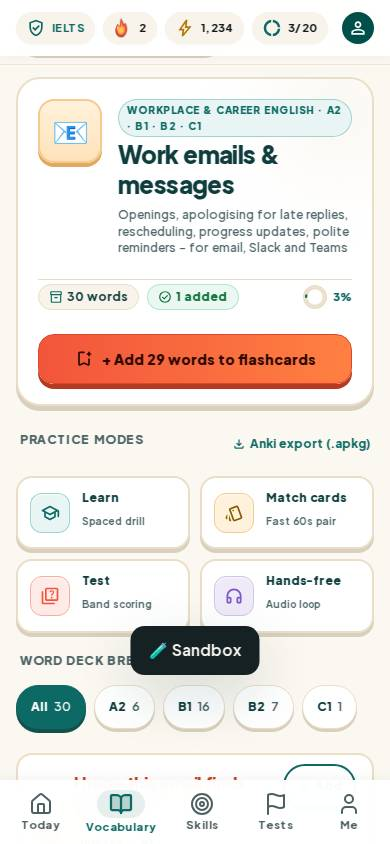 | [tap] button#tpMore – "View all 30 words expand_more" vùng chạm 167×34 < 44px [layout] div.w-full.max-w-[420px]>main.px-4.pt-3>div.rounded-3xl.p-5 – nội dung tràn ngang 32px bị cắt: "main.px-4.pt-3>div.rounded-3xl.p-5>div.absol [layout] div.w-full.max-w-[420px]>header.sticky.top-0>a.inline-flex.items-center – "arrow_back Workplace & Career English" bị span.material-symbols-o |
| 4 | [#/deck](items/app_deck.md) | **80** | 0 | 100 | 100 | 100 | – | 100 | 84 | 70 | 13 | 49 | ∅ |  | [tap] div.flex.items-center>span.text-[17px].font-extrabold>a.[color:inherit] – "resilience" vùng chạm 81×22 < 44px [tap] div.flex.flex-col>div.flex.items-center>button.w-7.h-7 – "volume_up" vùng chạm 28×28 < 44px [layout] div.flex.items-center>div.flex.items-center>button.w-11.h-11 – "arrow_back" bị div.flex.items-center>a.flex.items-center>div.h-8.px-2.5 đè l |
| 5 | [#/topic/ngsl1](items/app_topic_ngsl1.md) | **80** | 0 | 100 | 100 | 100 | – | 100 | 84 | 70 | 13 | 46 | ∅ | 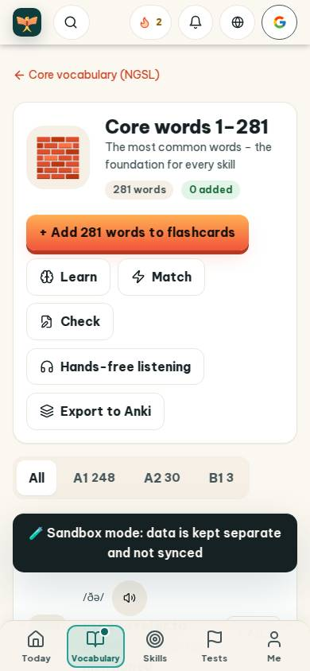 | [tap] div.flex.items-center>h3.text-base.font-extrabold>a.w – "the" vùng chạm 27×48 < 44px [tap] button#tpMore – "View all 281 words expand_more" vùng chạm 171×34 < 44px [layout] div.w-full.max-w-[420px]>main.px-4.pt-3>div.rounded-3xl.p-5 – nội dung tràn ngang 32px bị cắt: "main.px-4.pt-3>div.rounded-3xl.p-5>div.absol |
| 6 | [#/listen](items/app_listen.md) | **82** | 0 | 100 | 100 | 100 | 100 | 100 | 84 | 70 | 13 | 50 | ∅ | 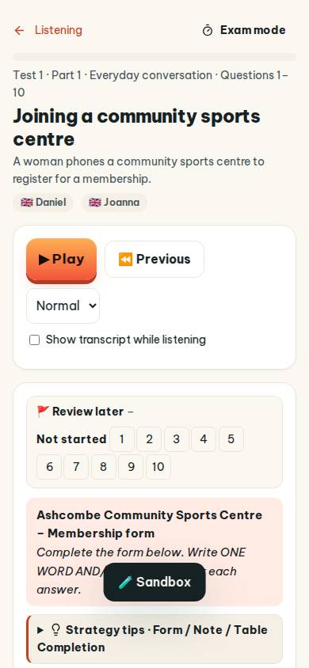 | [tap] div.lq-notes>div.lq-item.lq-gap>input.gap – "" vùng chạm 132×25 < 44px [tap] main#view>div.row.between>a.btn.sm – "Exam mode" vùng chạm 133×36 < 44px [layout] select#lRate – select "Normal" không có nhãn nhìn thấy – người học không biết ô này để làm gì |
| 7 | [#/read](items/app_read.md) | **82** | +2 | 100 | 100 | 67 | 100 | 80 | 76 | 85 | 13 | 100 | ∅ | 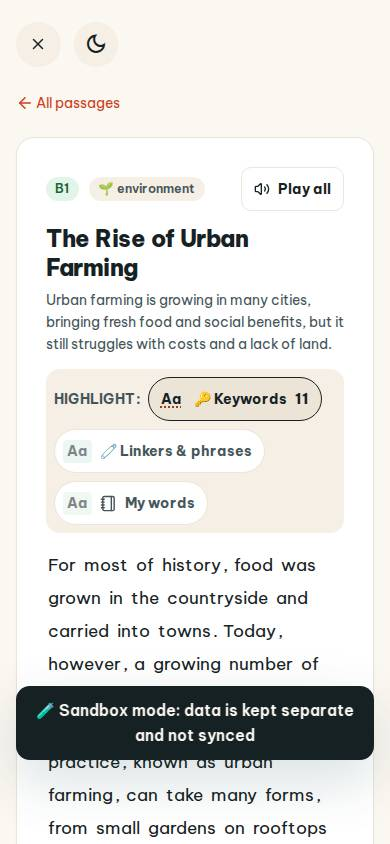 | [state] error: ReadHL is not defined [contrast] .hl-sw.link [contrast] .mine.hl-sw |
| 8 | [#/toeic-r](items/app_toeic-r.md) | **82** | 0 | 100 | 100 | 100 | 100 | 100 | 100 | 70 | 13 | 50 | ∅ |  | [layout] button#tSub – "Submit & see explanations" bị div#tq>div.qe-rv>span.qe-rv-g đè lên [layout] div.qe-rv>span.qe-rv-g>button.qe-n – "130" rớt xuống đứng một mình ở dòng cuối của div#tq>div.qe-rv>span.qe-rv-g [i18n] ar: thiếu dịch «to» |
| 9 | [#/dict/sustainable](items/app_dict_sustainable.md) | **83** | 0 | 100 | 100 | 100 | – | 90 | 76 | 100 | 13 | 60 | ∅ | 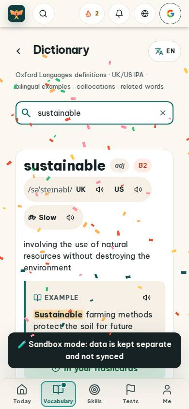 | [contrast] #toast [tap] div.card>div.wc-chips>button.chip.wc-chip – "sustainable development" vùng chạm 216×36 < 44px [tap] button#addPhr – "＋ Save your own phrase / structure" vùng chạm 293×38 < 44px |
| 10 | [#/toeic-sw](items/app_toeic-sw.md) | **84** | 0 | 100 | 100 | 100 | – | 100 | 92 | 100 | 13 | 50 | ∅ | 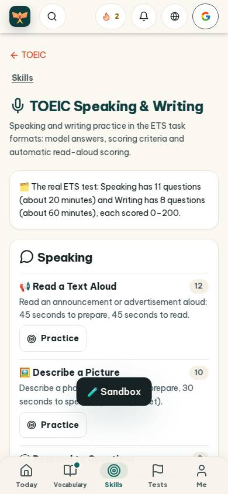 | [tap] div.card>div>a.btn.sm – "Practice" vùng chạm 115×36 < 44px [i18n] ar: thiếu dịch «Speaking» · thiếu dịch «Writing» [i18n] de: thiếu dịch «Speaking» · thiếu dịch «Writing» |
| 11 | [#/review](items/app_review.md) | **85** | 0 | 100 | 100 | 100 | 100 | 100 | 68 | 100 | 13 | 57 | ∅ | 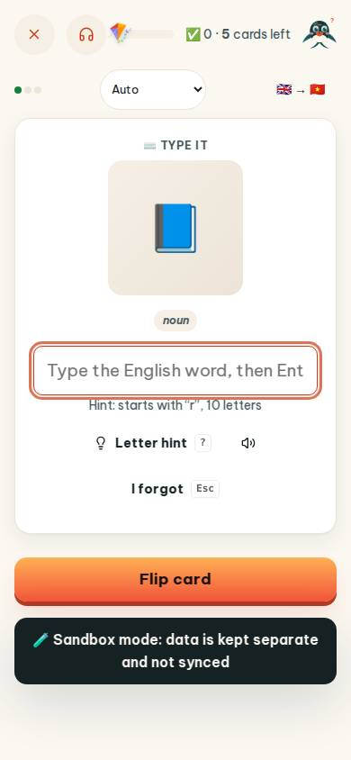 | [tap] button#toggleRev – "🇬🇧 → 🇻🇳" vùng chạm 80×36 < 44px [tap] button#rmLet – "Letter hint ?" vùng chạm 156×36 < 44px [tap] button#rmHear – "Hear the word" vùng chạm 42×36 < 44px |
| 12 | [#/task1](items/app_task1.md) | **85** | 0 | 100 | 100 | 100 | 100 | 100 | 68 | 100 | 27 | 50 | ∅ |  | [tap] main#view>div.tabs.fade-end>button – "Line graph · energy" vùng chạm 180×41 < 44px [tap] button#tBtn – "Start timer" vùng chạm 133×36 < 44px [tap] div.row.between>div.row>button.btn.sm – "Rewrite selected sentence" vùng chạm 247×36 < 44px |
| 13 | [#/usage/interested](items/app_usage_interested.md) | **85** | 0 | 100 | 100 | 100 | – | 100 | 28 | 40 | 100 | 59 | ∅ |  | [tap] main#view>p.small>a – "‹ All topics" vùng chạm 71×18 < 44px [tap] section.card.us-hero>div.us-acts>a.btn.sm – "See meaning" vùng chạm 144×36 < 44px [tap] section.card.us-hero>nav.us-jump>a – "Dependent preposition" vùng chạm 205×36 < 44px |
| 14 | [#/day/1](items/app_day_1.md) | **86** | 0 | 100 | 100 | 100 | – | 100 | 100 | 25 | 100 | 50 | ∅ | 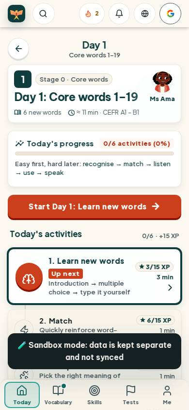 | [layout] div.w-full.min-h-0>main.flex-1.flex>section.rounded-[0.75rem].border – nội dung tràn ngang 24px bị cắt: "main.flex-1.flex>section.rounded-[0 [layout] section.rounded-[0.75rem].border>div.absolute.top-3>div.w-12.h-12 – nội dung tràn ngang 28px bị cắt: "div.absolute.top-3>div.w-12.h-12>span. [layout] a.rounded-[0.75rem].border-2>div.flex.flex-col>span.material-symbols-outlined.text-[18px] – nội dung tràn ngang 5px bị cắt |
| 15 | [#/method](items/app_method.md) | **86** | 0 | 100 | 100 | 100 | – | 100 | 84 | 85 | 47 | 50 | ∅ | 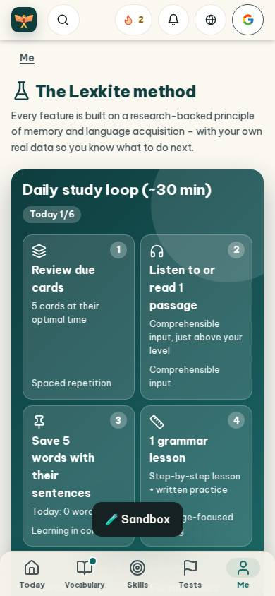 | [tap] div.card>div.row.between>a.small – "Target 90% →" vùng chạm 96×22 < 44px [tap] div.card>div.tiny.muted>a – "See the full path →" vùng chạm 125×18 < 44px [layout] main#view>div.card.hero-main – nội dung tràn ngang 60px bị cắt |
| 16 | [#/practice](items/app_practice.md) | **86** | 0 | 100 | 100 | 100 | 100 | 100 | 100 | 100 | 13 | 56 | ∅ | 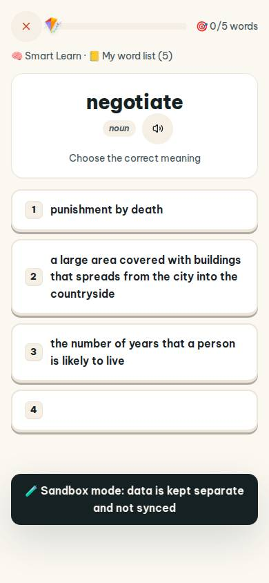 | [i18n] ar: thiếu dịch «noun» [i18n] de: thiếu dịch «noun» [i18n] es: thiếu dịch «noun» |
| 17 | [#/practice/learn](items/app_practice_learn.md) | **86** | 0 | 100 | 100 | 100 | 100 | 100 | 100 | 100 | 13 | 56 | ∅ |  | [i18n] ar: thiếu dịch «noun» [i18n] de: thiếu dịch «noun» [i18n] es: thiếu dịch «noun» |
| 18 | [Add-on › tab mới](items/ext_newtab.md) | **86** | +3 | 100 | 100 | ∅ | – | 100 | 20 | 55 | ∅ | ∅ | ∅ |  | [tap] article#ntCard>div.spks>button.spk – "🔊 UK" vùng chạm 56×24 < 44px [tap] button#ntSlow – "🐢" vùng chạm 35×24 < 44px [tap] button#ntEx – "“Please send a short biography for the s" vùng chạm 342×19 < 44px |
| 19 | [/L/credits.html](items/web_L_credits.html.md) | **86** | 0 | 100 | 100 | – | – | 100 | 76 | 85 | 13 | 100 | ∅ |  | [tap] tr>td>a – "DVI-VGA-Adapter.jpg" vùng chạm 142×20 < 44px [tap] main.doc>div.lg>a.brand – "lexkite" vùng chạm 109×36 < 44px [tap] div.tbx>div.lsw>button.lsw-b – "EN" vùng chạm 67×36 < 44px |
| 20 | [/L/schools.html](items/web_L_schools.html.md) | **86** | 0 | 100 | 100 | – | – | 100 | 84 | 85 | 13 | 100 | ∅ |  | [tap] main.doc>div.lg>a.brand – "lexkite" vùng chạm 109×36 < 44px [tap] div.tbx>div.lsw>button.lsw-b – "EN" vùng chạm 67×36 < 44px [layout] html – trang rộng 767px > 390px (cuộn ngang) |
| 21 | [#/stats](items/app_stats.md) | **87** | 0 | 100 | 100 | 100 | – | 100 | 100 | 40 | 100 | 47 | ∅ | 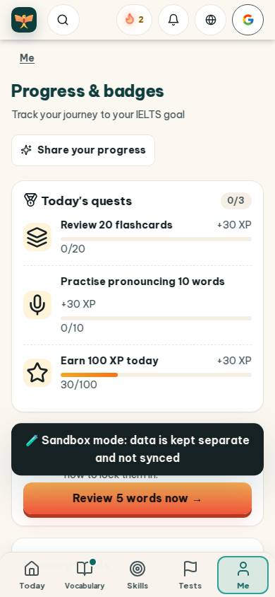 | [layout] main.flex-1.px-4>div.relative.pt-2>div.p-4.relative – nội dung tràn ngang 12px bị cắt: "div.relative.w-28>span.tslot.tslot-m>span.tslot-fig" [layout] header.sticky.top-0>div.flex.items-center>button.w-10.h-10 – "arrow_back" bị div.flex.items-center>a.flex.items-center>div.h-8.px-2.5 đè lên [layout] div.w-full.max-w-[390px]>header.sticky.top-0>button.[background:linear-gradient(180deg,_#FF7B54_0%,_#F2553B_100%)].[border:2px_solid_#B53A22 |
| 22 | [#/grammar](items/app_grammar.md) | **88** | 0 | 100 | 100 | 100 | 100 | 100 | 84 | 40 | 100 | 50 | ∅ |  | [tap] main#view>div.row.between>a.small – "Grammar" vùng chạm 87×22 < 44px [tap] main#view>div.row.between>a.btn.sm – "Full lesson" vùng chạm 127×36 < 44px [layout] main#view>div.card.hero-main – nội dung tràn ngang 60px bị cắt |
| 23 | [/L/*/](items/web_L_.md) | **88** | -1 | 60 | 100 | – | – | 100 | 84 | 100 | 100 | 92 | ∅ | 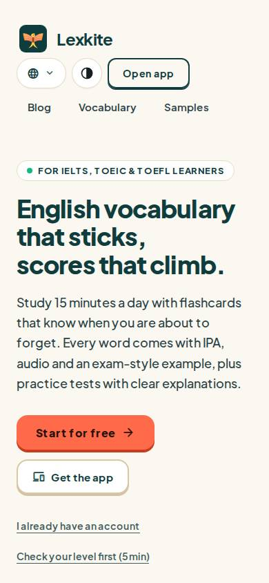 | [fn] link hỏng: /es/words/ [fn] link hỏng: /pt/words/ [fn] link hỏng: /fr/words/ |
| 24 | [/L/terms.html](items/web_L_terms.html.md) | **88** | 0 | 100 | 100 | – | – | 100 | 84 | 100 | 13 | 100 | ∅ | 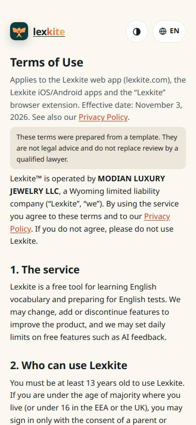 | [tap] main.doc>div.lg>a.brand – "lexkite" vùng chạm 109×36 < 44px [tap] div.tbx>div.lsw>button.lsw-b – "EN" vùng chạm 67×36 < 44px [i18n] ar: lang="en" |
| 25 | [#/speaking](items/app_speaking.md) | **89** | 0 | 100 | 100 | 100 | 100 | 100 | 76 | 55 | 100 | 50 | ∅ | 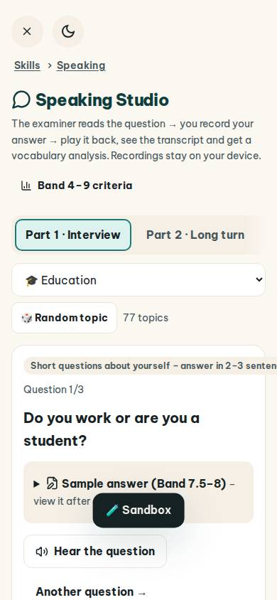 | [tap] div.row.between>div>a.btn.sm – "Band 4–9 criteria" vùng chạm 184×36 < 44px [tap] main#view>div.tabs>button – "Part 1 · Interview" vùng chạm 164×41 < 44px [tap] button#spRand – "🎲 Random topic" vùng chạm 149×36 < 44px |
| 26 | [/L/words/*](items/web_L_words_.md) | **89** | 0 | 60 | 100 | – | – | 100 | 84 | 100 | 100 | 100 | ∅ |  | [fn] link hỏng: /es/words/ [fn] link hỏng: /pt/words/ [fn] link hỏng: /fr/words/ |
| 27 | [#/dictation](items/app_dictation.md) | **90** | 0 | 100 | 100 | 100 | 100 | 100 | 92 | 100 | 13 | 100 | ∅ | 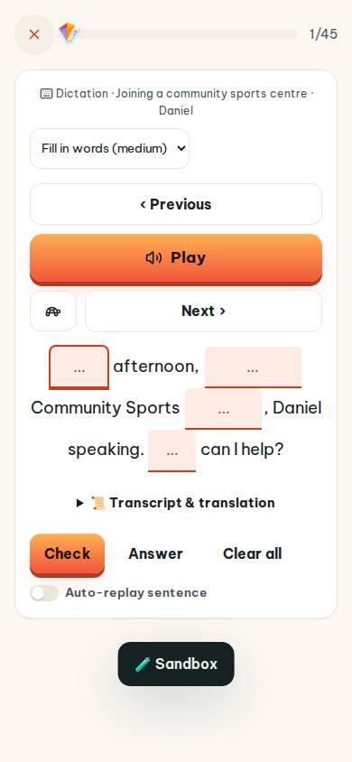 | [tap] button#dSlow – "Play slowly" vùng chạm 52×40 < 44px [i18n] ar: chữ Việt «Điền từ còn thiếu» [i18n] de: chữ Việt «Điền từ còn thiếu» |
| 28 | [#/home](items/app_home.md) | **90** | -1 | 100 | 100 | 100 | – | 100 | 100 | 35 | 100 | 75 | ∅ | 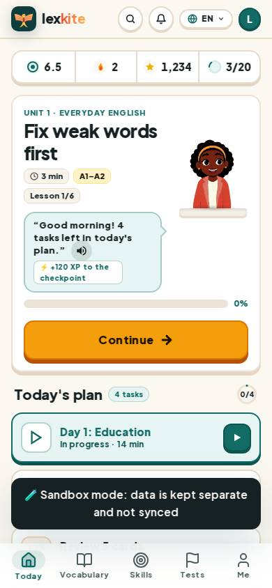 | [layout] main.w-full.min-h-screen>div.px-4.py-4>section.[border-radius:16px].p-4 – nội dung tràn ngang 12px bị cắt: "div.w-[116px].h-[156px]>span.tsl [layout] div#v2-pathlist>div.relative.w-full>div.absolute.start-[88px] – nội dung tràn ngang 24px bị cắt: "div.absolute.end-1>span.tslot.tslot-m>span [layout] span#xpPill – nội dung tràn ngang 3px bị cắt |
| 29 | [#/ideas](items/app_ideas.md) | **91** | 0 | 100 | 100 | 100 | – | 100 | 76 | 85 | 100 | 50 | ∅ | 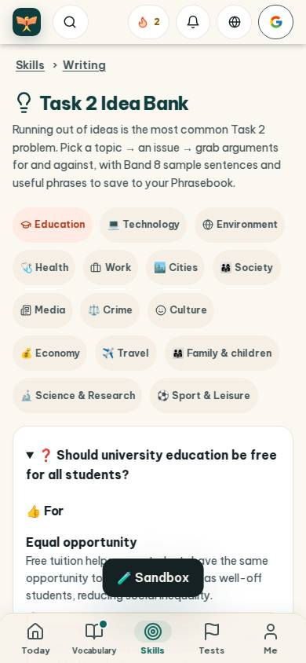 | [tap] main#view>div.row>a.chip.lv – "Education" vùng chạm 102×24 < 44px [tap] main#view>div.row>a.chip – "💻 Technology" vùng chạm 111×24 < 44px [tap] div.idea-it>div.row>button.chip.idea-ch – "+ widen access to higher education" vùng chạm 244×26 < 44px |
| 30 | [#/model/t1-travel](items/app_model_t1-travel.md) | **91** | 0 | 100 | 100 | 100 | – | 100 | 60 | 85 | 100 | 50 | ∅ | 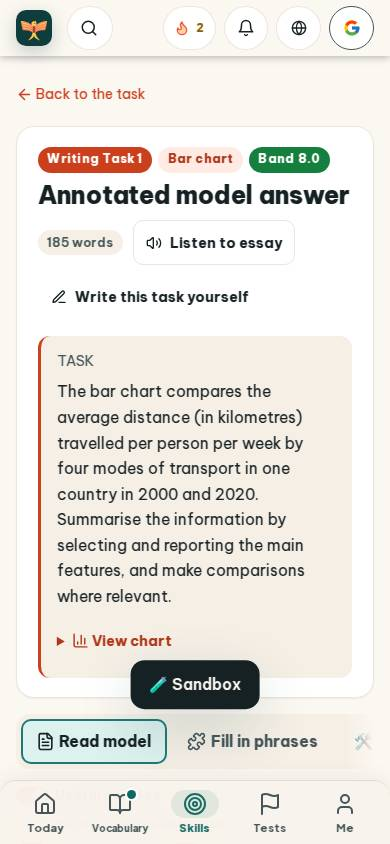 | [tap] article#annot>p>span.an-ch – "gained in popularity" vùng chạm 157×20 < 44px [tap] button#readM – "Listen to essay" vùng chạm 162×36 < 44px [tap] div.row.between>div.row>a.btn.sm – "Write this task yourself" vùng chạm 224×36 < 44px |
| 31 | [#/toeic](items/app_toeic.md) | **91** | 0 | 100 | 100 | 100 | – | 100 | 76 | 85 | 100 | 50 | ∅ | 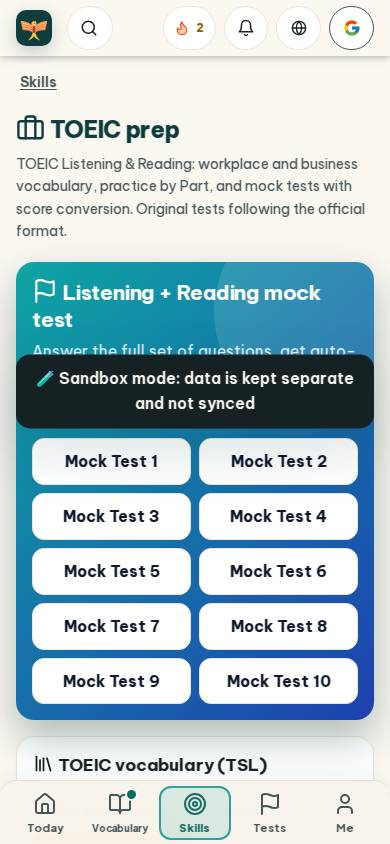 | [tap] div.card>div.row>a.btn.sm – "Smart Learn" vùng chạm 173×36 < 44px [tap] main#view>div.tabs.fade-end>a – "Test 1" vùng chạm 77×41 < 44px [tap] div.card>div.card-acts>a.btn.sm – "Practice" vùng chạm 212×36 < 44px |
| 32 | [#/verb/take](items/app_verb_take.md) | **91** | 0 | 100 | 100 | 100 | – | 100 | 20 | 100 | 100 | 60 | ∅ | 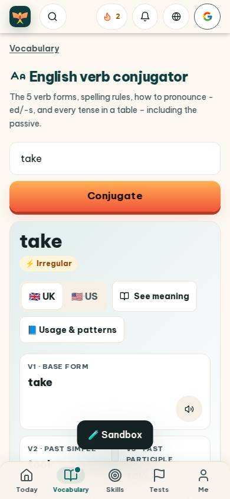 | [tap] div#vbReg>button – "🇬🇧 UK" vùng chạm 69×38 < 44px [tap] div.vb-grid2>div.vb-box>a.small – "Lesson: pronouncing -ed and -s →" vùng chạm 251×18 < 44px [tap] div#vbVoice>button – "Active" vùng chạm 77×38 < 44px |
| 33 | [#/write](items/app_write.md) | **91** | 0 | 100 | 100 | 100 | 100 | 100 | 52 | 85 | 100 | 50 | ∅ | 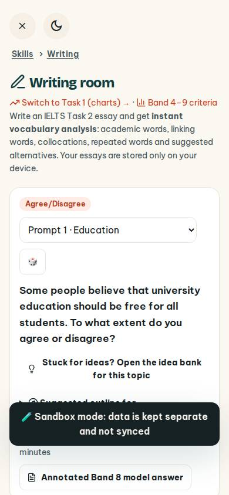 | [tap] button#rndP – "🎲" vùng chạm 43×36 < 44px [tap] div.stack>div.card>a.btn.sm – "Stuck for ideas? Open the idea bank for " vùng chạm 422×36 < 44px [tap] div.card>div.row.between>a.btn.sm – "Annotated Band 8 model answer" vùng chạm 293×36 < 44px |
| 34 | [#/fix](items/app_fix.md) | **92** | 0 | 100 | 100 | 100 | – | 100 | 68 | 85 | 100 | 57 | ∅ |  | [tap] button#fxSample – "Sample text" vùng chạm 140×36 < 44px [tap] button#fxClear – "🗑️ Delete" vùng chạm 95×36 < 44px [tap] button#fxCopy – "📋 Copy corrected text" vùng chạm 181×36 < 44px |
| 35 | [#/interpret](items/app_interpret.md) | **92** | 0 | 100 | 100 | 100 | – | 100 | 92 | 70 | 100 | 62 | ∅ | 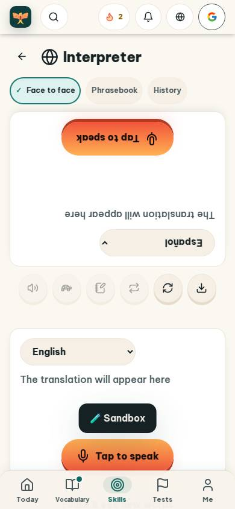 | [tap] div.ip>nav.ip-tabs>a.chip – "Face to face" vùng chạm 118×40 < 44px [layout] section.ip-half.ip-b>div.ip-hd>select.ip-lang – select "Español" không có nhãn nhìn thấy – người học không biết ô này để làm gì [layout] section.ip-half.ip-a>div.ip-hd>select.ip-lang – select "English" không có nhãn nhìn thấy – người học không biết ô này để làm gì |
| 36 | [#/mistakes](items/app_mistakes.md) | **92** | 0 | 100 | 100 | 100 | – | 100 | 100 | 70 | 100 | 58 | ∅ |  | [layout] nav#mTabs>button.shrink-0.px-3.5 – "Reading 0" lòi ra ngoài nav#mTabs 97px [layout] header.sticky.top-0>div.flex.items-center>button.w-10.h-10 – "arrow_back" bị div.h-14.px-[1rem]>div.flex.items-center>a.flex.items-center đè [perf] LCP 5472 ms · CLS 0.0001 · TBT 39 ms |
| 37 | [#/toefl](items/app_toefl.md) | **92** | 0 | 100 | 100 | 100 | – | 100 | 92 | 85 | 93 | 50 | ∅ | 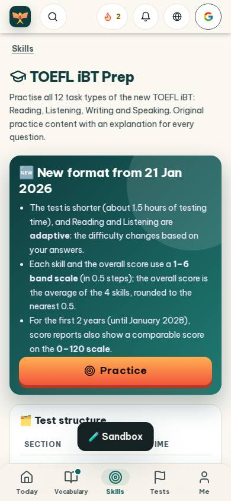 | [tap] div.card>div.row>a.btn.sm – "Practice" vùng chạm 115×36 < 44px [layout] main#view>div.grid.g2>div.card.hero-main – nội dung tràn ngang 60px bị cắt [i18n] ar: thiếu dịch «Reading» · thiếu dịch «Listening» |
| 38 | [/admin.html](items/web_admin.html.md) | **92** | 0 | 100 | 75 | – | – | 90 | 84 | 100 | ∅ | 100 | ∅ |  | [js] firebase is not defined [contrast] .adm-tag [tap] a.adm-skip[Bỏ qua tới nội dung] – "Skip to content" vùng chạm 133×39 < 44px |
| 39 | [#/confidence](items/app_confidence.md) | **93** | 0 | 100 | 100 | 100 | – | 100 | 100 | 85 | 100 | 50 | ∅ | 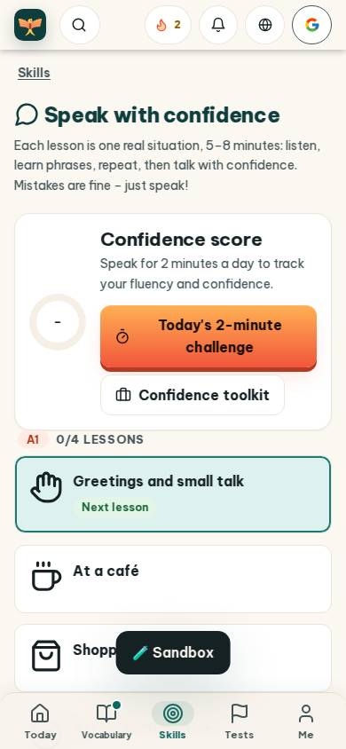 | [layout] div>div.ring>b – nhãn "–" đứng trơ một mình cả hàng (khung 64px) [perf] LCP 6288 ms · CLS 0.0033 · TBT 30 ms |
| 40 | [#/contact](items/app_contact.md) | **93** | 0 | 100 | 100 | 100 | – | 100 | 100 | 70 | 100 | 65 | ∅ |  | [layout] form#ctForm>input – "" nằm ngoài màn hình (x -9982…-9954 / 390) [layout] form#ctForm>input – input "" không có nhãn nhìn thấy – người học không biết ô này để làm gì [perf] LCP 4944 ms · CLS 0.0033 · TBT 0 ms |
| 41 | [#/criteria](items/app_criteria.md) | **93** | 0 | 100 | 100 | 100 | – | 100 | 60 | 100 | 100 | 55 | ∅ | 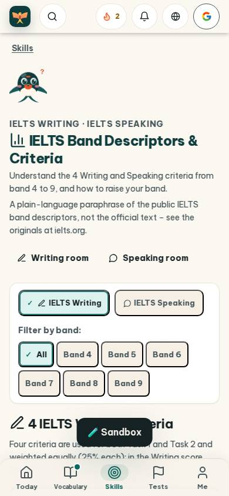 | [tap] div.row.between>div.row>a.btn.sm – "Writing room" vùng chạm 148×36 < 44px [tap] div#skillTabs>button.chip – "IELTS Writing" vùng chạm 156×37 < 44px [tap] div#bandFilters>button.chip – "All" vùng chạm 60×36 < 44px |
| 42 | [#/irregular](items/app_irregular.md) | **93** | 0 | 100 | 100 | 100 | 100 | 100 | 100 | 85 | 100 | 50 | ∅ |  | [layout] div#irvTch – nội dung tràn ngang 12px bị cắt: "div#irvTch>span.tslot.tslot-xs>span.tslot-fig", "span.tslot.tslot-xs>span.tslot-fig>img.tslot [perf] LCP 6324 ms · CLS 0 · TBT 91 ms |
| 43 | [#/library](items/app_library.md) | **93** | 0 | 100 | 100 | 100 | – | 100 | 100 | 92 | 100 | 45 | ∅ |  | [layout] button.hb-s>span>em – chữ bị cắt "…" (100>34px) [layout] a.tactile-card.group>div>p.text-[11px].font-medium – chữ bị cắt "…" (256>141px) [perf] LCP 9508 ms · CLS 0.0001 · TBT 376 ms |
| 44 | [#/pron](items/app_pron.md) | **93** | 0 | 100 | 100 | 100 | 100 | 100 | 100 | 85 | 100 | 50 | ∅ | 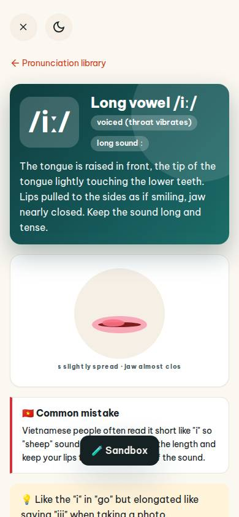 | [layout] div#pHead>div.card.hero-main – nội dung tràn ngang 60px bị cắt [perf] LCP 6272 ms · CLS 0 · TBT 68 ms |
| 45 | [#/roleplay](items/app_roleplay.md) | **93** | 0 | 100 | 100 | 100 | 100 | 100 | 92 | 85 | 100 | 50 | ∅ |  | [tap] div.card>div.rp-chips>button.btn.sm – "+ next door" vùng chạm 113×36 < 44px [layout] div.card>div.rp-chips>button.btn.sm – "+ free" rớt xuống đứng một mình ở dòng cuối của main#view>div.card>div.rp-chips [perf] LCP 6664 ms · CLS 0 · TBT 9 ms |
| 46 | [#/stories](items/app_stories.md) | **93** | 0 | 100 | 100 | 100 | – | 100 | 100 | 85 | 100 | 50 | ∅ | 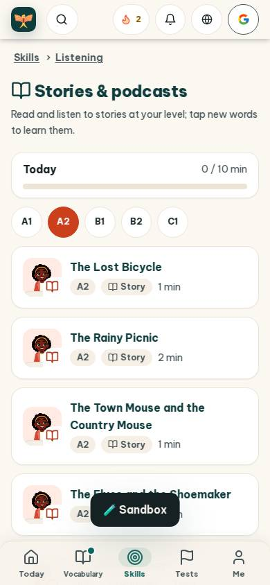 | [layout] div#stList>a.card.st-card>div.st-cover.st-lv-A2 – nội dung tràn ngang 12px bị cắt: "div.st-cover.st-lv-A2>span.tslot.tslot-xs>span.tslot-fig [perf] LCP 6680 ms · CLS 0.0033 · TBT 94 ms |
| 47 | [#/streak](items/app_streak.md) | **93** | +1 | 100 | 100 | 100 | – | 100 | 100 | 85 | 100 | 50 | ∅ | 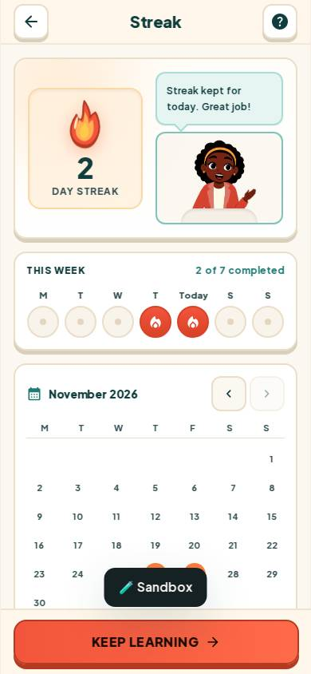 | [layout] span#xpPill – nội dung tràn ngang 84px bị cắt [perf] LCP 6148 ms · CLS 0.0678 · TBT 167 ms |
| 48 | [#/usage](items/app_usage.md) | **93** | 0 | 100 | 100 | 100 | – | 100 | 92 | 85 | 100 | 60 | ∅ | 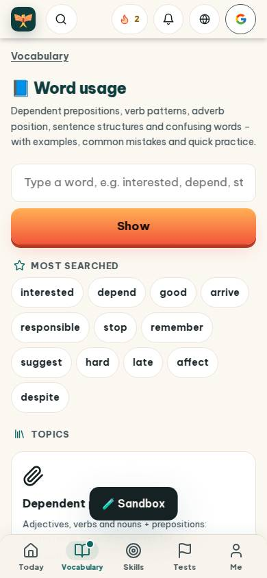 | [tap] main#view>div.us-chips>a – "interested" vùng chạm 106×36 < 44px [layout] main#view>div.us-chips>a – "despite" rớt xuống đứng một mình ở dòng cuối của main#view>div.us-chips [perf] LCP 5316 ms · CLS 0.0033 · TBT 10 ms |
| 49 | [#/call](items/app_call.md) | **94** | 0 | 100 | 100 | 100 | 100 | 100 | 92 | 100 | 100 | 50 | ∅ | 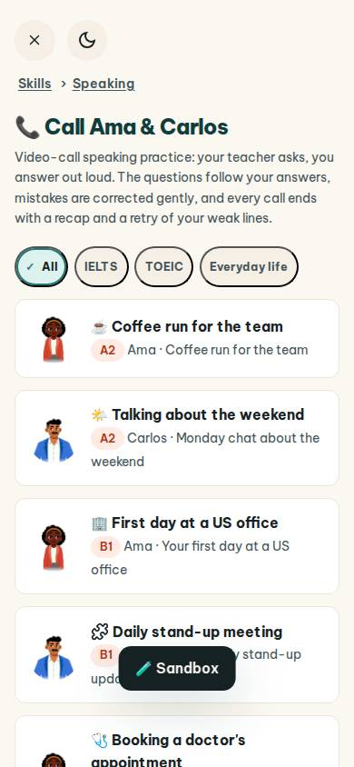 | [tap] main#view>div.call-flt>button.chip – "All" vùng chạm 59×36 < 44px [perf] LCP 6792 ms · CLS 0 · TBT 67 ms |
| 50 | [#/cambridge](items/app_cambridge.md) | **94** | 0 | 100 | 100 | 100 | – | 100 | 100 | 100 | 93 | 50 | ∅ | 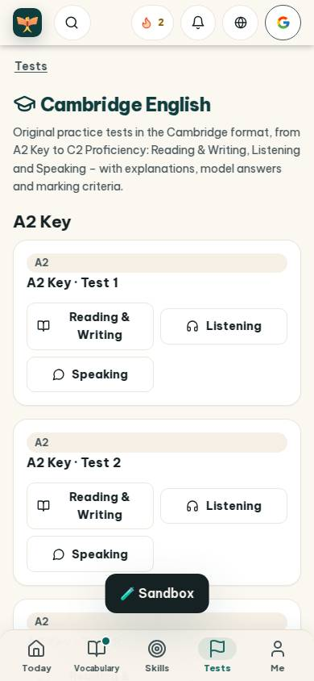 | [i18n] ar: thiếu dịch «Listening» · thiếu dịch «Speaking» [perf] LCP 10176 ms · CLS 0.0033 · TBT 85 ms |
| 51 | [#/cbt](items/app_cbt.md) | **94** | -1 | 100 | 100 | 100 | 100 | 90 | 100 | 100 | 100 | 50 | ∅ |  | [contrast] #toast [perf] LCP 7048 ms · CLS 0 · TBT 61 ms |
| 52 | [#/course/ielts-writing](items/app_course_ielts-writing.md) | **94** | 0 | 100 | 100 | 100 | – | 100 | 100 | 100 | 100 | 50 | ∅ | 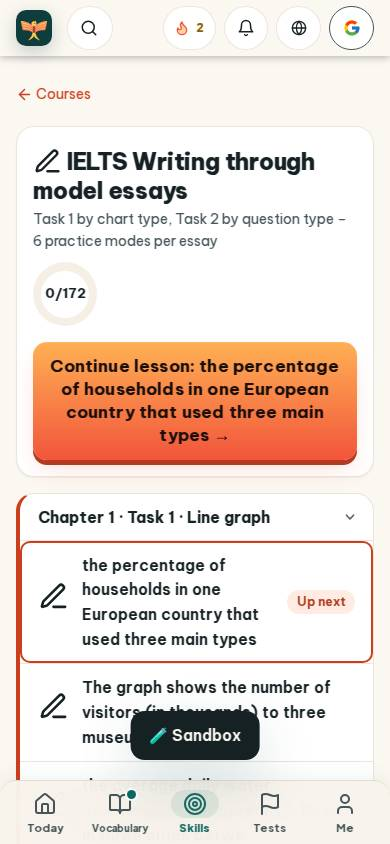 | [perf] LCP 18912 ms · CLS 0.0033 · TBT 79 ms |
| 53 | [#/courses](items/app_courses.md) | **94** | 0 | 100 | 100 | 100 | – | 100 | 100 | 100 | 100 | 50 | ∅ | 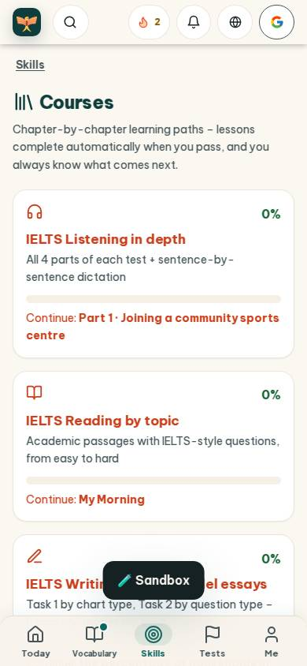 | [perf] LCP 18852 ms · CLS 0.0033 · TBT 77 ms |
| 54 | [#/goal](items/app_goal.md) | **94** | 0 | 100 | 100 | 100 | – | 100 | 100 | 96 | 100 | 50 | ∅ | 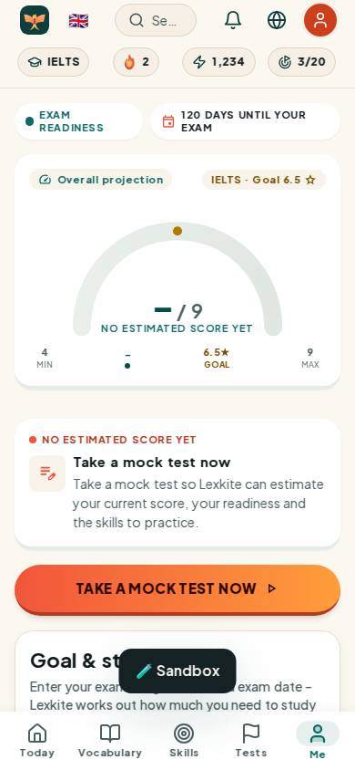 | [layout] button.hb-s>span>em – chữ bị cắt "…" (100>34px) [perf] LCP 8268 ms · CLS 0.002 · TBT 190 ms |
| 55 | [#/handsfree](items/app_handsfree.md) | **94** | 0 | 100 | 100 | 100 | 100 | 100 | 92 | 100 | 100 | 50 | ∅ | 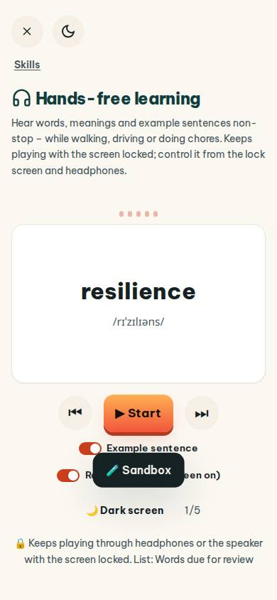 | [tap] button#hfDark – "🌙 Dark screen" vùng chạm 136×36 < 44px [perf] LCP 11128 ms · CLS 0 · TBT 96 ms |
| 56 | [#/lesson](items/app_lesson.md) | **94** | 0 | 100 | 100 | 100 | 100 | 100 | 100 | 100 | 100 | 42 | ∅ | 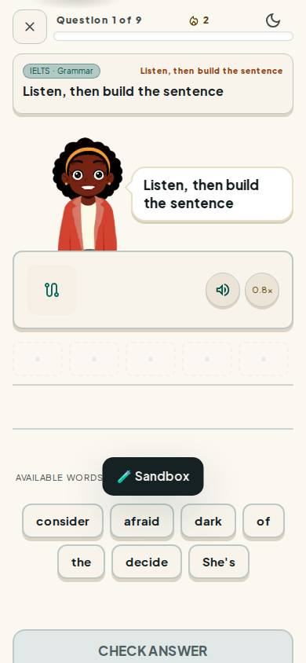 | [perf] LCP 7916 ms · CLS 0 · TBT 452 ms |
| 57 | [#/listening](items/app_listening.md) | **94** | 0 | 100 | 100 | 100 | – | 100 | 84 | 100 | 100 | 50 | ∅ |  | [tap] main#view>div.tabs.fade-end>a – "Test 1" vùng chạm 77×41 < 44px [tap] div.card>div.card-acts>a.btn.sm – "Practice" vùng chạm 195×36 < 44px [perf] LCP 9072 ms · CLS 0.0033 · TBT 83 ms |
| 58 | [#/mediate](items/app_mediate.md) | **94** | 0 | 100 | 100 | 100 | – | 100 | 100 | 100 | 100 | 50 | ∅ |  | [perf] LCP 6500 ms · CLS 0.0033 · TBT 123 ms |
| 59 | [#/models](items/app_models.md) | **94** | 0 | 100 | 100 | 100 | – | 100 | 100 | 100 | 100 | 50 | ∅ |  | [perf] LCP 7328 ms · CLS 0.0033 · TBT 24 ms |
| 60 | [#/path](items/app_path.md) | **94** | 0 | 100 | 100 | 100 | – | 100 | 92 | 100 | 100 | 50 | ∅ | 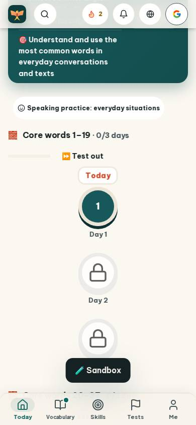 | [tap] div.dp-body>div.dp-unit>a.btn.sm – "⏩ Test out" vùng chạm 109×40 < 44px [perf] LCP 7012 ms · CLS 0.0033 · TBT 56 ms |
| 61 | [#/phrases](items/app_phrases.md) | **94** | 0 | 100 | 100 | 100 | – | 100 | 100 | 100 | 100 | 50 | ∅ |  | [perf] LCP 7316 ms · CLS 0.0033 · TBT 18 ms |
| 62 | [#/reading](items/app_reading.md) | **94** | 0 | 100 | 100 | 100 | – | 100 | 92 | 100 | 100 | 50 | ∅ | 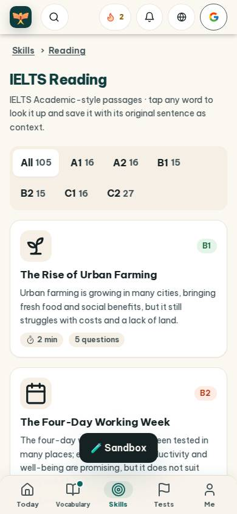 | [tap] main#view>div.tabs>a – "All 105" vùng chạm 77×39 < 44px [perf] LCP 6248 ms · CLS 0.0033 · TBT 103 ms |
| 63 | [#/roleplay/manager](items/app_roleplay_manager.md) | **94** | 0 | 100 | 100 | 100 | 100 | 100 | 92 | 100 | 100 | 50 | ∅ | 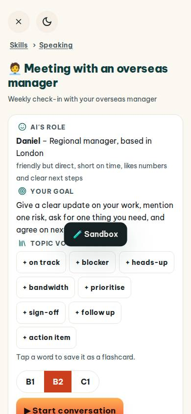 | [tap] div.card>div.rp-chips>button.btn.sm – "+ on track" vùng chạm 102×36 < 44px [perf] LCP 6680 ms · CLS 0 · TBT 11 ms |
| 64 | [#/rtype](items/app_rtype.md) | **94** | 0 | 100 | 100 | 100 | 100 | 100 | 92 | 100 | 100 | 50 | ∅ | 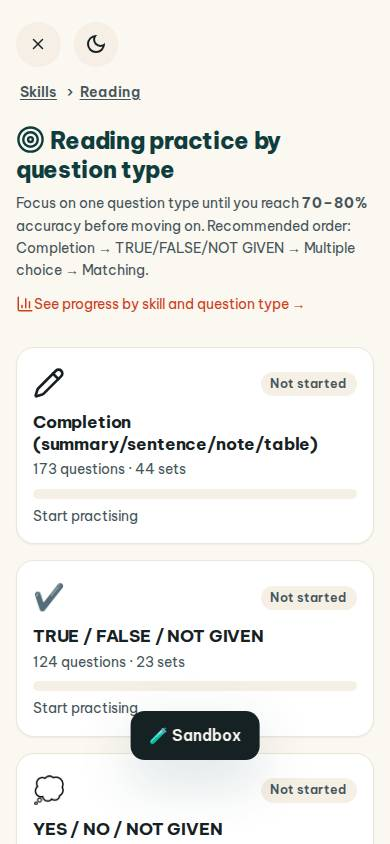 | [tap] div.page-head>div>a.small – "See progress by skill and question type " vùng chạm 293×18 < 44px [perf] LCP 8572 ms · CLS 0 · TBT 16 ms |
| 65 | [#/say](items/app_say.md) | **94** | 0 | 100 | 100 | 100 | – | 100 | 100 | 100 | 100 | 50 | ∅ | 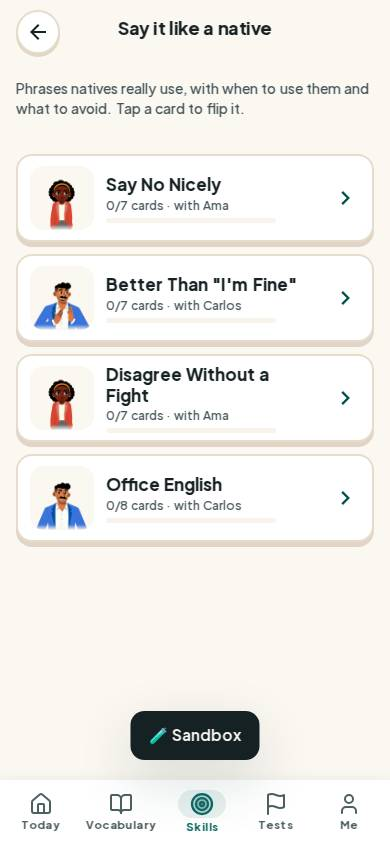 | [perf] LCP 8404 ms · CLS 0.0007 · TBT 63 ms |
| 66 | [#/skill](items/app_skill.md) | **94** | 0 | 100 | 100 | 100 | – | 100 | 100 | 96 | 100 | 50 | ∅ | 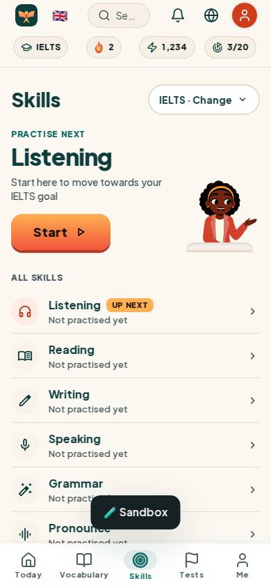 | [layout] button.hb-s>span>em – chữ bị cắt "…" (100>34px) [perf] LCP 6172 ms · CLS 0.0045 · TBT 103 ms |
| 67 | [#/skills](items/app_skills.md) | **94** | 0 | 100 | 100 | 100 | – | 100 | 100 | 96 | 100 | 50 | ∅ |  | [layout] button.hb-s>span>em – chữ bị cắt "…" (100>34px) [perf] LCP 8752 ms · CLS 0.003 · TBT 101 ms |
| 68 | [#/speak](items/app_speak.md) | **94** | 0 | 100 | 100 | 100 | – | 100 | 100 | 96 | 100 | 50 | ∅ |  | [layout] button.hb-s>span>em – chữ bị cắt "…" (100>34px) [perf] LCP 9324 ms · CLS 0.0031 · TBT 126 ms |
| 69 | [#/toefl-p](items/app_toefl-p.md) | **94** | 0 | 100 | 100 | 100 | 100 | 100 | 84 | 100 | 100 | 50 | ∅ | 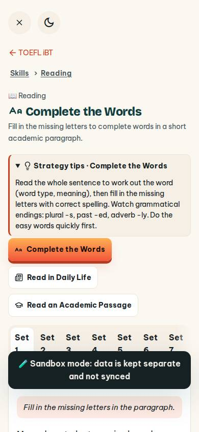 | [tap] div.cw-text>label.cw-slot>input.gap.cw – "Blank 1" vùng chạm 30×22 < 44px [tap] main#view>div.tabs>a – "Set 1" vùng chạm 69×39 < 44px [perf] LCP 11816 ms · CLS 0 · TBT 74 ms |
| 70 | [#/tracks](items/app_tracks.md) | **94** | 0 | 100 | 100 | 100 | – | 100 | 100 | 100 | 93 | 50 | ∅ |  | [i18n] ar: thiếu dịch «Reading» · thiếu dịch «Listening» [perf] LCP 7304 ms · CLS 0.0033 · TBT 9 ms |
| 71 | [#/train](items/app_train.md) | **94** | +1 | 100 | 100 | 100 | – | 100 | 100 | 96 | 100 | 46 | ∅ |  | [layout] button.hb-s>span>em – chữ bị cắt "…" (100>34px) [perf] LCP 8492 ms · CLS 0.003 · TBT 330 ms |
| 72 | [#/vocab](items/app_vocab.md) | **94** | 0 | 100 | 100 | 100 | – | 100 | 100 | 96 | 100 | 50 | ∅ |  | [layout] button.hb-s>span>em – chữ bị cắt "…" (100>34px) [perf] LCP 7500 ms · CLS 0.0014 · TBT 109 ms |
| 73 | [#/watch](items/app_watch.md) | **94** | 0 | 100 | 100 | 100 | – | 100 | 92 | 85 | 100 | 61 | ∅ |  | [tap] a#wtYT – "Open on YouTube" vùng chạm 157×36 < 44px [layout] form#wtSave>button.btn.primary – "Look up" rớt xuống đứng một mình ở dòng cuối của form#wtSave [perf] LCP 5232 ms · CLS 0.0033 · TBT 0 ms |
| 74 | [#/call/coffee](items/app_call_coffee.md) | **95** | 0 | 100 | 100 | 100 | 100 | 100 | 100 | 100 | 100 | 50 | ∅ |  | [perf] LCP 6740 ms · CLS 0 · TBT 100 ms |
| 75 | [#/class](items/app_class.md) | **95** | 0 | 100 | 100 | 100 | – | 100 | 92 | 100 | 100 | 60 | ∅ | 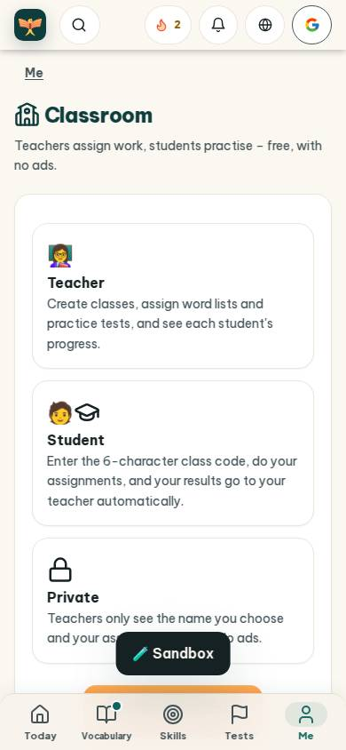 | [tap] div.card>p.tiny.muted>a – "Guide for schools & IT admins →" vùng chạm 215×18 < 44px [perf] LCP 5324 ms · CLS 0.0033 · TBT 21 ms |
| 76 | [#/diary](items/app_diary.md) | **95** | 0 | 100 | 100 | 100 | – | 100 | 100 | 100 | 93 | 61 | ∅ | 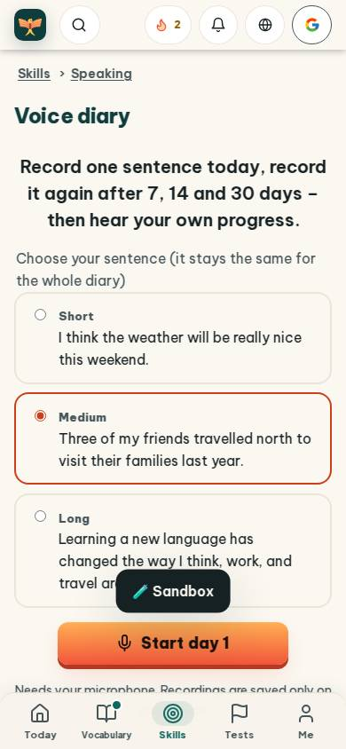 | [i18n] es: thiếu dịch «Media» [perf] LCP 5208 ms · CLS 0.0033 · TBT 4 ms |
| 77 | [#/handoff](items/app_handoff.md) | **95** | -1 | 100 | 100 | 100 | – | 100 | 100 | 100 | 100 | 59 | ∅ | 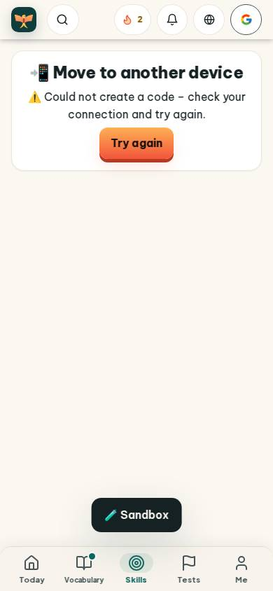 | [perf] LCP 5380 ms · CLS 0.0033 · TBT 20 ms |
| 78 | [#/mock](items/app_mock.md) | **95** | 0 | 100 | 100 | 100 | 100 | 100 | 100 | 100 | 100 | 50 | ∅ | 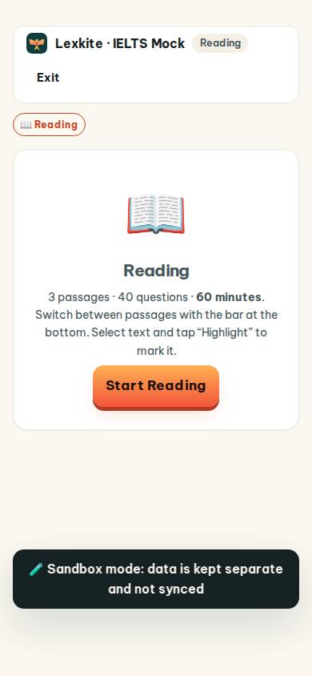 | [perf] LCP 15608 ms · CLS 0 · TBT 145 ms |
| 79 | [#/qstats](items/app_qstats.md) | **95** | -1 | 100 | 100 | 100 | – | 100 | 100 | 100 | 100 | 58 | ∅ | 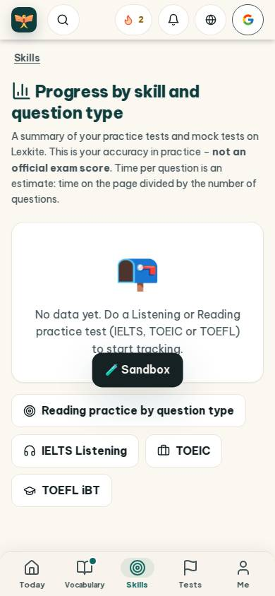 | [perf] LCP 5452 ms · CLS 0.0033 · TBT 16 ms |
| 80 | [#/quick](items/app_quick.md) | **95** | 0 | 100 | 100 | 100 | 100 | 100 | 100 | 100 | 100 | 50 | ∅ | 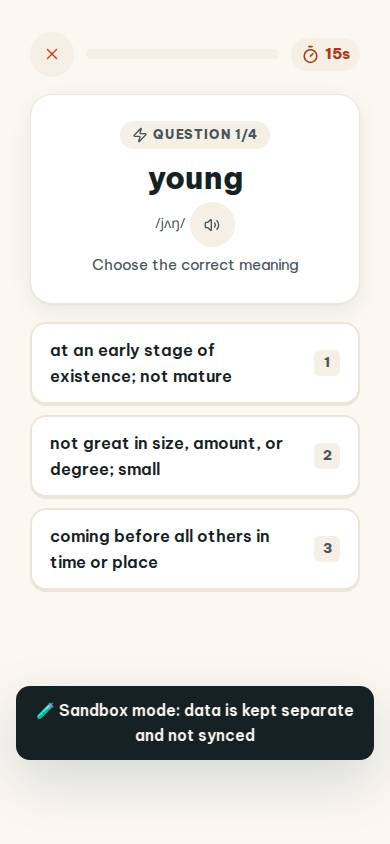 | [perf] LCP 7668 ms · CLS 0 · TBT 14 ms |
| 81 | [#/reflex](items/app_reflex.md) | **95** | 0 | 100 | 100 | 100 | 100 | 100 | 100 | 100 | 100 | 50 | ∅ |  | [perf] LCP 9504 ms · CLS 0 · TBT 109 ms |
| 82 | [#/settings](items/app_settings.md) | **95** | 0 | 100 | 100 | 100 | – | 100 | 100 | 100 | 100 | 59 | ∅ |  | [perf] LCP 5356 ms · CLS 0.0033 · TBT 14 ms |
| 83 | [#/settings/account](items/app_settings_account.md) | **95** | 0 | 100 | 100 | 100 | – | 100 | 100 | 100 | 100 | 56 | ∅ |  | [perf] LCP 5572 ms · CLS 0.0033 · TBT 45 ms |
| 84 | [#/settings/ai](items/app_settings_ai.md) | **95** | +1 | 100 | 100 | 100 | – | 100 | 100 | 100 | 100 | 52 | ∅ |  | [perf] LCP 5836 ms · CLS 0.0033 · TBT 59 ms |
| 85 | [#/settings/data](items/app_settings_data.md) | **95** | 0 | 100 | 100 | 100 | – | 100 | 100 | 100 | 100 | 59 | ∅ |  | [perf] LCP 5340 ms · CLS 0.0033 · TBT 30 ms |
| 86 | [#/settings/ext](items/app_settings_ext.md) | **95** | 0 | 100 | 100 | 100 | – | 100 | 100 | 100 | 100 | 59 | ∅ | 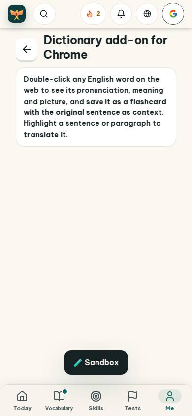 | [perf] LCP 5360 ms · CLS 0.0033 · TBT 51 ms |
| 87 | [#/settings/help](items/app_settings_help.md) | **95** | 0 | 100 | 100 | 100 | – | 100 | 100 | 100 | 100 | 59 | ∅ |  | [perf] LCP 5376 ms · CLS 0.0033 · TBT 5 ms |
| 88 | [#/settings/look](items/app_settings_look.md) | **95** | 0 | 100 | 100 | 100 | – | 100 | 100 | 100 | 100 | 59 | ∅ |  | [perf] LCP 5400 ms · CLS 0.0033 · TBT 40 ms |
| 89 | [#/settings/remind](items/app_settings_remind.md) | **95** | 0 | 100 | 100 | 100 | – | 100 | 100 | 100 | 100 | 58 | ∅ |  | [perf] LCP 5452 ms · CLS 0.0033 · TBT 39 ms |
| 90 | [#/settings/sound](items/app_settings_sound.md) | **95** | 0 | 100 | 100 | 100 | – | 100 | 100 | 100 | 100 | 59 | ∅ |  | [perf] LCP 5388 ms · CLS 0.0168 · TBT 66 ms |
| 91 | [#/tests](items/app_tests.md) | **95** | -1 | 100 | 100 | 100 | – | 100 | 92 | 96 | 100 | 67 | ∅ |  | [tap] main#view>div.page-head>button.btn.sm – "IELTS · Change" vùng chạm 159×36 < 44px [layout] button.hb-s>span>em – chữ bị cắt "…" (102>34px) [perf] LCP 4796 ms · CLS 0.0014 · TBT 15 ms |
| 92 | [#/toeic-test](items/app_toeic-test.md) | **95** | -3 | 100 | 100 | 100 | 100 | 100 | 92 | 85 | 100 | 73 | ∅ |  | [tap] button#tTest – "Test sound" vùng chạm 133×36 < 44px [layout] button#tTest – "Test sound" rớt xuống đứng một mình ở dòng cuối của div.study-wrap>div.card.tx-start>div.tx-check [perf] LCP 4368 ms · CLS 0 · TBT 166 ms |
| 93 | [#/welcome](items/app_welcome.md) | **95** | 0 | 100 | 100 | 100 | – | 100 | 100 | 77 | 100 | 75 | ∅ |  | [layout] span#xpPill – nội dung tràn ngang 23px bị cắt [layout] button.hb-s>span>em – chữ bị cắt "…" (100>34px) [layout] div.lv-row>div.grow.lv-tx>div.tiny.muted – chữ bị cắt "…" (115>111px) |
| 94 | [Add-on › popup](items/ext_popup.md) | **95** | 0 | 100 | 100 | ∅ | – | 90 | 84 | 85 | ∅ | ∅ | ∅ |  | [contrast] #streak [tap] a#syncNow – "☁️ Sync with Google" vùng chạm 137×27 < 44px [tap] details.pp-set>summary – "⚙️ Lookup settings" vùng chạm 306×21 < 44px |
| 95 | [/samples/*](items/web_samples_.md) | **95** | 0 | 100 | 100 | – | – | 100 | 36 | 100 | ∅ | 100 | ∅ |  | [tap] section#d2>p>mark.ph – "It is undeniable that" vùng chạm 147×19 < 44px [tap] section#d3>p>mark.ph – "ordinary workers" vùng chạm 126×19 < 44px [tap] section#d4>p>mark.ph – "A fairer approach" vùng chạm 129×19 < 44px |
| 96 | [#/league](items/app_league.md) | **96** | 0 | 100 | 100 | 100 | – | 100 | 100 | 100 | 100 | 62 | ∅ |  | [perf] LCP 5184 ms · CLS 0.0033 · TBT 0 ms |
| 97 | [#/me](items/app_me.md) | **96** | 0 | 100 | 100 | 100 | – | 100 | 100 | 96 | 100 | 67 | ∅ |  | [layout] button.hb-s>span>em – chữ bị cắt "…" (100>34px) [perf] LCP 4792 ms · CLS 0 · TBT 157 ms |
| 98 | [#/outcome](items/app_outcome.md) | **96** | 0 | 100 | 100 | 100 | – | 100 | 100 | 100 | 100 | 60 | ∅ |  | [perf] LCP 5320 ms · CLS 0.0033 · TBT 0 ms |
| 99 | [#/report](items/app_report.md) | **96** | +1 | 100 | 100 | 100 | – | 100 | 100 | 100 | 100 | 60 | ∅ |  | [perf] LCP 5320 ms · CLS 0.0033 · TBT 0 ms |
| 100 | [#/resources](items/app_resources.md) | **96** | 0 | 100 | 100 | 100 | – | 100 | 100 | 100 | 100 | 62 | ∅ |  | [perf] LCP 5144 ms · CLS 0.0033 · TBT 20 ms |
| 101 | [#/score](items/app_score.md) | **96** | 0 | 100 | 100 | 100 | – | 100 | 100 | 100 | 100 | 61 | ∅ |  | [perf] LCP 5216 ms · CLS 0.0033 · TBT 1 ms |
| 102 | [#/settings/study](items/app_settings_study.md) | **96** | +2 | 100 | 100 | 100 | – | 100 | 100 | 100 | 100 | 60 | ∅ |  | [perf] LCP 5328 ms · CLS 0.0033 · TBT 13 ms |
| 103 | [#/style](items/app_style.md) | **96** | 0 | 100 | 100 | 100 | – | 100 | 100 | 100 | 100 | 64 | ∅ |  | [perf] LCP 5040 ms · CLS 0.0033 · TBT 0 ms |
| 104 | [#/tlprep](items/app_tlprep.md) | **96** | 0 | 100 | 100 | 100 | – | 100 | 100 | 100 | 100 | 63 | ∅ |  | [perf] LCP 5072 ms · CLS 0.0033 · TBT 0 ms |
| 105 | [Add-on › app #/dict/sustainable](items/ext_app_dict_sustainable.md) | **96** | 0 | 100 | 100 | ∅ | ∅ | 100 | 52 | 100 | ∅ | ∅ | ∅ |  | [tap] div.main>header.topbar>a.brand – "" vùng chạm 36×36 < 44px [tap] button#avatarBtn – "Sign in with Google" vùng chạm 36×44 < 44px [tap] div.card>div.wc-chips>button.chip.wc-chip – "sustainable development" vùng chạm 206×36 < 44px |
| 106 | [Add-on › app #/home](items/ext_app_home.md) | **96** | 0 | 100 | 100 | ∅ | ∅ | 100 | 76 | 85 | ∅ | ∅ | ∅ |  | [tap] div.main>header.topbar>a.brand – "" vùng chạm 36×36 < 44px [tap] button#avatarBtn – "Sign in with Google" vùng chạm 36×44 < 44px [tap] div.ux1-pick>p.center>a.small – "Level test (5 min)" vùng chạm 139×18 < 44px |
| 107 | [Add-on › app #/review](items/ext_app_review.md) | **96** | 0 | 100 | 100 | ∅ | ∅ | 100 | 84 | 85 | ∅ | ∅ | ∅ |  | [tap] button#toggleRev – "🇬🇧 → 🇻🇳" vùng chạm 81×36 < 44px [tap] div.card.face>div.row.center>button.btn.sm – "🇺🇸 US" vùng chạm 66×36 < 44px [layout] div.study-wrap>p.muted.tiny>span.kbd – nhãn "Z" đứng trơ một mình cả hàng (khung 358px) |
| 108 | [/credits.html](items/web_credits.html.md) | **96** | 0 | 100 | 100 | – | – | 100 | 76 | 85 | ∅ | 100 | ∅ |  | [tap] tr>td>a – "DVI-VGA-Adapter.jpg" vùng chạm 142×20 < 44px [tap] main.doc>div.lg>a.brand – "lexkite" vùng chạm 109×36 < 44px [tap] div.tbx>div.lsw>button.lsw-b – "EN" vùng chạm 67×36 < 44px |
| 109 | [/L/blog/*/](items/web_L_blog_.md) | **96** | 0 | 100 | 100 | – | – | 100 | 44 | 96 | 100 | 100 | ∅ |  | [tap] ol>li>a – "How to Structure Spontaneous Part 2 Mono" vùng chạm 248×41 < 44px [tap] ul>li>a – "English level test" vùng chạm 139×29 < 44px [tap] article.post>div.tags>a – "#ielts-speaking" vùng chạm 119×32 < 44px |
| 110 | [/viet-thu/*](items/web_viet-thu_.md) | **96** | 0 | 100 | 100 | – | – | 100 | 44 | 100 | ∅ | 100 | ∅ |  | [tap] aside#pwa>div.cta-actions>button.btn-hide – "Ẩn" vùng chạm 28×30 < 44px [tap] div.side-box.legend>div.tools>button – "Tô màu" vùng chạm 87×32 < 44px [tap] section#d2>p>mark.ph – "express my dissatisfaction with" vùng chạm 247×20 < 44px |
| 111 | [#/paraphrase](items/app_paraphrase.md) | **97** | 0 | 100 | 100 | 100 | 100 | 100 | 100 | 100 | 100 | 75 | ∅ |  | [perf] LCP 4284 ms · CLS 0 · TBT 9 ms |
| 112 | [/L/ielts-writing/task-1/*](items/web_L_ielts-writing_task-1_.md) | **97** | 0 | 100 | 100 | – | – | 100 | 84 | 85 | 100 | 100 | ∅ |  | [tap] div.side-box.legend>div.tools>button – "Highlights" vùng chạm 105×32 < 44px [tap] aside#ext>div.cta-actions>button.btn-hide – "Hide" vùng chạm 41×26 < 44px [layout] article.page.smp>section.prompt>div.tbl – nội dung tràn ngang 118px bị cắt: "2010", "2015", "2020" |
| 113 | [/L/privacy.html](items/web_L_privacy.html.md) | **97** | 0 | 100 | 100 | – | – | 100 | 84 | 85 | 100 | 100 | ∅ |  | [tap] main.doc>div.lg>a.brand – "lexkite" vùng chạm 109×36 < 44px [tap] div.tbx>div.lsw>button.lsw-b – "EN" vùng chạm 67×36 < 44px [layout] main.doc>table – nội dung tràn ngang 20px bị cắt: "Where it is stored", "On your device (browser storage, app sto", "Firebase Authentication |
| 114 | [/L/samples/*](items/web_L_samples_.md) | **97** | 0 | 100 | 100 | – | – | 100 | 76 | 85 | 100 | 100 | ∅ |  | [tap] aside#pwa>div.cta-actions>button.btn-hide – "Hide" vùng chạm 39×30 < 44px [tap] div.side-box.legend>div.tools>button – "Highlights" vùng chạm 105×32 < 44px [tap] aside#ext>div.cta-actions>button.btn-hide – "Hide" vùng chạm 41×26 < 44px |
| 115 | [/privacy.html](items/web_privacy.html.md) | **97** | 0 | 100 | 100 | – | – | 100 | 84 | 85 | ∅ | 100 | ∅ |  | [tap] main.doc>div.lg>a.brand – "lexkite" vùng chạm 109×36 < 44px [tap] div.tbx>div.lsw>button.lsw-b – "EN" vùng chạm 67×36 < 44px [layout] main.doc>table – nội dung tràn ngang 20px bị cắt: "Where it is stored", "On your device (browser storage, app sto", "Firebase Authentication |
| 116 | [/schools.html](items/web_schools.html.md) | **97** | 0 | 100 | 100 | – | – | 100 | 84 | 85 | ∅ | 100 | ∅ |  | [tap] main.doc>div.lg>a.brand – "lexkite" vùng chạm 109×36 < 44px [tap] div.tbx>div.lsw>button.lsw-b – "EN" vùng chạm 67×36 < 44px [layout] html – trang rộng 767px > 390px (cuộn ngang) |
| 117 | [/L/](items/web_L_.md) | **98** | 0 | 100 | 100 | – | – | 100 | 100 | 85 | 100 | 100 | ∅ |  | [layout] main#main>section.ra.dg – nội dung tràn ngang 23px bị cắt: "main#main>section.ra.dg>div.ed.cj" |
| 118 | [/L/blog/categoria/*/](items/web_L_blog_categoria_.md) | **98** | 0 | 90 | 100 | – | – | 100 | 100 | 100 | 100 | 100 | ∅ |  | [fn] link hỏng: /pt/words/ |
| 119 | [/L/blog/categorie/*/](items/web_L_blog_categorie_.md) | **98** | 0 | 90 | 100 | – | – | 100 | 100 | 100 | 100 | 100 | ∅ |  | [fn] link hỏng: /fr/words/ |
| 120 | [/L/blog/category/*/](items/web_L_blog_category_.md) | **98** | 0 | 90 | 100 | – | – | 100 | 100 | 100 | 100 | 100 | ∅ |  | [fn] link hỏng: /ar/words/ |
| 121 | [/L/blog/category/ielts/page/*/](items/web_L_blog_category_ielts_page_.md) | **98** | 0 | 90 | 100 | – | – | 100 | 100 | 100 | 100 | 100 | ∅ |  | [fn] link hỏng: /zh/words/ |
| 122 | [/L/blog/etiket/*/](items/web_L_blog_etiket_.md) | **98** | 0 | 90 | 100 | – | – | 100 | 100 | 100 | 100 | 100 | ∅ |  | [fn] link hỏng: /tr/words/ |
| 123 | [/L/blog/etiqueta/*/](items/web_L_blog_etiqueta_.md) | **98** | 0 | 90 | 100 | – | – | 100 | 100 | 100 | 100 | 100 | ∅ |  | [fn] link hỏng: /es/words/ |
| 124 | [/L/blog/etiquette/*/](items/web_L_blog_etiquette_.md) | **98** | 0 | 90 | 100 | – | – | 100 | 100 | 100 | 100 | 100 | ∅ |  | [fn] link hỏng: /fr/words/ |
| 125 | [/L/blog/halaman/*/](items/web_L_blog_halaman_.md) | **98** | 0 | 90 | 100 | – | – | 100 | 100 | 100 | 100 | 100 | ∅ |  | [fn] link hỏng: /id/words/ |
| 126 | [/L/blog/kategori/*/](items/web_L_blog_kategori_.md) | **98** | 0 | 90 | 100 | – | – | 100 | 100 | 100 | 100 | 100 | ∅ |  | [fn] link hỏng: /tr/words/ |
| 127 | [/L/blog/kategorie/*/](items/web_L_blog_kategorie_.md) | **98** | 0 | 90 | 100 | – | – | 100 | 100 | 100 | 100 | 100 | ∅ |  | [fn] link hỏng: /de/words/ |
| 128 | [/L/blog/pagina/*/](items/web_L_blog_pagina_.md) | **98** | 0 | 90 | 100 | – | – | 100 | 100 | 100 | 100 | 100 | ∅ |  | [fn] link hỏng: /es/words/ |
| 129 | [/L/blog/sayfa/*/](items/web_L_blog_sayfa_.md) | **98** | 0 | 90 | 100 | – | – | 100 | 100 | 100 | 100 | 100 | ∅ |  | [fn] link hỏng: /tr/words/ |
| 130 | [/L/blog/schlagwort/*/](items/web_L_blog_schlagwort_.md) | **98** | 0 | 90 | 100 | – | – | 100 | 100 | 100 | 100 | 100 | ∅ |  | [fn] link hỏng: /de/words/ |
| 131 | [/L/blog/seite/*/](items/web_L_blog_seite_.md) | **98** | 0 | 90 | 100 | – | – | 100 | 100 | 100 | 100 | 100 | ∅ |  | [fn] link hỏng: /de/words/ |
| 132 | [/L/blog/tag/ielts/halaman/*/](items/web_L_blog_tag_ielts_halaman_.md) | **98** | 0 | 90 | 100 | – | – | 100 | 100 | 100 | 100 | 100 | ∅ |  | [fn] link hỏng: /id/words/ |
| 133 | [/L/blog/tag/speaking/page/*/](items/web_L_blog_tag_speaking_page_.md) | **98** | 0 | 90 | 100 | – | – | 100 | 100 | 100 | 100 | 100 | ∅ |  | [fn] link hỏng: /ja/words/ |
| 134 | [/L/blog/tema/*/](items/web_L_blog_tema_.md) | **98** | 0 | 90 | 100 | – | – | 100 | 100 | 100 | 100 | 100 | ∅ |  | [fn] link hỏng: /es/words/ |
| 135 | [/L/blog/topik/*/](items/web_L_blog_topik_.md) | **98** | 0 | 90 | 100 | – | – | 100 | 100 | 100 | 100 | 100 | ∅ |  | [fn] link hỏng: /id/words/ |
| 136 | [/L/englisch-einstufungstest/*/](items/web_L_englisch-einstufungstest_.md) | **98** | 0 | 90 | 100 | – | – | 100 | 100 | 100 | 100 | 100 | ∅ |  | [fn] link hỏng: /de/words/ |
| 137 | [/L/ielts-writing/*/](items/web_L_ielts-writing_.md) | **98** | 0 | 100 | 100 | – | – | 100 | 100 | 85 | 100 | 100 | ∅ |  | [layout] div.tfw.ovf>nav.cats>a – "Vocabulary" lòi ra ngoài div.page.smp>div.tfw.ovf>nav.cats 448px |
| 138 | [/L/ingilizce-seviye-testi/*/](items/web_L_ingilizce-seviye-testi_.md) | **98** | 0 | 90 | 100 | – | – | 100 | 100 | 100 | 100 | 100 | ∅ |  | [fn] link hỏng: /tr/words/ |
| 139 | [/L/research/*/](items/web_L_research_.md) | **98** | 0 | 100 | 100 | – | – | 100 | 92 | 85 | 100 | 100 | ∅ |  | [tap] section>p>a – "CC BY 4.0" vùng chạm 80×19 < 44px [layout] main#nd>section>div.tbl – nội dung tràn ngang 348px bị cắt: "Typical mistake → correction", "Memory tip", "It has a big affect on me." |
| 140 | [/L/tes-level-bahasa-inggris/*/](items/web_L_tes-level-bahasa-inggris_.md) | **98** | 0 | 90 | 100 | – | – | 100 | 100 | 100 | 100 | 100 | ∅ |  | [fn] link hỏng: /id/words/ |
| 141 | [/L/test-de-niveau-anglais/*/](items/web_L_test-de-niveau-anglais_.md) | **98** | 0 | 90 | 100 | – | – | 100 | 100 | 100 | 100 | 100 | ∅ |  | [fn] link hỏng: /fr/words/ |
| 142 | [/L/test-de-nivel-de-ingles/*/](items/web_L_test-de-nivel-de-ingles_.md) | **98** | 0 | 90 | 100 | – | – | 100 | 100 | 100 | 100 | 100 | ∅ |  | [fn] link hỏng: /es/words/ |
| 143 | [/L/test-na-uroven-angliyskogo/*/](items/web_L_test-na-uroven-angliyskogo_.md) | **98** | 0 | 90 | 100 | – | – | 100 | 100 | 100 | 100 | 100 | ∅ |  | [fn] link hỏng: /ru/words/ |
| 144 | [/L/teste-de-nivel-de-ingles/*/](items/web_L_teste-de-nivel-de-ingles_.md) | **98** | 0 | 90 | 100 | – | – | 100 | 100 | 100 | 100 | 100 | ∅ |  | [fn] link hỏng: /pt/words/ |
| 145 | [#/letters](items/app_letters.md) | **99** | +2 | 100 | 100 | 100 | 100 | 100 | 84 | 100 | 100 | 100 | ∅ |  | [tap] button#ltTimer – "20:00" vùng chạm 96×36 < 44px [tap] div.row.between>div.row>a.btn.sm – "Show model" vùng chạm 139×36 < 44px |
| 146 | [Add-on › app #/me](items/ext_app_me.md) | **99** | 0 | 100 | 100 | ∅ | ∅ | 100 | 100 | 96 | ∅ | ∅ | ∅ |  | [layout] button.hb-s>span>em – chữ bị cắt "…" (100>34px) |
| 147 | [Add-on › app #/settings](items/ext_app_settings.md) | **99** | 0 | 100 | 100 | ∅ | ∅ | 100 | 84 | 100 | ∅ | ∅ | ∅ |  | [tap] div.main>header.topbar>a.brand – "" vùng chạm 36×36 < 44px [tap] button#avatarBtn – "Sign in with Google" vùng chạm 36×44 < 44px |
| 148 | [Add-on › app #/vocab](items/ext_app_vocab.md) | **99** | 0 | 100 | 100 | ∅ | ∅ | 100 | 100 | 96 | ∅ | ∅ | ∅ |  | [layout] button.hb-s>span>em – chữ bị cắt "…" (100>34px) |
| 149 | [/404.html](items/web_404.html.md) | **99** | 0 | 100 | 100 | – | – | 100 | 84 | 100 | ∅ | 100 | ∅ |  | [tap] div.top>div.lsw>button.lsw-b – "VI" vùng chạm 63×36 < 44px [tap] main>a.logo – "Lexkite" vùng chạm 127×40 < 44px |
| 150 | [/bye.html](items/web_bye.html.md) | **99** | 0 | 100 | 100 | – | – | 100 | 84 | 100 | ∅ | 100 | ∅ |  | [tap] button#lng – "Tiếng Việt" vùng chạm 89×31 < 44px [tap] main.box>p.links>a – "Keep learning on the web →" vùng chạm 224×22 < 44px |
| 151 | [/L/grammar/*](items/web_L_grammar_.md) | **99** | 0 | 100 | 100 | – | – | 100 | 84 | 100 | 100 | 100 | ∅ |  | [tap] aside#pwa>div.cta-actions>button.btn-hide – "Hide" vùng chạm 39×30 < 44px [tap] aside#ext>div.cta-actions>button.btn-hide – "Hide" vùng chạm 41×26 < 44px |
| 152 | [/L/ielts-writing/general-task-1/*](items/web_L_ielts-writing_general-task-1_.md) | **99** | 0 | 100 | 100 | – | – | 100 | 84 | 100 | 100 | 100 | ∅ |  | [tap] div.side-box.legend>div.tools>button – "Highlights" vùng chạm 105×32 < 44px [tap] aside#ext>div.cta-actions>button.btn-hide – "Hide" vùng chạm 41×26 < 44px |
| 153 | [/L/pronunciation/*](items/web_L_pronunciation_.md) | **99** | 0 | 100 | 100 | – | – | 100 | 84 | 100 | 100 | 100 | ∅ |  | [tap] aside#pwa>div.cta-actions>button.btn-hide – "Hide" vùng chạm 39×30 < 44px [tap] aside#ext>div.cta-actions>button.btn-hide – "Hide" vùng chạm 41×26 < 44px |
| 154 | [/L/speaking/*](items/web_L_speaking_.md) | **99** | 0 | 100 | 100 | – | – | 100 | 84 | 100 | 100 | 100 | ∅ |  | [tap] aside#pwa>div.cta-actions>button.btn-hide – "Hide" vùng chạm 39×30 < 44px [tap] aside#ext>div.cta-actions>button.btn-hide – "Hide" vùng chạm 41×26 < 44px |
| 155 | [/L/vocabulary/*](items/web_L_vocabulary_.md) | **99** | 0 | 100 | 100 | – | – | 100 | 84 | 100 | 100 | 100 | ∅ |  | [tap] aside#pwa>div.cta-actions>button.btn-hide – "Hide" vùng chạm 39×30 < 44px [tap] aside#ext>div.cta-actions>button.btn-hide – "Hide" vùng chạm 41×26 < 44px |
| 156 | [/ngu-phap/*](items/web_ngu-phap_.md) | **99** | 0 | 100 | 100 | – | – | 100 | 84 | 100 | ∅ | 100 | ∅ |  | [tap] aside#pwa>div.cta-actions>button.btn-hide – "Ẩn" vùng chạm 28×30 < 44px [tap] aside#ext>div.cta-actions>button.btn-hide – "Ẩn" vùng chạm 29×26 < 44px |
| 157 | [/phat-am/*](items/web_phat-am_.md) | **99** | 0 | 100 | 100 | – | – | 100 | 84 | 100 | ∅ | 100 | ∅ |  | [tap] aside#pwa>div.cta-actions>button.btn-hide – "Ẩn" vùng chạm 28×30 < 44px [tap] aside#ext>div.cta-actions>button.btn-hide – "Ẩn" vùng chạm 29×26 < 44px |
| 158 | [/speaking/*](items/web_speaking_.md) | **99** | 0 | 100 | 100 | – | – | 100 | 84 | 100 | ∅ | 100 | ∅ |  | [tap] aside#pwa>div.cta-actions>button.btn-hide – "Ẩn" vùng chạm 28×30 < 44px [tap] aside#ext>div.cta-actions>button.btn-hide – "Ẩn" vùng chạm 29×26 < 44px |
| 159 | [/terms.html](items/web_terms.html.md) | **99** | 0 | 100 | 100 | – | – | 100 | 84 | 100 | ∅ | 100 | ∅ |  | [tap] main.doc>div.lg>a.brand – "lexkite" vùng chạm 109×36 < 44px [tap] div.tbx>div.lsw>button.lsw-b – "EN" vùng chạm 67×36 < 44px |
| 160 | [/tu-vung/*](items/web_tu-vung_.md) | **99** | 0 | 100 | 100 | – | – | 100 | 84 | 100 | ∅ | 100 | ∅ |  | [tap] aside#pwa>div.cta-actions>button.btn-hide – "Ẩn" vùng chạm 28×30 < 44px [tap] aside#ext>div.cta-actions>button.btn-hide – "Ẩn" vùng chạm 29×26 < 44px |
| 161 | [#/listen-test](items/app_listen-test.md) | **100** | 0 | 100 | 100 | 100 | 100 | 100 | 100 | 100 | 100 | 100 | ∅ |  |  |
| 162 | [#/placement](items/app_placement.md) | **100** | 0 | 100 | 100 | 100 | 100 | 100 | 100 | 100 | 100 | 100 | ∅ |  |  |
| 163 | [Add-on › bong bóng tra từ](items/ext_bubble.md) | **100** | 0 | 100 | 100 | ∅ | – | 100 | 100 | 100 | ∅ | ∅ | ∅ |  |  |
| 164 | [/](items/web_.md) | **100** | 0 | 100 | 100 | – | – | 100 | 100 | 100 | ∅ | 100 | ∅ |  |  |
| 165 | [/embed/*/](items/web_embed_.md) | **100** | 0 | 100 | 100 | – | – | 100 | 100 | 100 | ∅ | 100 | ∅ |  |  |
| 166 | [/go/*/](items/web_go_.md) | **100** | 0 | 100 | 100 | – | – | 100 | 100 | 100 | ∅ | 100 | ∅ |  |  |
| 167 | [/L/about/*/](items/web_L_about_.md) | **100** | 0 | 100 | 100 | – | – | 100 | 92 | 100 | 100 | 100 | ∅ |  | [tap] ul>li>a – "IELTS" vùng chạm 46×19 < 44px |
| 168 | [/L/blog/chu-de/*/](items/web_L_blog_chu-de_.md) | **100** | 0 | 100 | 100 | – | – | 100 | 100 | 100 | 100 | 100 | ∅ |  |  |
| 169 | [/L/blog/page/*/](items/web_L_blog_page_.md) | **100** | 0 | 100 | 100 | – | – | 100 | 100 | 100 | 100 | 100 | ∅ |  |  |
| 170 | [/L/blog/tag/*/](items/web_L_blog_tag_.md) | **100** | 0 | 100 | 100 | – | – | 100 | 100 | 100 | 100 | 100 | ∅ |  |  |
| 171 | [/L/blog/tag/ielts/page/*/](items/web_L_blog_tag_ielts_page_.md) | **100** | 0 | 100 | 100 | – | – | 100 | 100 | 100 | 100 | 100 | ∅ |  |  |
| 172 | [/L/blog/the/*/](items/web_L_blog_the_.md) | **100** | 0 | 100 | 100 | – | – | 100 | 100 | 100 | 100 | 100 | ∅ |  |  |
| 173 | [/L/blog/topic/*/](items/web_L_blog_topic_.md) | **100** | 0 | 100 | 100 | – | – | 100 | 100 | 100 | 100 | 100 | ∅ |  |  |
| 174 | [/L/blog/topic/ielts/page/*/](items/web_L_blog_topic_ielts_page_.md) | **100** | 0 | 100 | 100 | – | – | 100 | 100 | 100 | 100 | 100 | ∅ |  |  |
| 175 | [/L/blog/trang/*/](items/web_L_blog_trang_.md) | **100** | 0 | 100 | 100 | – | – | 100 | 100 | 100 | 100 | 100 | ∅ |  |  |
| 176 | [/L/conversations/*](items/web_L_conversations_.md) | **100** | 0 | 100 | 100 | – | – | 100 | 92 | 100 | 100 | 100 | ∅ |  | [tap] article.page.wd>p.golink>a – "Learn your first English words in 60 sec" vùng chạm 355×19 < 44px |
| 177 | [/L/english-level-test/*/](items/web_L_english-level-test_.md) | **100** | 0 | 100 | 100 | – | – | 100 | 100 | 100 | 100 | 100 | ∅ |  |  |
| 178 | [/L/kiem-tra-trinh-do-tieng-anh/*/](items/web_L_kiem-tra-trinh-do-tieng-anh_.md) | **100** | 0 | 100 | 100 | – | – | 100 | 100 | 100 | 100 | 100 | ∅ |  |  |
| 179 | [/L/video/*/](items/web_L_video_.md) | **100** | 0 | 100 | 100 | – | – | 100 | 100 | 100 | 100 | 100 | ∅ |  |  |
| 180 | [/video/*/](items/web_video_.md) | **100** | 0 | 100 | 100 | – | – | 100 | 100 | 100 | ∅ | 100 | ∅ |  |  |
| 181 | [/*/](items/web_.md) | **∅** |  | ∅ | ∅ | ∅ | ∅ | ∅ | ∅ | ∅ | ∅ | ∅ | ∅ |  | [fn] không đo được: page.goto: Timeout 45000ms exceeded. Call log:   - navigating to "http://127.0.0.1:43473/get/", waiting until "load"  |
| 182 | [Native P01 · App frame](items/native_P01.md) | **∅** |  | 100 | ∅ | ∅ | ∅ | ∅ | ∅ | ∅ | ∅ | ∅ | ∅ |  |  |
| 183 | [Native P02 · Today](items/native_P02.md) | **∅** |  | 100 | ∅ | ∅ | ∅ | ∅ | ∅ | ∅ | ∅ | ∅ | ∅ |  |  |
| 184 | [Native P03 · Lesson player](items/native_P03.md) | **∅** |  | 100 | ∅ | ∅ | ∅ | ∅ | ∅ | ∅ | ∅ | ∅ | ∅ |  |  |
| 185 | [Native P04 · Review & practice (FSRS-5 cards, grades, learning steps, due](items/native_P04.md) | **∅** |  | 100 | ∅ | ∅ | ∅ | ∅ | ∅ | ∅ | ∅ | ∅ | ∅ |  |  |
| 186 | [Native P05 · Vocabulary](items/native_P05.md) | **∅** |  | 100 | ∅ | ∅ | ∅ | ∅ | ∅ | ∅ | ∅ | ∅ | ∅ |  |  |
| 187 | [Native P06 · Listening & reading](items/native_P06.md) | **∅** |  | 100 | ∅ | ∅ | ∅ | ∅ | ∅ | ∅ | ∅ | ∅ | ∅ |  |  |
| 188 | [Native P07 · Speaking & pronunciation](items/native_P07.md) | **∅** |  | 100 | ∅ | ∅ | ∅ | ∅ | ∅ | ∅ | ∅ | ∅ | ∅ |  |  |
| 189 | [Native P08 · Live call with Ama/Carlos (on-device/edge AI tiers, captions](items/native_P08.md) | **∅** |  | 100 | ∅ | ∅ | ∅ | ∅ | ∅ | ∅ | ∅ | ∅ | ∅ |  |  |
| 190 | [Native P09 · Writing & grammar](items/native_P09.md) | **∅** |  | 100 | ∅ | ∅ | ∅ | ∅ | ∅ | ∅ | ∅ | ∅ | ∅ |  |  |
| 191 | [Native P10 · Tests](items/native_P10.md) | **∅** |  | ∅ | ∅ | ∅ | ∅ | ∅ | ∅ | ∅ | ∅ | ∅ | ∅ |  | [fn] chưa có màn native (app Capacitor vẫn phục vụ) |
| 192 | [Native P11 · Me](items/native_P11.md) | **∅** |  | ∅ | ∅ | ∅ | ∅ | ∅ | ∅ | ∅ | ∅ | ∅ | ∅ |  | [fn] chưa có màn native (app Capacitor vẫn phục vụ) |
| 193 | [Native P12 · Learn from YouTube video (official player, A-B, speed, notes](items/native_P12.md) | **∅** |  | 100 | ∅ | ∅ | ∅ | ∅ | ∅ | ∅ | ∅ | ∅ | ∅ |  |  |
| 194 | [Native P13 · Mediation](items/native_P13.md) | **∅** |  | 100 | ∅ | ∅ | ∅ | ∅ | ∅ | ∅ | ∅ | ∅ | ∅ |  |  |
| 195 | [Native P14 · Interpreter](items/native_P14.md) | **∅** |  | 100 | ∅ | ∅ | ∅ | ∅ | ∅ | ∅ | ∅ | ∅ | ∅ |  |  |
| 196 | [Native C01 · Auth](items/native_C01.md) | **∅** |  | 100 | ∅ | ∅ | ∅ | ∅ | ∅ | ∅ | ∅ | ∅ | ∅ |  |  |
| 197 | [Native C02 · Offline-first store (SwiftData/Room) + sync](items/native_C02.md) | **∅** |  | 100 | ∅ | ∅ | ∅ | ∅ | ∅ | ∅ | ∅ | ∅ | ∅ |  |  |
| 198 | [Native C03 · Migration from the Capacitor app](items/native_C03.md) | **∅** |  | 100 | ∅ | ∅ | ∅ | ∅ | ∅ | ∅ | ∅ | ∅ | ∅ |  |  |
| 199 | [Native C04 · Audio](items/native_C04.md) | **∅** |  | 100 | ∅ | ∅ | ∅ | ∅ | ∅ | ∅ | ∅ | ∅ | ∅ |  |  |
| 200 | [Native C05 · Teachers Ama/Carlos 2D](items/native_C05.md) | **∅** |  | 100 | ∅ | ∅ | ∅ | ∅ | ∅ | ∅ | ∅ | ∅ | ∅ |  |  |
| 201 | [Native C06 · Push (FCM/APNs) + local reminders](items/native_C06.md) | **∅** |  | ∅ | ∅ | ∅ | ∅ | ∅ | ∅ | ∅ | ∅ | ∅ | ∅ |  | [fn] chưa có màn native (app Capacitor vẫn phục vụ) |
| 202 | [Native C07 · Widgets](items/native_C07.md) | **∅** |  | ∅ | ∅ | ∅ | ∅ | ∅ | ∅ | ∅ | ∅ | ∅ | ∅ |  | [fn] chưa có màn native (app Capacitor vẫn phục vụ) |
| 203 | [Native C08 · Deep links](items/native_C08.md) | **∅** |  | 100 | ∅ | ∅ | ∅ | ∅ | ∅ | ∅ | ∅ | ∅ | ∅ |  |  |
| 204 | [Native C09 · Haptics (correct/wrong/complete), respects system settings](items/native_C09.md) | **∅** |  | 100 | ∅ | ∅ | ∅ | ∅ | ∅ | ∅ | ∅ | ∅ | ∅ |  |  |
| 205 | [Native C10 · i18n 15 languages + RTL (ar) + +40 % text growth; generated ](items/native_C10.md) | **∅** |  | 100 | ∅ | ∅ | ∅ | ∅ | ∅ | ∅ | ∅ | ∅ | ∅ |  |  |
| 206 | [Native C11 · Themes](items/native_C11.md) | **∅** |  | 100 | ∅ | ∅ | ∅ | ∅ | ∅ | ∅ | ∅ | ∅ | ∅ |  |  |
| 207 | [Native C12 · On-device AI](items/native_C12.md) | **∅** |  | ∅ | ∅ | ∅ | ∅ | ∅ | ∅ | ∅ | ∅ | ∅ | ∅ |  | [fn] chưa có màn native (app Capacitor vẫn phục vụ) |
| 208 | [Native C13 · Ads](items/native_C13.md) | **∅** |  | ∅ | ∅ | ∅ | ∅ | ∅ | ∅ | ∅ | ∅ | ∅ | ∅ |  | [fn] chưa có màn native (app Capacitor vẫn phục vụ) |
| 209 | [Native C14 · In-app update prompt + remote content updates through the da](items/native_C14.md) | **∅** |  | ∅ | ∅ | ∅ | ∅ | ∅ | ∅ | ∅ | ∅ | ∅ | ∅ |  | [fn] chưa có màn native (app Capacitor vẫn phục vụ) |
| 210 | [Native C15 · Share sheet (word card, progress), store review prompt](items/native_C15.md) | **∅** |  | ∅ | ∅ | ∅ | ∅ | ∅ | ∅ | ∅ | ∅ | ∅ | ∅ |  | [fn] chưa có màn native (app Capacitor vẫn phục vụ) |
| 211 | [Native C16 · Target languages beyond English (Spanish course) through the](items/native_C16.md) | **∅** |  | ∅ | ∅ | ∅ | ∅ | ∅ | ∅ | ∅ | ∅ | ∅ | ∅ |  | [fn] chưa có màn native (app Capacitor vẫn phục vụ) |
| 212 | [Native C17 · First-run onboarding](items/native_C17.md) | **∅** |  | 100 | ∅ | ∅ | ∅ | ∅ | ∅ | ∅ | ∅ | ∅ | ∅ |  |  |
