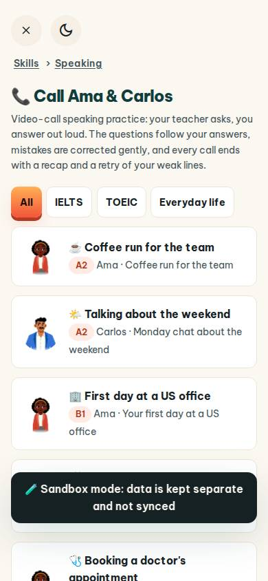
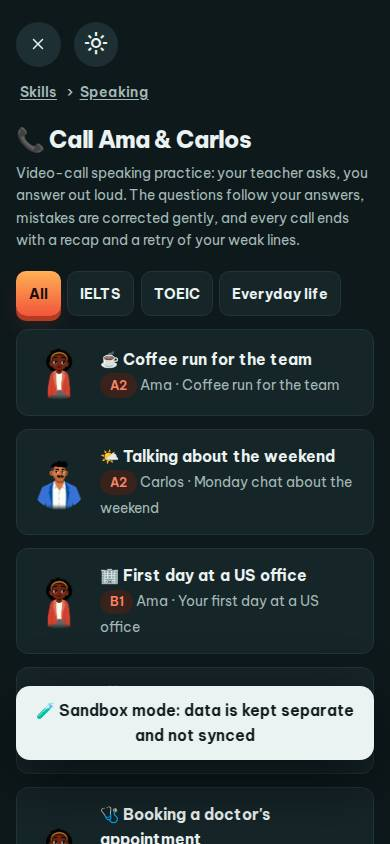
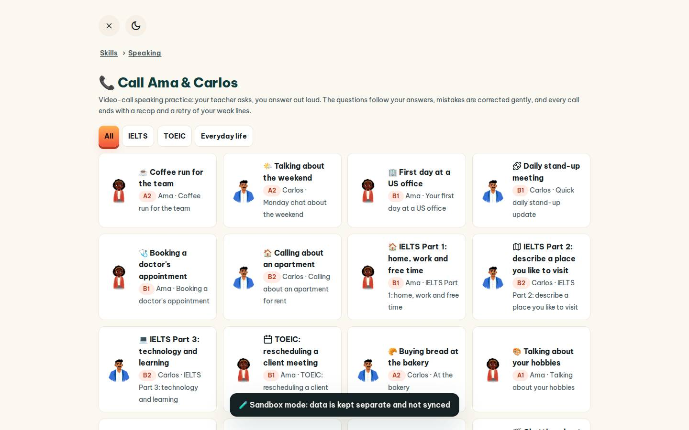
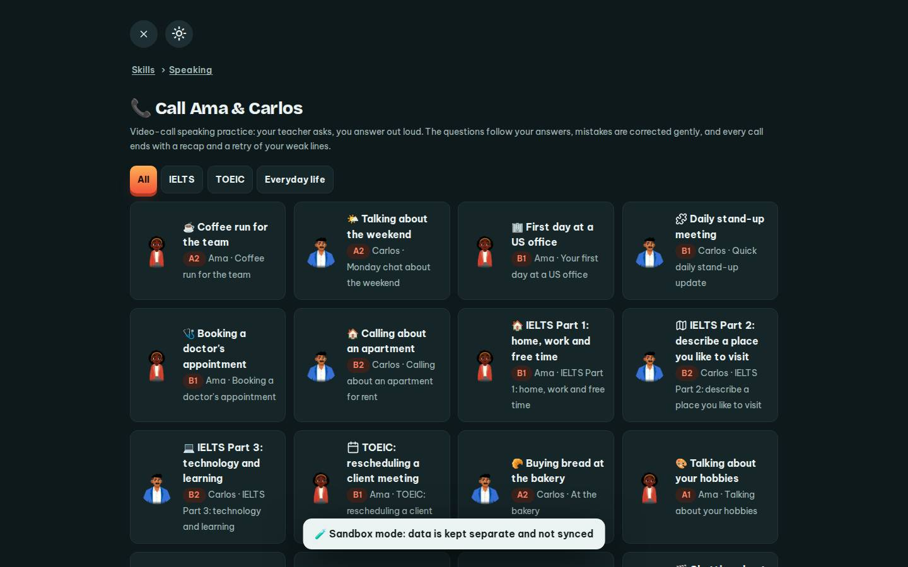

# #/call

Điểm: **93** · độ phủ 100 % · /call

- Chức năng: 100
- Lỗi JS: 100
- Rỗng/lỗi/tải: 100
- Back/Thoát: 100
- Tương phản: 100
- Chạm ≥44: 92
- Bố cục: 100
- i18n 15: 100
- Hiệu năng: 50
- Độ đẹp: 82

## Lỗi
- [tap] main#view>div.call-flt>button.btn.sm – "All" vùng chạm 43×44 < 44px
- [perf] LCP 6344 ms · CLS 0.0007 · TBT 95 ms
- [beauty] Character avatars look like generic stock illustrations, not integrated brand mascots.
- [beauty] Sandbox mode banner is a heavy, dark block that disrupts the light, airy rhythm.
- [beauty] Tab pills and card icons feel slightly generic compared to Duolingo's bespoke polish.

## Ảnh
390l 
390d 
1440l 
1440d 
