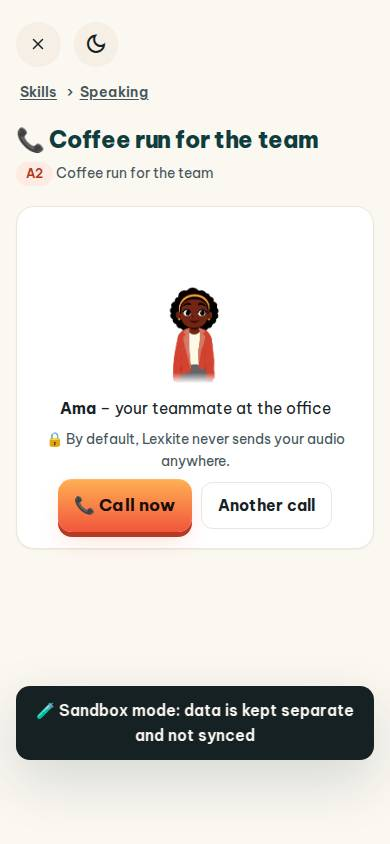
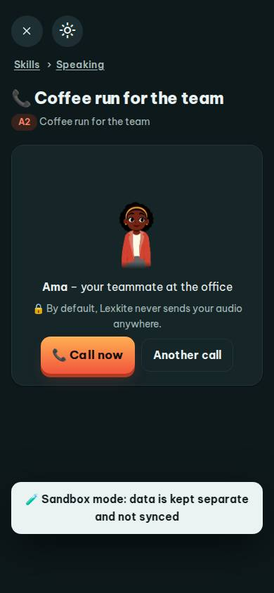
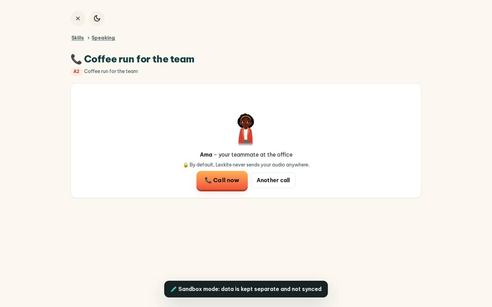
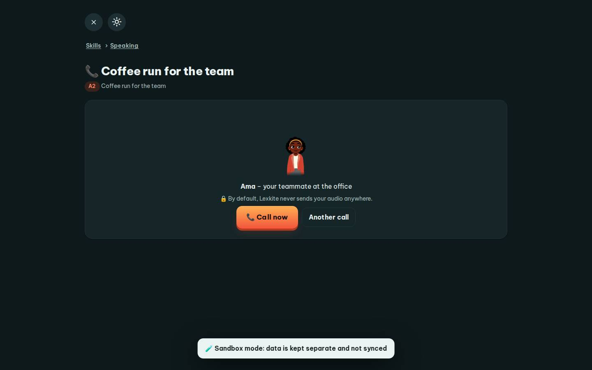

# #/call/coffee

Điểm: **96** · độ phủ 100 % · /call/coffee

- Chức năng: 100
- Lỗi JS: 100
- Rỗng/lỗi/tải: 100
- Back/Thoát: 100
- Tương phản: 100
- Chạm ≥44: 100
- Bố cục: 100
- i18n 15: 100
- Hiệu năng: 81
- Độ đẹp: 82

## Lỗi
- [perf] LCP 3848 ms · CLS 0.0007 · TBT 63 ms
- [beauty] Character illustration feels pasted on, not integrated
- [beauty] Large empty space below card breaks rhythm
- [beauty] Sandbox banner looks like a debug overlay

## Ảnh
390l 
390d 
1440l 
1440d 
