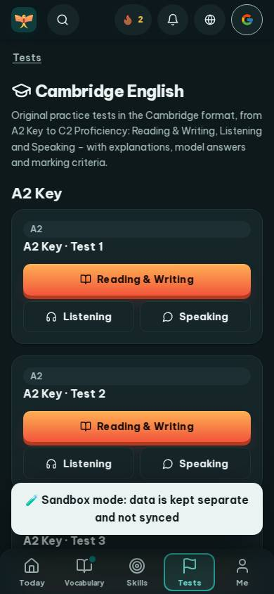
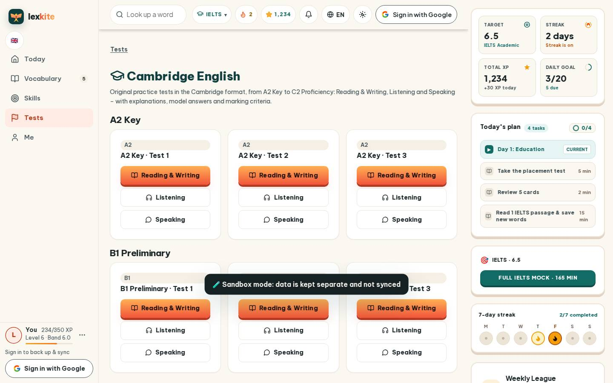

# #/cambridge

Điểm: **94** · độ phủ 86 % · /cambridge

- Chức năng: 100
- Lỗi JS: 100
- Rỗng/lỗi/tải: 100
- Back/Thoát: –
- Tương phản: 100
- Chạm ≥44: 100
- Bố cục: 100
- i18n 15: 93
- Hiệu năng: 50
- Độ đẹp: ∅

## Lỗi
- [i18n] ar: thiếu dịch «Listening» · thiếu dịch «Speaking»
- [perf] LCP 10176 ms · CLS 0.0033 · TBT 85 ms

## Ảnh
390l 
390d 
1440l 
1440d 
