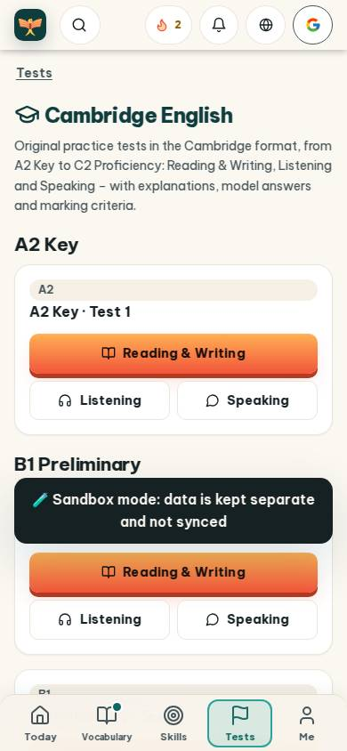
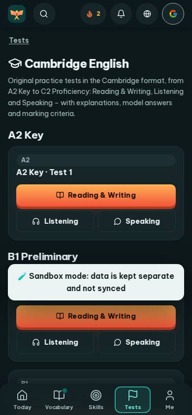
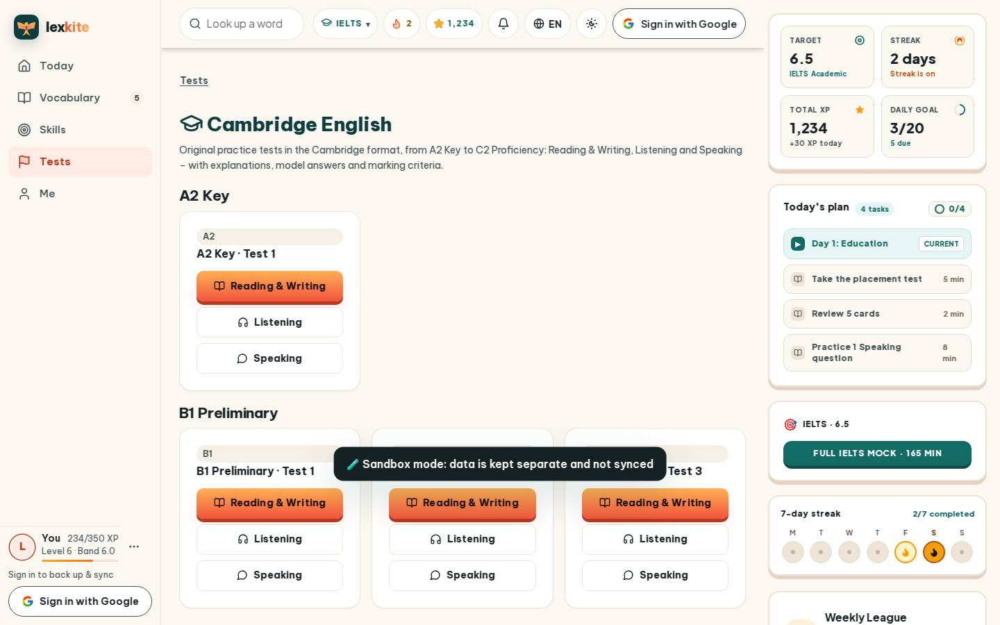
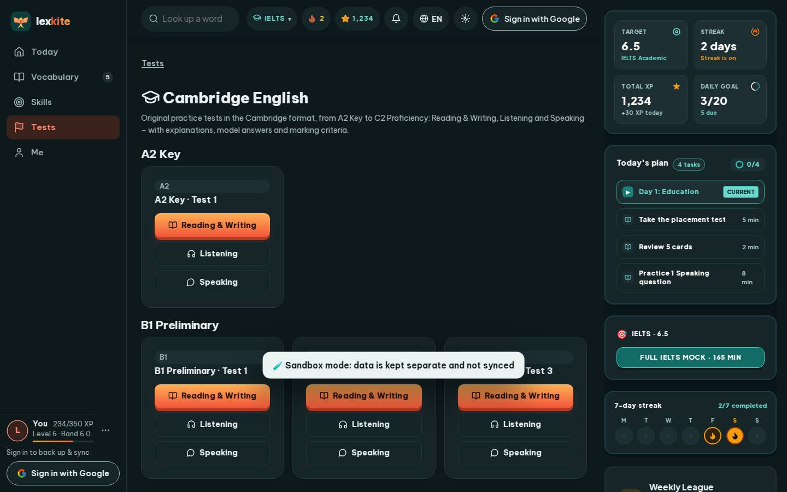

# #/cambridge

Điểm: **84** · độ phủ 100 % · /cambridge

- Chức năng: 100
- Lỗi JS: 100
- Rỗng/lỗi/tải: 100
- Back/Thoát: –
- Tương phản: 100
- Chạm ≥44: 100
- Bố cục: 100
- i18n 15: 13
- Hiệu năng: 50
- Độ đẹp: 79

## Lỗi
- [i18n] ar: thiếu dịch «Listening» · thiếu dịch «Speaking»
- [i18n] de: thiếu dịch «Listening» · thiếu dịch «Speaking»
- [i18n] es: thiếu dịch «Listening» · thiếu dịch «Speaking»
- [i18n] fr: thiếu dịch «Listening» · thiếu dịch «Speaking»
- [perf] LCP 9160 ms · CLS 0.0031 · TBT 60 ms
- [beauty] Dark 'Sandbox mode' banner breaks visual rhythm and feels like a raw system alert.
- [beauty] Top navigation bar is crowded with disparate icons (search, streak, bell, globe, Google).
- [beauty] Lacks the playful character integration and vibrant, cohesive color palette of Duolingo.

## Ảnh
390l 
390d 
1440l 
1440d 
