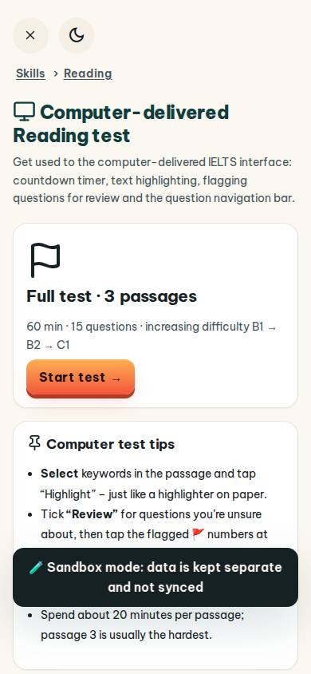
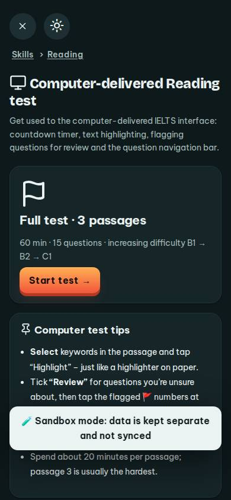
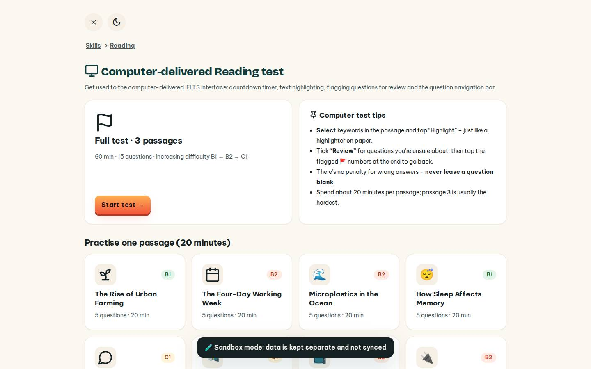
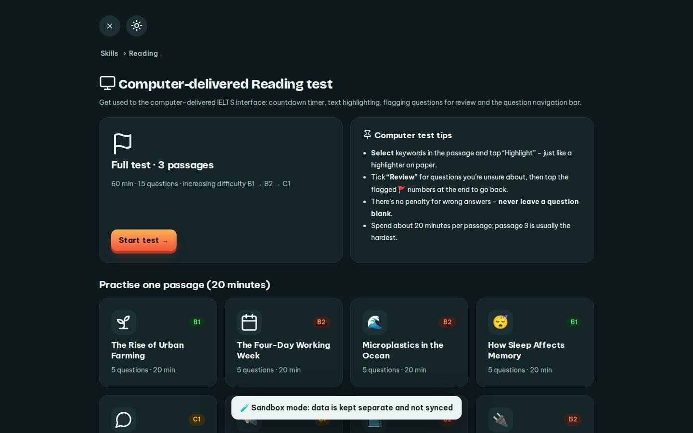

# #/cbt

Điểm: **93** · độ phủ 100 % · /cbt

- Chức năng: 100
- Lỗi JS: 100
- Rỗng/lỗi/tải: 100
- Back/Thoát: 100
- Tương phản: 100
- Chạm ≥44: 100
- Bố cục: 100
- i18n 15: 100
- Hiệu năng: 50
- Độ đẹp: 84

## Lỗi
- [perf] LCP 6472 ms · CLS 0 · TBT 138 ms
- [beauty] Dark toast notification obscures content and disrupts layout flow
- [beauty] Lacks Duolingo's characteristic playful character integration
- [beauty] Generic icon style feels less polished than Duolingo's custom illustrations

## Ảnh
390l 
390d 
1440l 
1440d 
