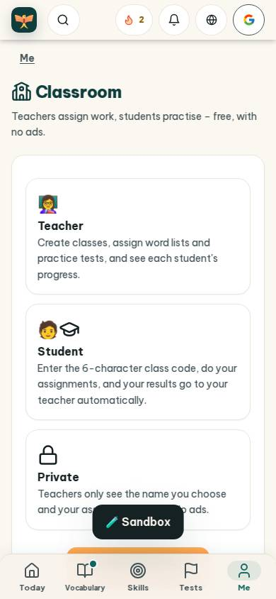
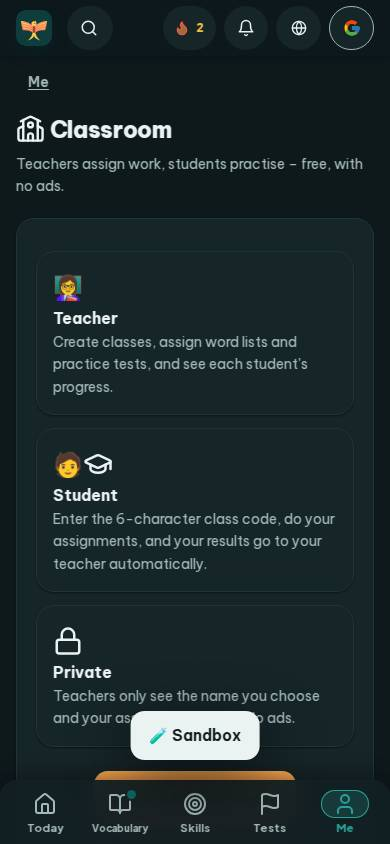

# #/class

Điểm: **92** · độ phủ 100 % · /class

- Chức năng: 100
- Lỗi JS: 100
- Rỗng/lỗi/tải: 100
- Back/Thoát: –
- Tương phản: 100
- Chạm ≥44: 92
- Bố cục: 100
- i18n 15: 100
- Hiệu năng: 61
- Độ đẹp: 76

## Lỗi
- [tap] div.card>p.tiny.muted>a – "Guide for schools & IT admins →" vùng chạm 215×18 < 44px
- [perf] LCP 5220 ms · CLS 0.0039 · TBT 37 ms
- [beauty] Generic emoji icons (teacher, student) lack Duolingo's custom character polish.
- [beauty] Dark toast banner overlaps content, creating visual clutter.
- [beauty] Cards feel plain/flat with weak primary action emphasis.

## Ảnh
390l 
390d 
1440l 
1440d 
