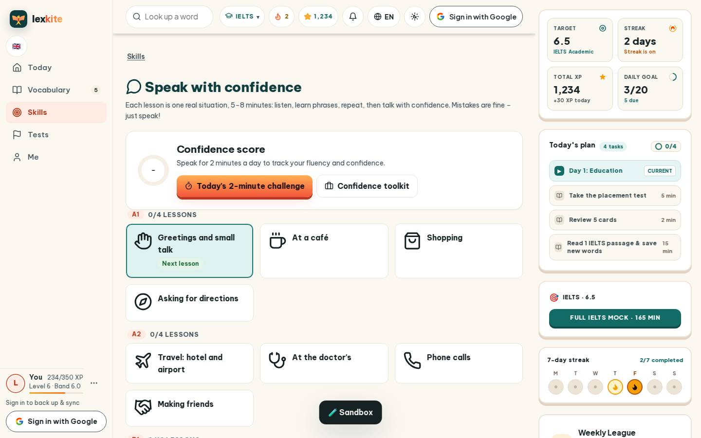
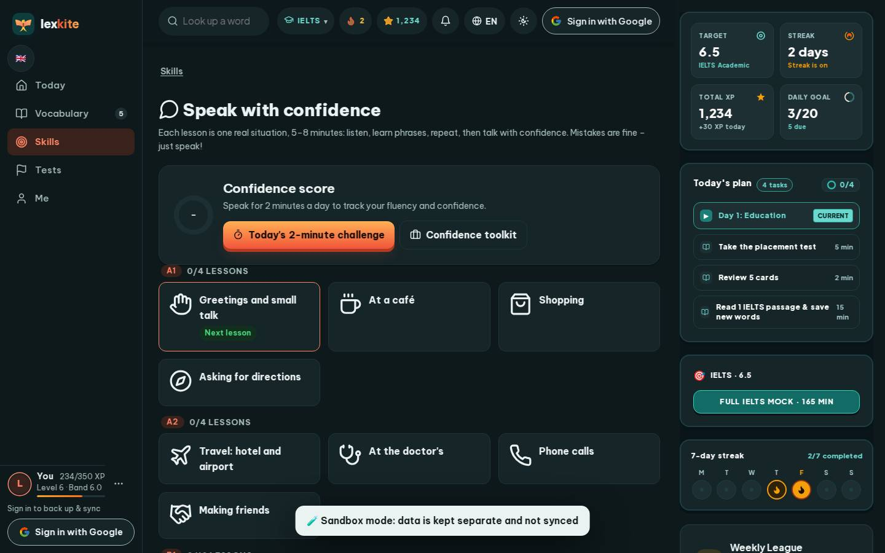

# #/confidence

Điểm: **91** · độ phủ 100 % · /confidence

- Chức năng: 100
- Lỗi JS: 100
- Rỗng/lỗi/tải: 100
- Back/Thoát: –
- Tương phản: 100
- Chạm ≥44: 100
- Bố cục: 85
- i18n 15: 100
- Hiệu năng: 50
- Độ đẹp: 82

## Lỗi
- [layout] div>div.ring>b – nhãn "–" đứng trơ một mình cả hàng (khung 64px)
- [perf] LCP 6268 ms · CLS 0.0039 · TBT 36 ms
- [beauty] Generic line icons lack Duolingo's character polish
- [beauty] Dark toast banner feels abrupt and cluttered
- [beauty] Top nav icons are visually inconsistent

## Ảnh
390l 
390d 
1440l 
1440d 
