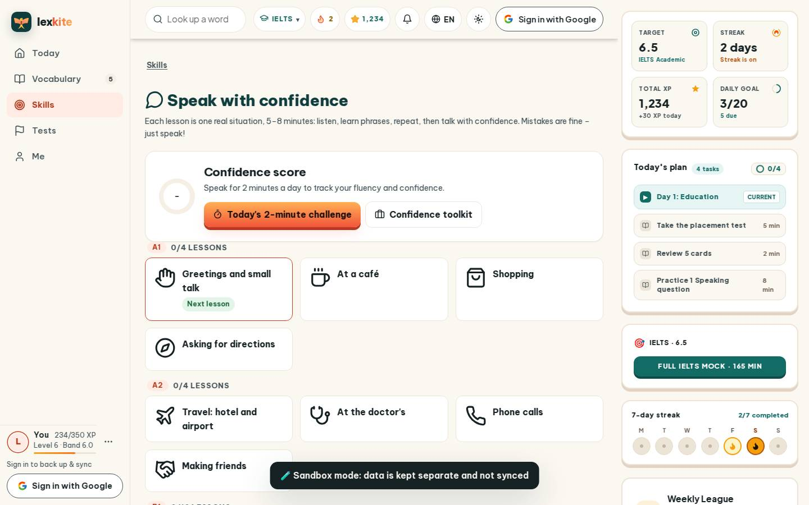
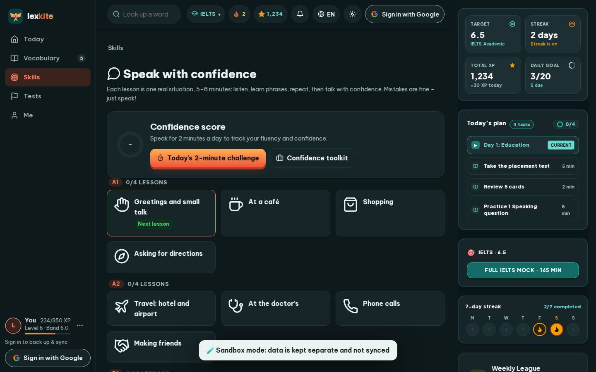

# #/confidence

Điểm: **90** · độ phủ 100 % · /confidence

- Chức năng: 100
- Lỗi JS: 100
- Rỗng/lỗi/tải: 100
- Back/Thoát: –
- Tương phản: 90
- Chạm ≥44: 100
- Bố cục: 85
- i18n 15: 100
- Hiệu năng: 50
- Độ đẹp: 83

## Lỗi
- [contrast] a[data-ext-cta="rail"]
- [layout] div>div.ring>b – nhãn "–" đứng trơ một mình cả hàng (khung 64px)
- [perf] LCP 6052 ms · CLS 0.0031 · TBT 28 ms
- [beauty] Top navigation bar feels crowded and generic compared to Duolingo's clean header.
- [beauty] The dark 'Sandbox mode' banner is visually heavy and disrupts the light, friendly theme.
- [beauty] The circular placeholder with a dash next to the score looks unfinished.

## Ảnh
390l 
390d 
1440l 
1440d 
