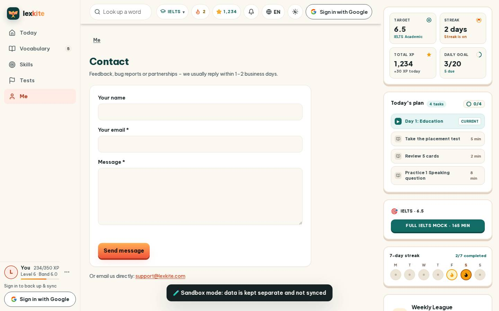

# #/contact

Điểm: **91** · độ phủ 100 % · /contact

- Chức năng: 100
- Lỗi JS: 100
- Rỗng/lỗi/tải: 100
- Back/Thoát: –
- Tương phản: 100
- Chạm ≥44: 100
- Bố cục: 70
- i18n 15: 100
- Hiệu năng: 74
- Độ đẹp: 76

## Lỗi
- [layout] form#ctForm>input – "" nằm ngoài màn hình (x -9982…-9954 / 390)
- [layout] form#ctForm>input – input "" không có nhãn nhìn thấy – người học không biết ô này để làm gì
- [perf] LCP 4300 ms · CLS 0.0031 · TBT 81 ms
- [beauty] Generic form layout, lacks Duolingo's playful character integration
- [beauty] Dark sandbox banner feels abrupt and visually heavy
- [beauty] Top nav icons are plain and lack polished detail

## Ảnh
390l 
390d 
1440l 
1440d 
