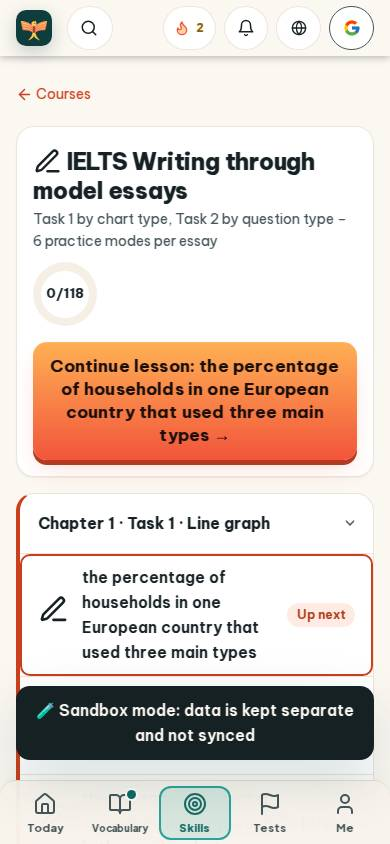
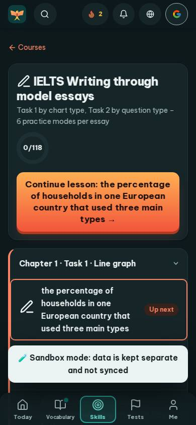
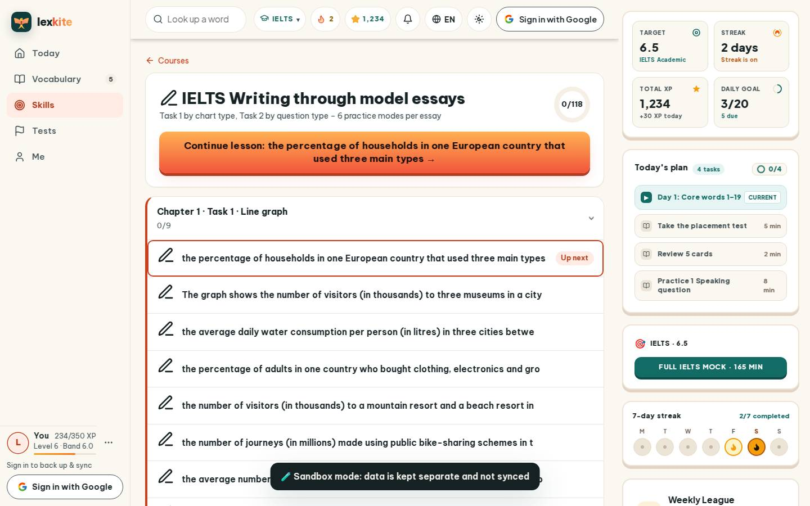
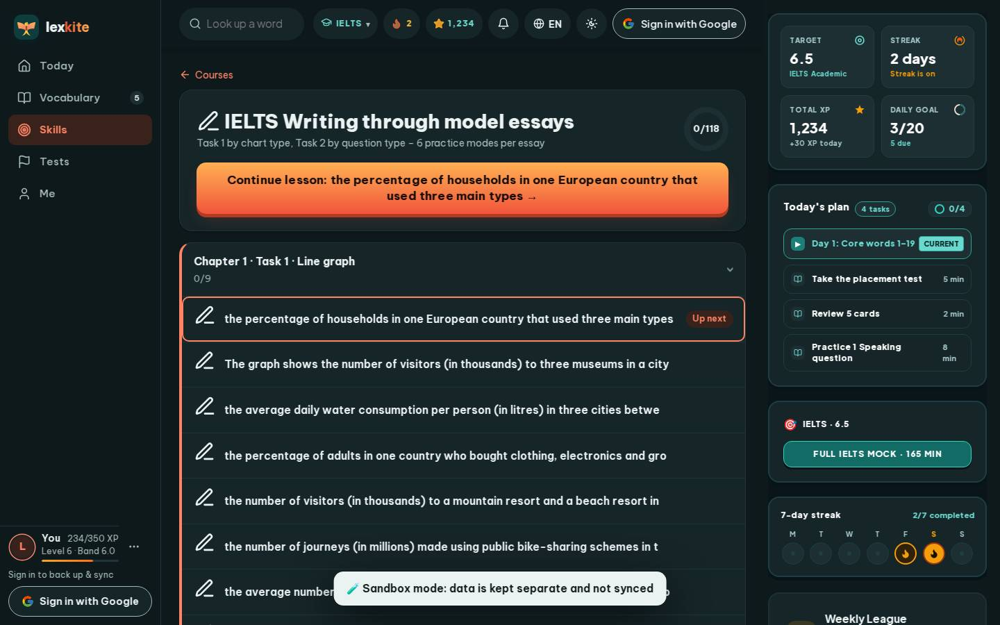

# #/course/ielts-writing

Điểm: **91** · độ phủ 100 % · /course/ielts-writing

- Chức năng: 100
- Lỗi JS: 100
- Rỗng/lỗi/tải: 100
- Back/Thoát: –
- Tương phản: 100
- Chạm ≥44: 92
- Bố cục: 100
- i18n 15: 100
- Hiệu năng: 50
- Độ đẹp: 75

## Lỗi
- [tap] main#view>a.small – "Courses" vùng chạm 78×18 < 44px
- [perf] LCP 16252 ms · CLS 0.0031 · TBT 84 ms
- [beauty] Generic sans-serif lacks Duolingo's friendly, rounded character
- [beauty] Orange CTA text contrast is borderline low
- [beauty] No character/illustration integration; feels like a standard web app

## Ảnh
390l 
390d 
1440l 
1440d 
