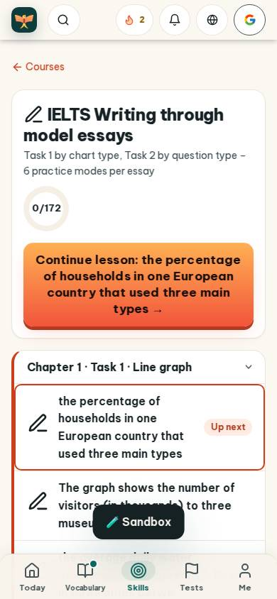
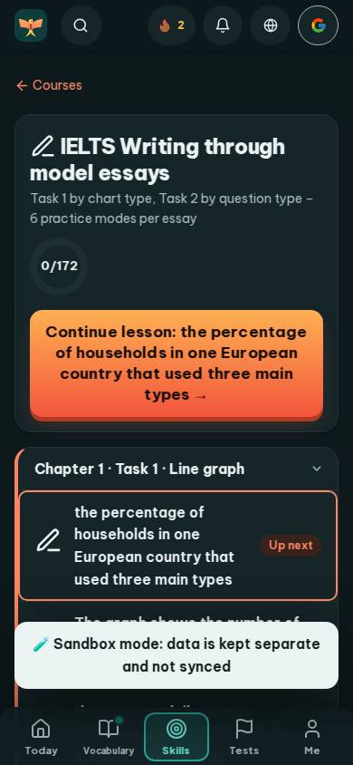
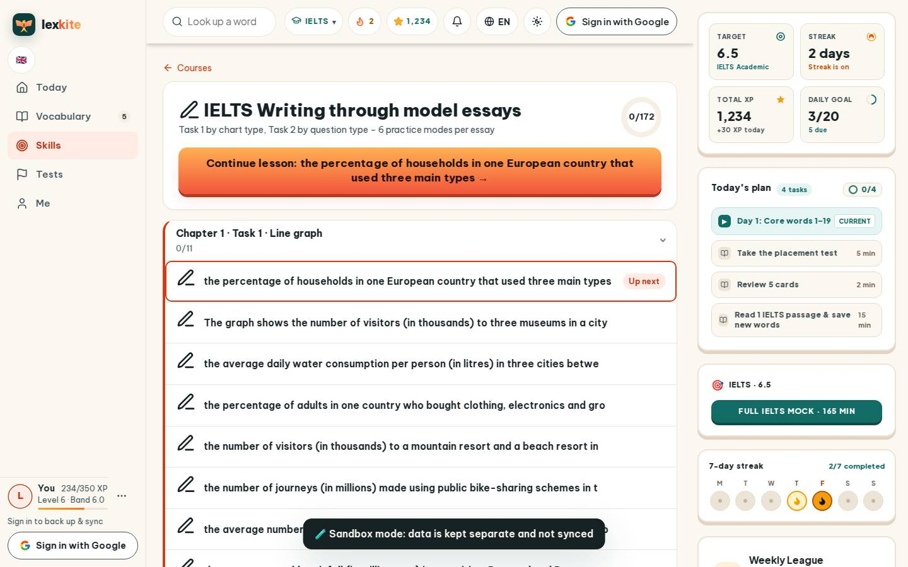
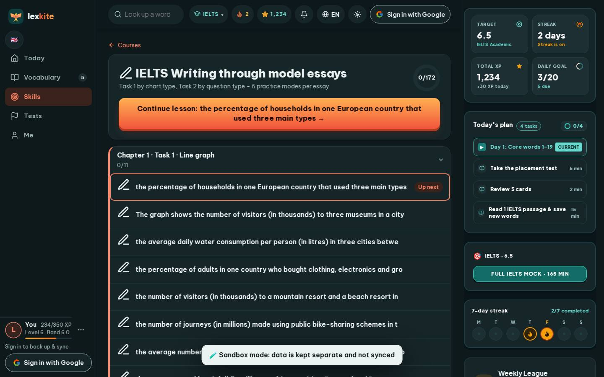

# #/course/ielts-writing

Điểm: **92** · độ phủ 100 % · /course/ielts-writing

- Chức năng: 100
- Lỗi JS: 100
- Rỗng/lỗi/tải: 100
- Back/Thoát: –
- Tương phản: 100
- Chạm ≥44: 100
- Bố cục: 100
- i18n 15: 100
- Hiệu năng: 50
- Độ đẹp: 75

## Lỗi
- [perf] LCP 18476 ms · CLS 0.004 · TBT 106 ms
- [beauty] Generic flat cards lack Duolingo's playful character integration
- [beauty] Dense text-heavy primary button feels utilitarian, not gamified
- [beauty] Toast banner overlaps content, creating visual clutter

## Ảnh
390l 
390d 
1440l 
1440d 
