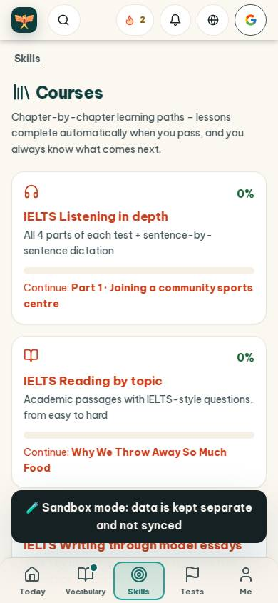
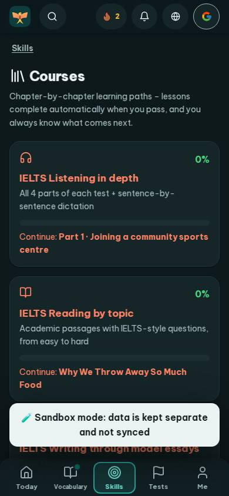
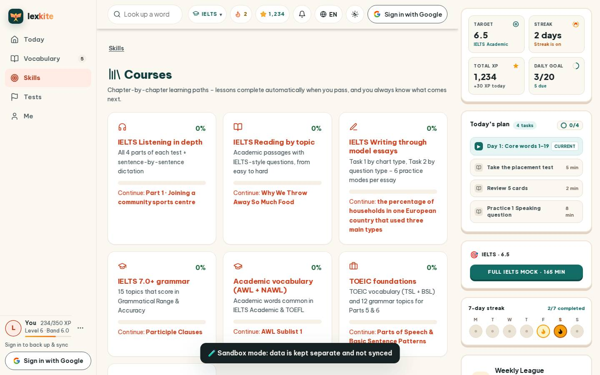
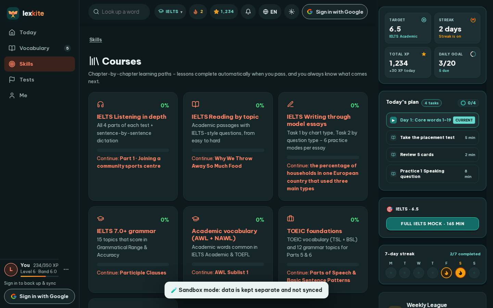

# #/courses

Điểm: **90** · độ phủ 100 % · /courses

- Chức năng: 100
- Lỗi JS: 100
- Rỗng/lỗi/tải: 100
- Back/Thoát: –
- Tương phản: 90
- Chạm ≥44: 100
- Bố cục: 100
- i18n 15: 100
- Hiệu năng: 43
- Độ đẹp: 75

## Lỗi
- [contrast] a[data-ext-cta="rail"]
- [perf] LCP 16752 ms · CLS 0.0031 · TBT 439 ms
- [beauty] Dark toast banner obscures third course card
- [beauty] Generic flat icons lack Duolingo character polish
- [beauty] Reddish-orange accent feels harsh, low harmony

## Ảnh
390l 
390d 
1440l 
1440d 
