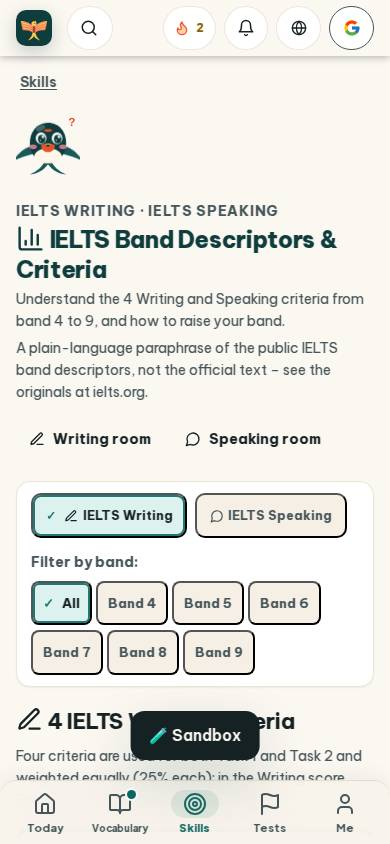
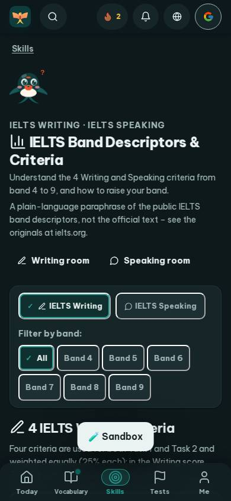
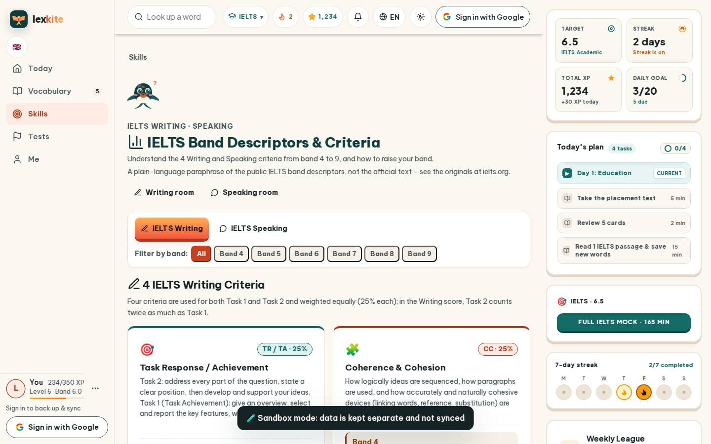
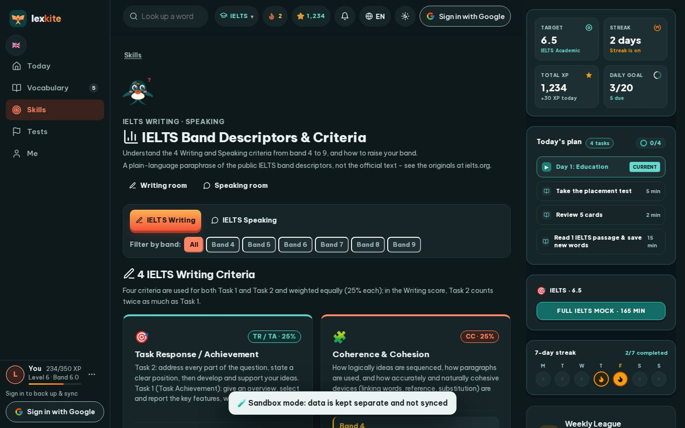

# #/criteria

Điểm: **93** · độ phủ 86 % · /criteria

- Chức năng: 100
- Lỗi JS: 100
- Rỗng/lỗi/tải: 100
- Back/Thoát: –
- Tương phản: 100
- Chạm ≥44: 60
- Bố cục: 100
- i18n 15: 100
- Hiệu năng: 55
- Độ đẹp: ∅

## Lỗi
- [tap] div.row.between>div.row>a.btn.sm – "Writing room" vùng chạm 148×36 < 44px
- [tap] div#skillTabs>button.chip – "IELTS Writing" vùng chạm 156×37 < 44px
- [tap] div#bandFilters>button.chip – "All" vùng chạm 60×36 < 44px
- [tap] div#modelBandTabs>button.chip – "Band 5.0" vùng chạm 92×37 < 44px
- [tap] button#crCopy – "Copy" vùng chạm 34×36 < 44px
- [perf] LCP 5628 ms · CLS 0.0033 · TBT 122 ms

## Ảnh
390l 
390d 
1440l 
1440d 
