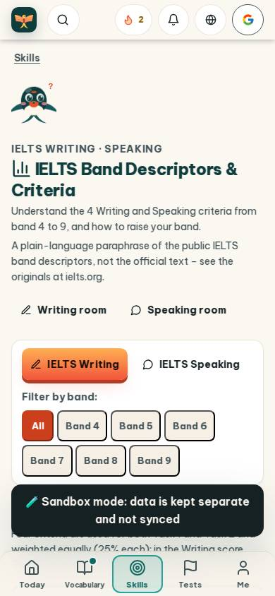
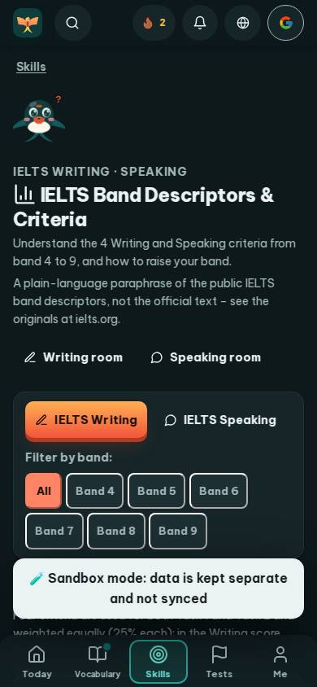
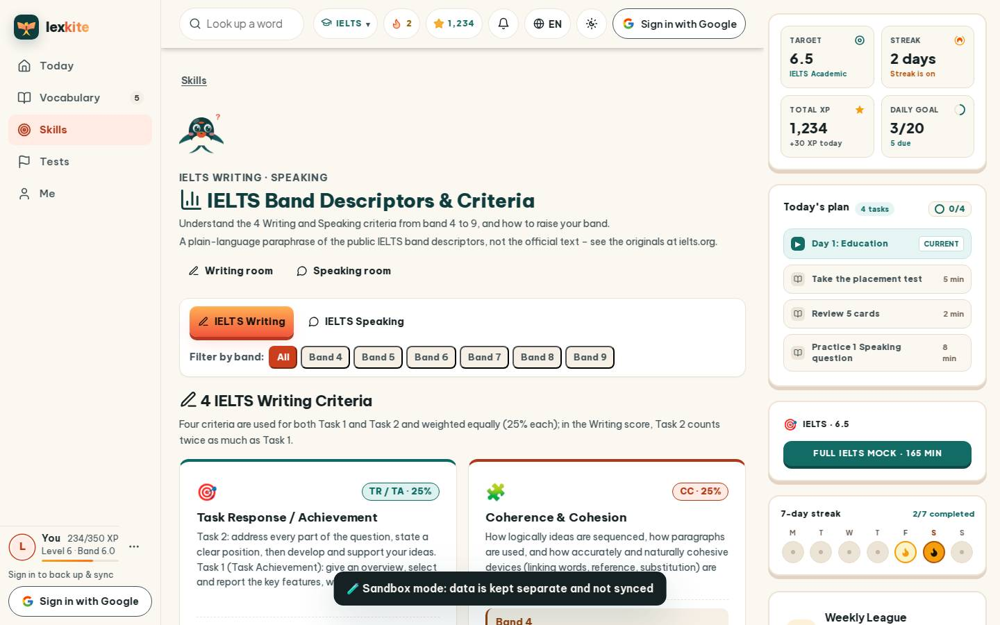
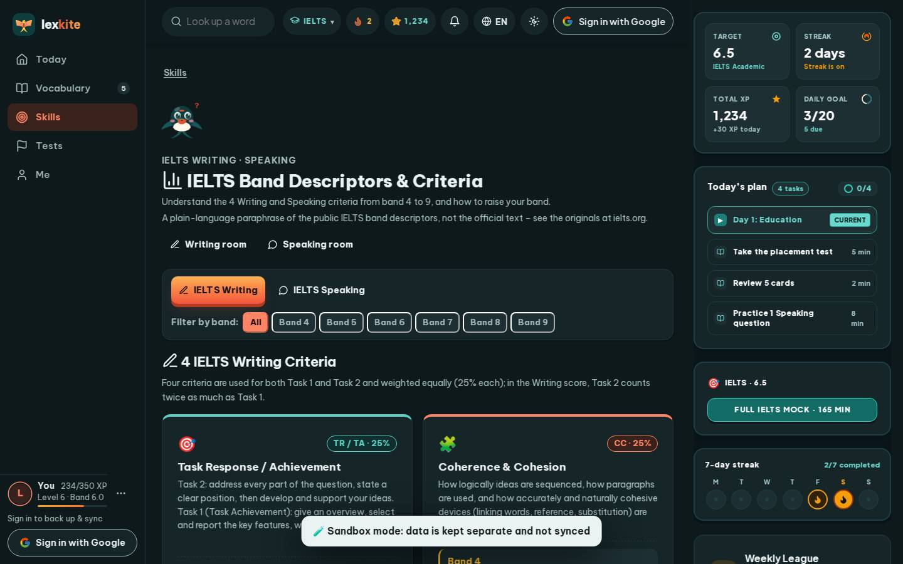

# #/criteria

Điểm: **91** · độ phủ 100 % · /criteria

- Chức năng: 100
- Lỗi JS: 100
- Rỗng/lỗi/tải: 100
- Back/Thoát: –
- Tương phản: 100
- Chạm ≥44: 60
- Bố cục: 100
- i18n 15: 100
- Hiệu năng: 54
- Độ đẹp: 79

## Lỗi
- [tap] div.row.between>div.row>a.btn.sm – "Writing room" vùng chạm 148×36 < 44px
- [tap] div#skillTabs>button.btn.sm – "IELTS Speaking" vùng chạm 164×36 < 44px
- [tap] div#bandFilters>button.chip – "All" vùng chạm 41×33 < 44px
- [tap] div#modelBandTabs>button.btn.sm – "Band 5.0" vùng chạm 93×36 < 44px
- [tap] button#crCopy – "Copy" vùng chạm 34×36 < 44px
- [perf] LCP 5588 ms · CLS 0.0031 · TBT 256 ms
- [beauty] Sandbox mode banner overlaps and obscures content below
- [beauty] Top navigation icons are inconsistent in style and alignment
- [beauty] Character illustration feels pasted on rather than integrated

## Ảnh
390l 
390d 
1440l 
1440d 
