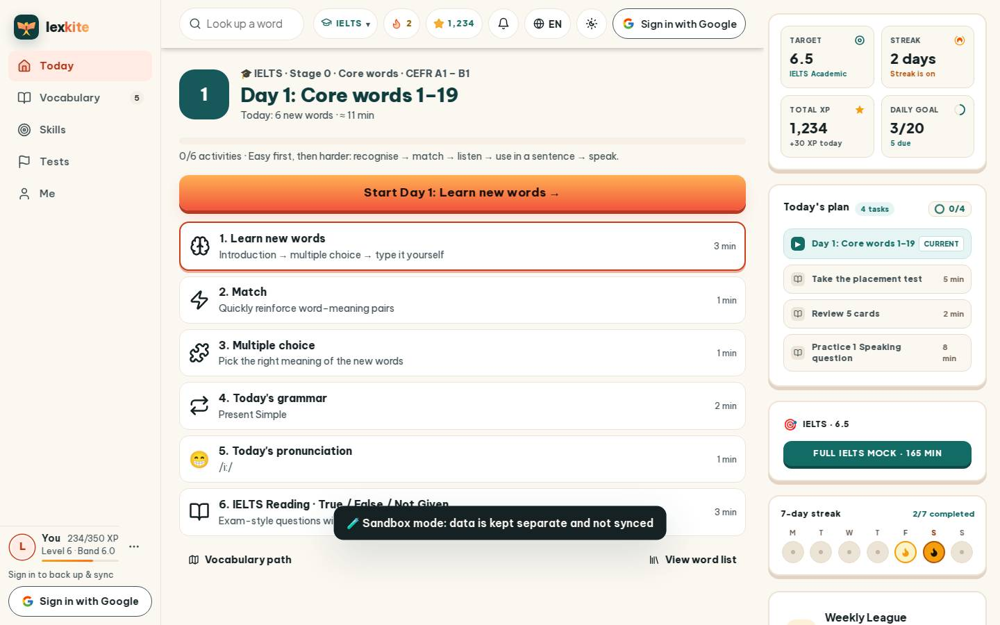
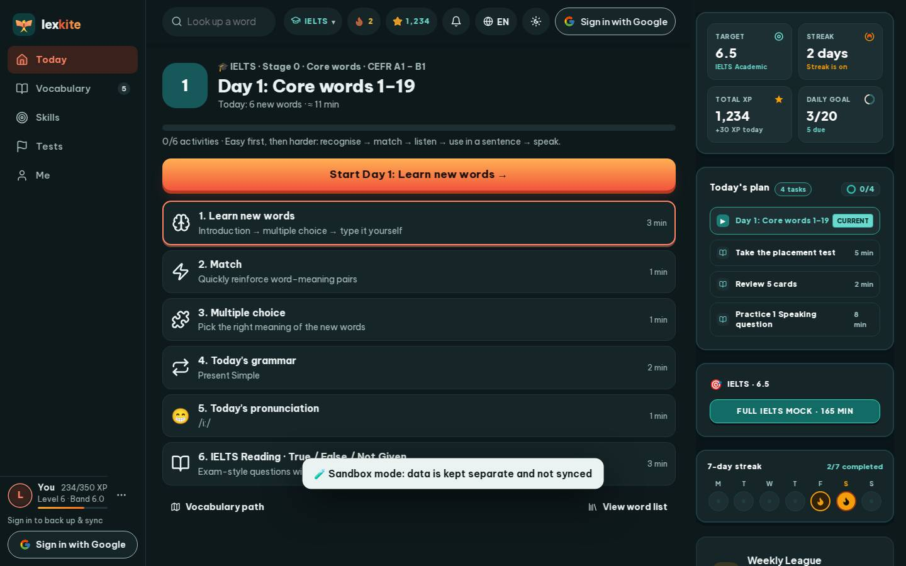

# #/day/1

Điểm: **95** · độ phủ 100 % · /day/1

- Chức năng: 100
- Lỗi JS: 100
- Rỗng/lỗi/tải: 100
- Back/Thoát: –
- Tương phản: 100
- Chạm ≥44: 92
- Bố cục: 100
- i18n 15: 100
- Hiệu năng: 78
- Độ đẹp: 83

## Lỗi
- [tap] main#view>div.row.between>a.btn.sm – "Vocabulary path" vùng chạm 175×36 < 44px
- [perf] LCP 4056 ms · CLS 0.0031 · TBT 59 ms
- [beauty] Top nav icons (search, bell, globe) feel generic and cluttered.
- [beauty] Dark 'Sandbox mode' banner is visually heavy and breaks the light theme.
- [beauty] Activity list icons are simple line-art, lacking Duolingo's playful polish.

## Ảnh
390l 
390d 
1440l 
1440d 
