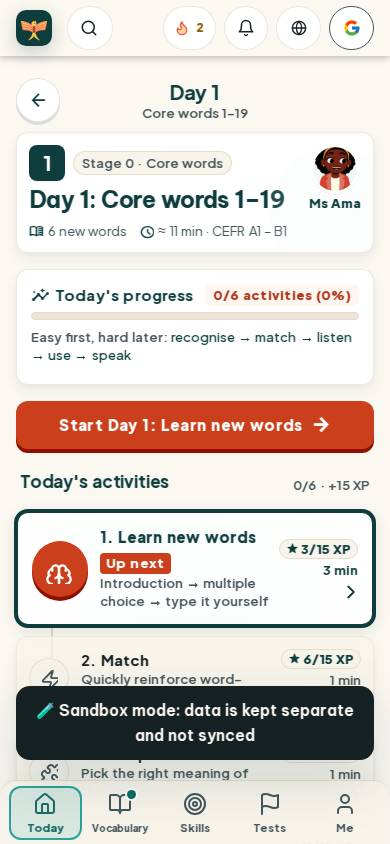
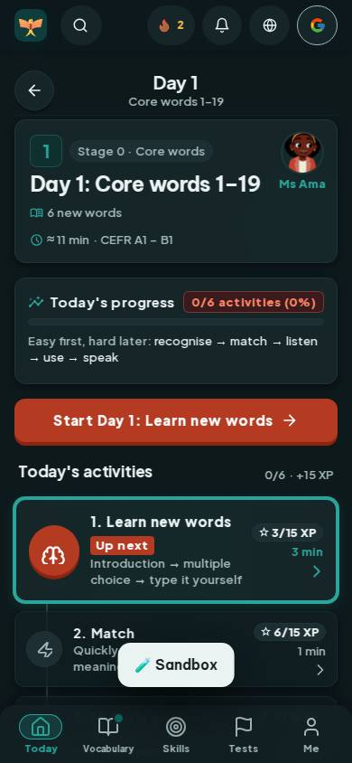
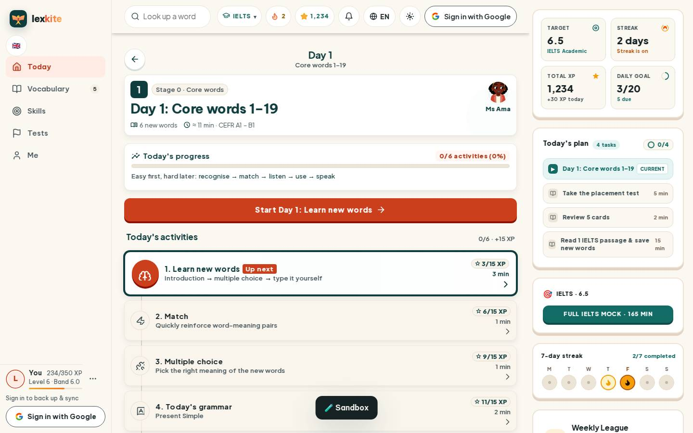
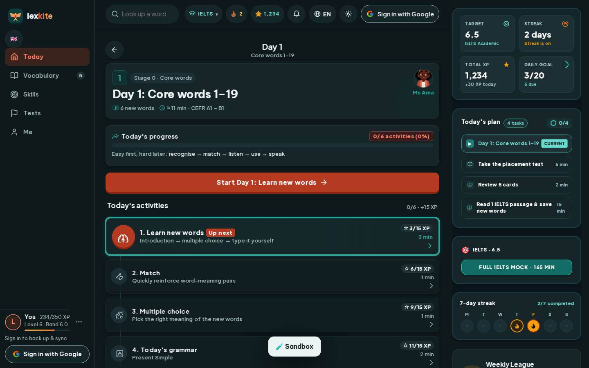

# #/day/1

Điểm: **89** · độ phủ 100 % · /day/1

- Chức năng: 100
- Lỗi JS: 100
- Rỗng/lỗi/tải: 100
- Back/Thoát: –
- Tương phản: 100
- Chạm ≥44: 100
- Bố cục: 25
- i18n 15: 100
- Hiệu năng: 86
- Độ đẹp: 82

## Lỗi
- [layout] div.w-full.min-h-0>main.flex-1.flex>section.rounded-[0.75rem].border – nội dung tràn ngang 24px bị cắt: "main.flex-1.flex>section.rounded-[0
- [layout] section.rounded-[0.75rem].border>div.absolute.top-3>div.w-12.h-12 – nội dung tràn ngang 28px bị cắt: "div.absolute.top-3>div.w-12.h-12>span.
- [layout] a.rounded-[0.75rem].border-2>div.flex.flex-col>span.material-symbols-outlined.text-[18px] – nội dung tràn ngang 5px bị cắt
- [layout] div.flex.items-center>div.w-10.h-10>span.material-symbols-outlined.text-[18px] – nội dung tràn ngang 5px bị cắt: "span.material-symbols-outl
- [layout] a.rounded-[0.75rem].border>div.flex.flex-col>span.material-symbols-outlined.text-[16px] – nội dung tràn ngang 4px bị cắt
- [perf] LCP 3484 ms · CLS 0.0039 · TBT 183 ms
- [beauty] Dark toast notification obscures content and breaks visual flow
- [beauty] Top nav bar feels cluttered with mixed icon styles
- [beauty] Progress bar lacks clear visual hierarchy against text

## Ảnh
390l 
390d 
1440l 
1440d 
