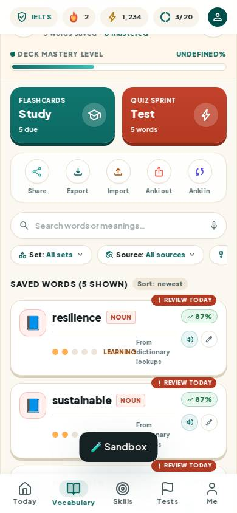
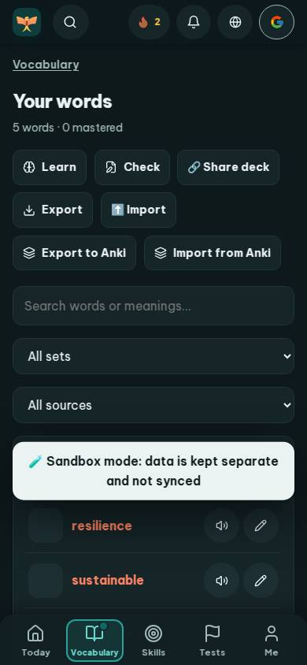
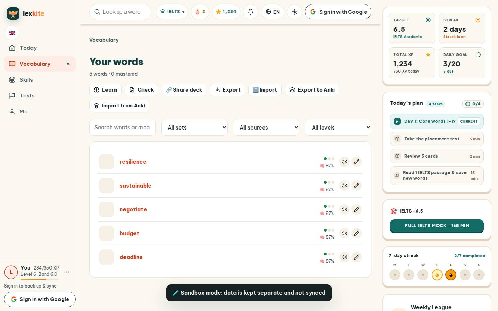
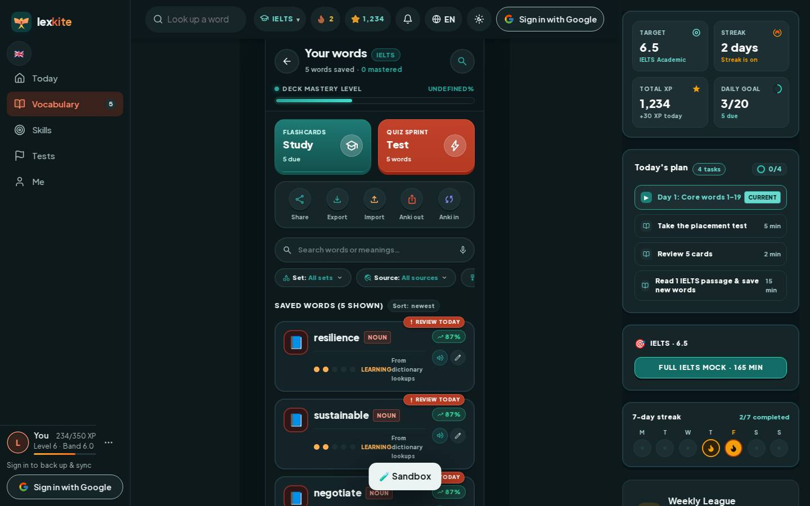

# #/deck

Điểm: **80** · độ phủ 86 % · /deck

- Chức năng: 100
- Lỗi JS: 100
- Rỗng/lỗi/tải: 100
- Back/Thoát: –
- Tương phản: 100
- Chạm ≥44: 84
- Bố cục: 70
- i18n 15: 13
- Hiệu năng: 49
- Độ đẹp: ∅

## Lỗi
- [tap] div.flex.items-center>span.text-[17px].font-extrabold>a.[color:inherit] – "resilience" vùng chạm 81×22 < 44px
- [tap] div.flex.flex-col>div.flex.items-center>button.w-7.h-7 – "volume_up" vùng chạm 28×28 < 44px
- [layout] div.flex.items-center>div.flex.items-center>button.w-11.h-11 – "arrow_back" bị div.flex.items-center>a.flex.items-center>div.h-8.px-2.5 đè l
- [layout] button#dkFind – "search" bị header.fixed.top-0>div.h-14.px-[1rem]>a.w-8.h-8 đè lên
- [i18n] ar: thiếu dịch «noun» · chữ Việt «Bộ lọc»
- [i18n] de: thiếu dịch «noun» · chữ Việt «Bộ lọc»
- [i18n] es: thiếu dịch «noun» · chữ Việt «Bộ lọc»
- [i18n] fr: thiếu dịch «Source:» · thiếu dịch «noun»
- [perf] LCP 7480 ms · CLS 0.0001 · TBT 243 ms

## Ảnh
390l 
390d 
1440l 
1440d 
