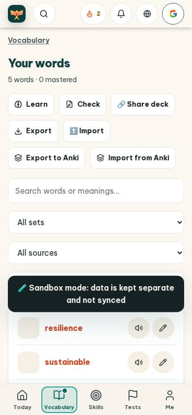
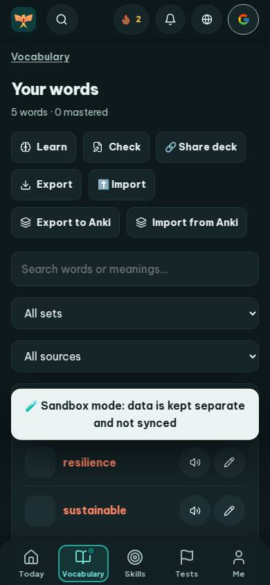
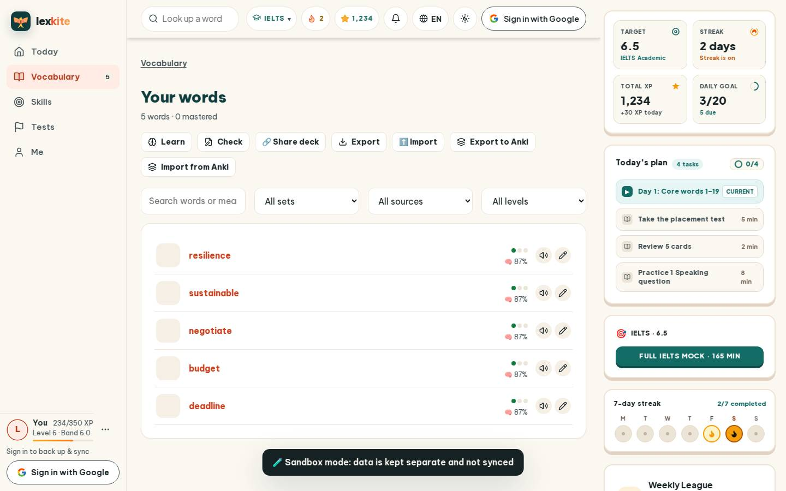
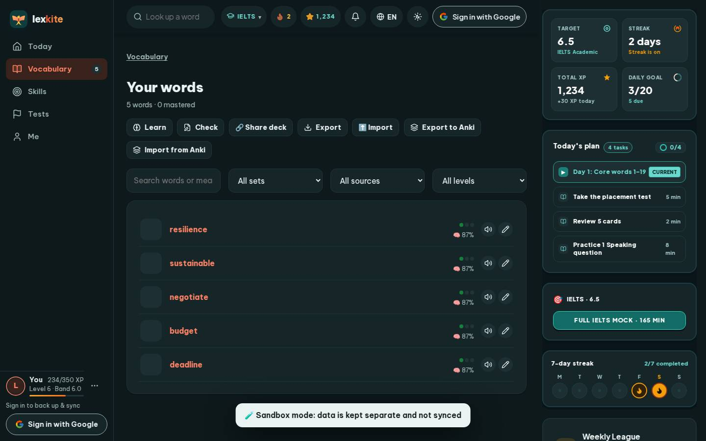

# #/deck

Điểm: **86** · độ phủ 100 % · /deck

- Chức năng: 100
- Lỗi JS: 100
- Rỗng/lỗi/tải: 100
- Back/Thoát: –
- Tương phản: 100
- Chạm ≥44: 52
- Bố cục: 40
- i18n 15: 100
- Hiệu năng: 79
- Độ đẹp: 75

## Lỗi
- [tap] div.page-head>div.row>a.btn.sm – "Learn" vùng chạm 94×36 < 44px
- [tap] button#shareBtn – "🔗 Share deck" vùng chạm 130×36 < 44px
- [tap] button#exportBtn – "Export" vùng chạm 102×36 < 44px
- [tap] button#ankiOut – "Export to Anki" vùng chạm 157×36 < 44px
- [tap] button#ankiIn – "Import from Anki" vùng chạm 174×36 < 44px
- [layout] select#filterTopic – select "All sets" không có nhãn nhìn thấy – người học không biết ô này để làm gì
- [layout] select#filterFrom – select "All sources" không có nhãn nhìn thấy – người học không biết ô này để làm gì
- [layout] select#filterM – select "All levels" không có nhãn nhìn thấy – người học không biết ô này để làm gì
- [layout] button#ankiIn – "Import from Anki" rớt xuống đứng một mình ở dòng cuối của main#view>div.page-head>div.row
- [perf] LCP 3980 ms · CLS 0.0033 · TBT 8 ms
- [beauty] Word list items lack clear visual hierarchy and primary action emphasis.
- [beauty] Sandbox mode banner is visually heavy and disrupts the content flow.
- [beauty] Generic icons and flat colors feel less polished than Duolingo's vibrant style.

## Ảnh
390l 
390d 
1440l 
1440d 
