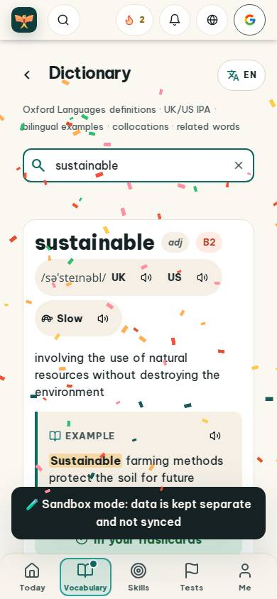
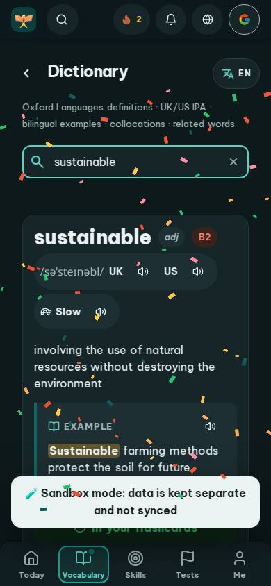
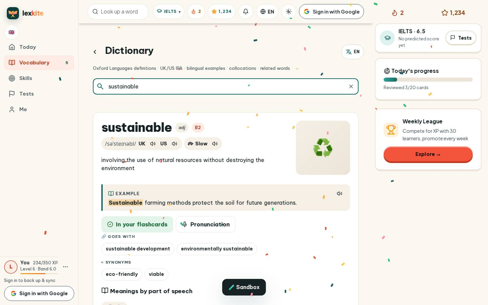
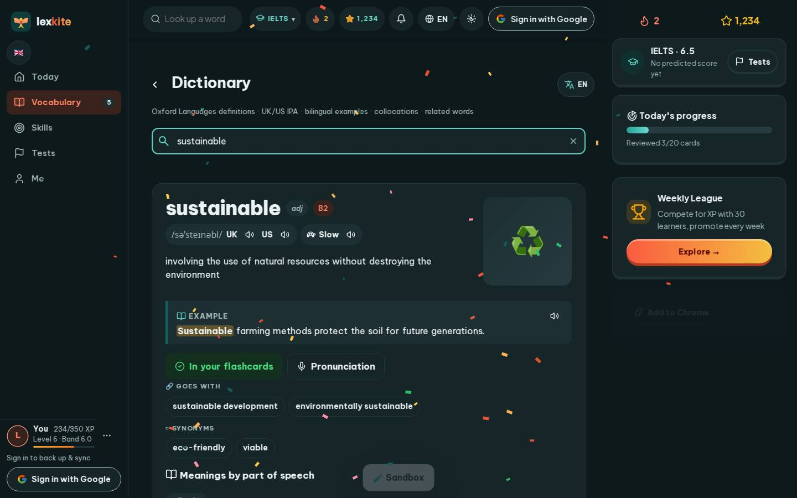

# #/dict/sustainable

Điểm: **81** · độ phủ 100 % · /dict/sustainable

- Chức năng: 100
- Lỗi JS: 100
- Rỗng/lỗi/tải: 100
- Back/Thoát: –
- Tương phản: 90
- Chạm ≥44: 76
- Bố cục: 100
- i18n 15: 13
- Hiệu năng: 49
- Độ đẹp: 76

## Lỗi
- [contrast] #toast
- [tap] div.card>div.wc-chips>button.chip.wc-chip – "sustainable development" vùng chạm 216×36 < 44px
- [tap] button#addPhr – "＋ Save your own phrase / structure" vùng chạm 293×38 < 44px
- [tap] button#relRetry – "↻ Try again" vùng chạm 112×38 < 44px
- [i18n] ar: thiếu dịch «adjective»
- [i18n] de: thiếu dịch «adjective»
- [i18n] es: thiếu dịch «adjective»
- [i18n] fr: thiếu dịch «adjective»
- [perf] LCP 5920 ms · CLS 0.0109 · TBT 280 ms
- [beauty] Confetti overlay clutters text and reduces readability
- [beauty] Dark toast notification obscures content and feels intrusive
- [beauty] Generic layout lacks Duolingo's distinctive character integration

## Ảnh
390l 
390d 
1440l 
1440d 
