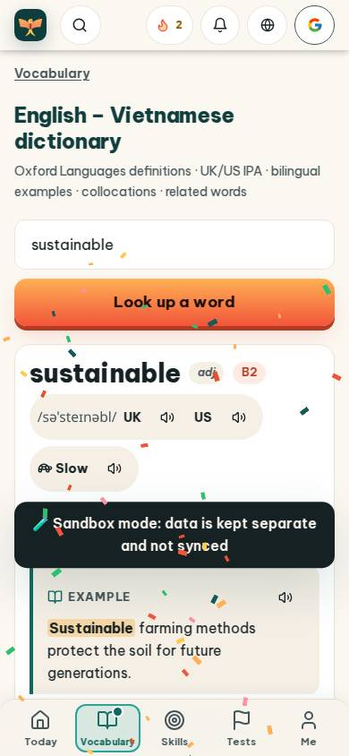
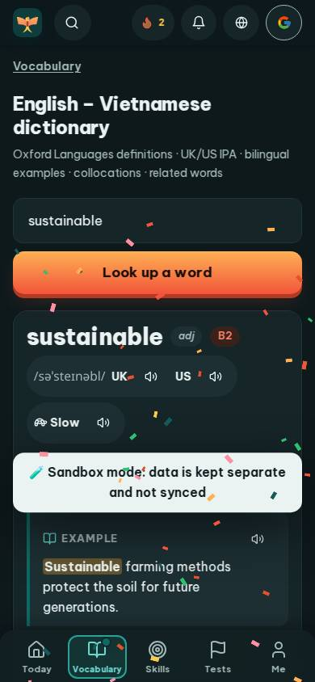
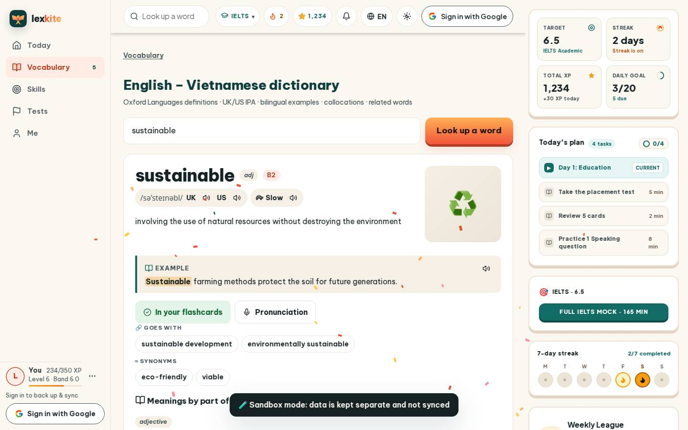
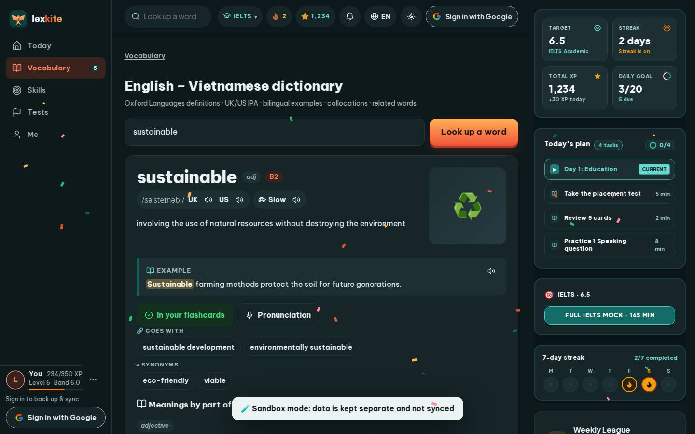

# #/dict/sustainable

Điểm: **84** · độ phủ 100 % · /dict/sustainable

- Chức năng: 100
- Lỗi JS: 100
- Rỗng/lỗi/tải: 100
- Back/Thoát: –
- Tương phản: 100
- Chạm ≥44: 76
- Bố cục: 100
- i18n 15: 13
- Hiệu năng: 61
- Độ đẹp: 77

## Lỗi
- [tap] div.card>div.wc-chips>button.chip.wc-chip – "sustainable development" vùng chạm 216×36 < 44px
- [tap] button#addPhr – "＋ Save your own phrase / structure" vùng chạm 293×36 < 44px
- [tap] button#relRetry – "↻ Try again" vùng chạm 112×36 < 44px
- [i18n] ar: thiếu dịch «adjective»
- [i18n] de: thiếu dịch «adjective»
- [i18n] es: thiếu dịch «adjective»
- [i18n] fr: thiếu dịch «adjective»
- [perf] LCP 5220 ms · CLS 0.0106 · TBT 33 ms
- [beauty] Confetti overlay obscures text and UI elements
- [beauty] Sandbox mode banner looks like a raw debug toast
- [beauty] Top nav icons are inconsistent in style and weight

## Ảnh
390l 
390d 
1440l 
1440d 
