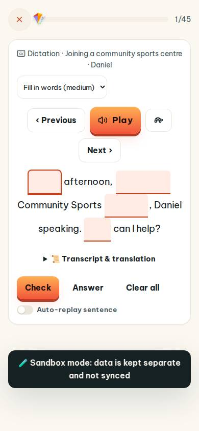
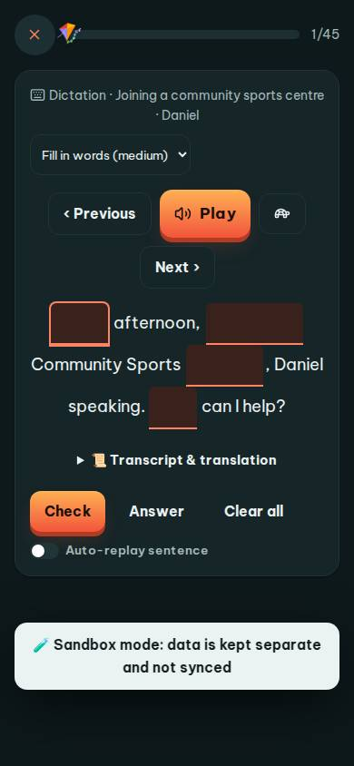
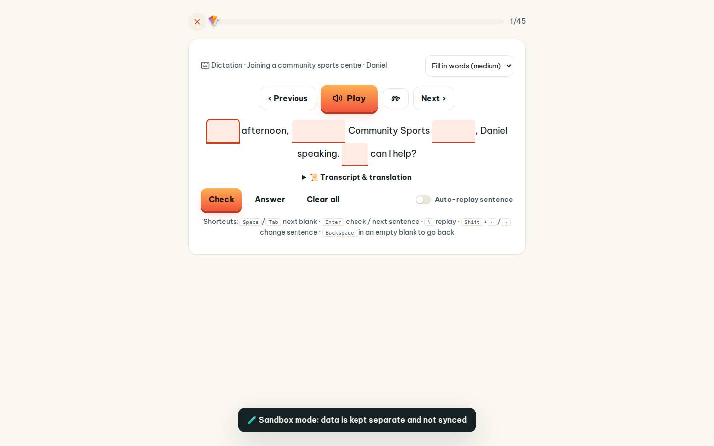
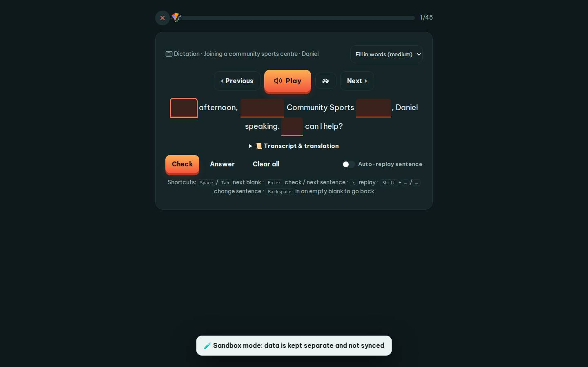

# #/dictation

Điểm: **87** · độ phủ 100 % · /dictation

- Chức năng: 100
- Lỗi JS: 100
- Rỗng/lỗi/tải: 100
- Back/Thoát: 100
- Tương phản: 100
- Chạm ≥44: 84
- Bố cục: 55
- i18n 15: 100
- Hiệu năng: 50
- Độ đẹp: 72

## Lỗi
- [tap] button#dSlow – "Play slowly" vùng chạm 52×40 < 44px
- [tap] details#dTr>summary – "📜 Transcript & translation" vùng chạm 630×23 < 44px
- [layout] button#dNext – "Next ›" rớt xuống đứng một mình ở dòng cuối của div.study-wrap>div.card.q-card>div.row.center
- [layout] select#dMode – select "Fill in words (medium)" không có nhãn nhìn thấy – người học không biết ô này để làm gì
- [layout] div.card.q-card>div.dict-line>input.dict-h – input "" không có nhãn nhìn thấy – người học không biết ô này để làm gì
- [perf] LCP 10880 ms · CLS 0 · TBT 74 ms
- [beauty] Input boxes have inconsistent, uneven widths and alignment
- [beauty] Multiple primary actions (Play, Check) compete for attention
- [beauty] Layout feels generic, lacking Duolingo's playful character integration

## Ảnh
390l 
390d 
1440l 
1440d 
