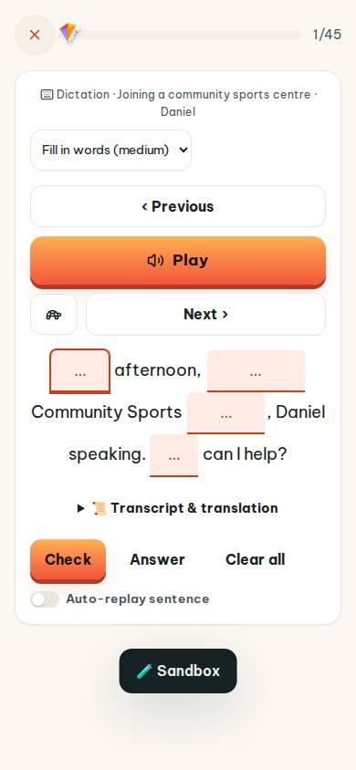
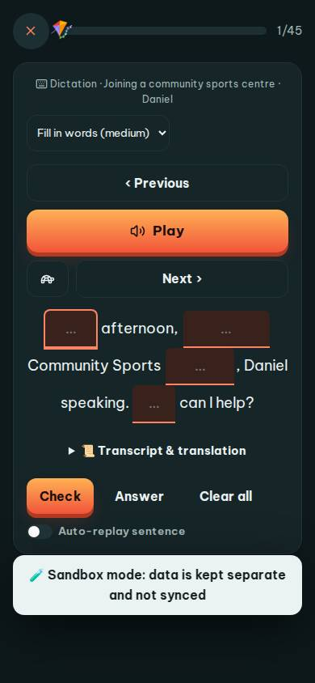
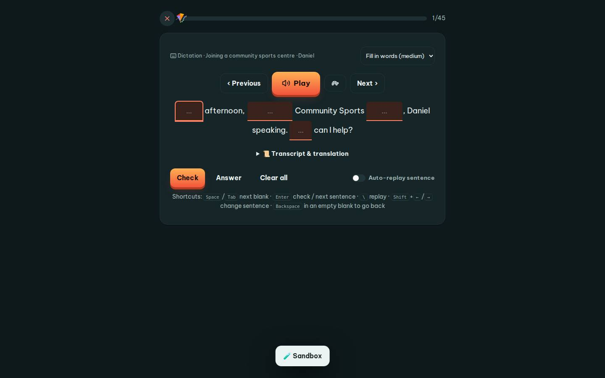

# #/dictation

Điểm: **90** · độ phủ 86 % · /dictation

- Chức năng: 100
- Lỗi JS: 100
- Rỗng/lỗi/tải: 100
- Back/Thoát: 100
- Tương phản: 100
- Chạm ≥44: 92
- Bố cục: 100
- i18n 15: 13
- Hiệu năng: 100
- Độ đẹp: ∅

## Lỗi
- [tap] button#dSlow – "Play slowly" vùng chạm 52×40 < 44px
- [i18n] ar: chữ Việt «Điền từ còn thiếu»
- [i18n] de: chữ Việt «Điền từ còn thiếu»
- [i18n] es: chữ Việt «Điền từ còn thiếu»
- [i18n] fr: chữ Việt «Điền từ còn thiếu»

## Ảnh
390l 
390d 
1440l 
1440d 
