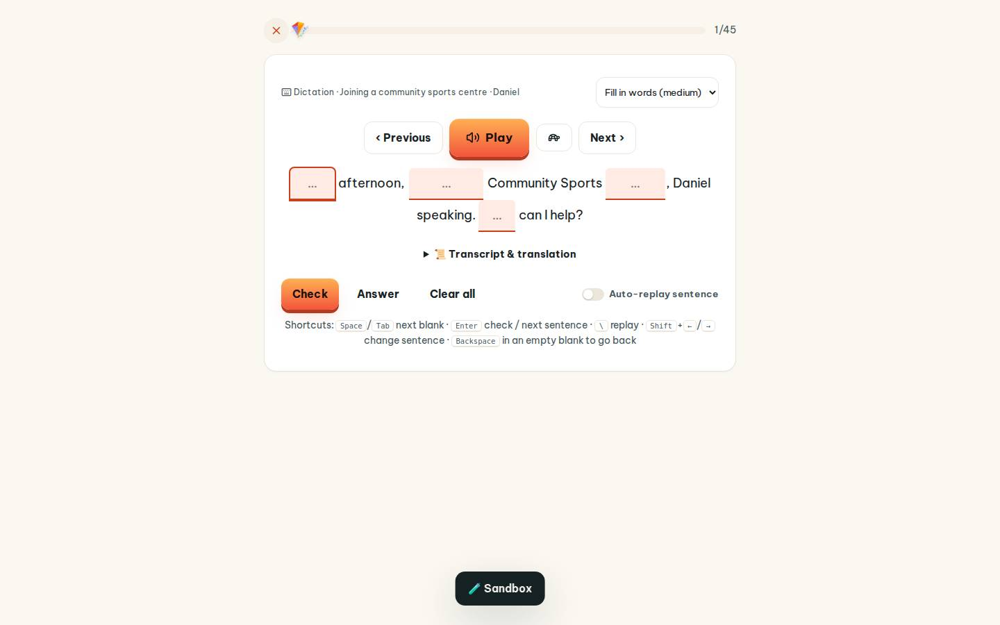

# #/dictation

Điểm: **86** · độ phủ 100 % · /dictation

- Chức năng: 100
- Lỗi JS: 100
- Rỗng/lỗi/tải: 100
- Back/Thoát: 100
- Tương phản: 100
- Chạm ≥44: 92
- Bố cục: 100
- i18n 15: 13
- Hiệu năng: 82
- Độ đẹp: 72

## Lỗi
- [tap] button#dSlow – "Play slowly" vùng chạm 52×40 < 44px
- [i18n] ar: chữ Việt «Điền từ còn thiếu»
- [i18n] de: chữ Việt «Điền từ còn thiếu»
- [i18n] es: chữ Việt «Điền từ còn thiếu»
- [i18n] fr: chữ Việt «Điền từ còn thiếu»
- [perf] LCP 3776 ms · CLS 0.0007 · TBT 147 ms
- [beauty] Generic web-style buttons and inputs lack Duolingo's playful polish
- [beauty] Fill-in blanks look like raw text fields, not integrated game elements
- [beauty] No character or illustration integration; layout feels utilitarian

## Ảnh
390l 
390d 
1440l 
1440d 
