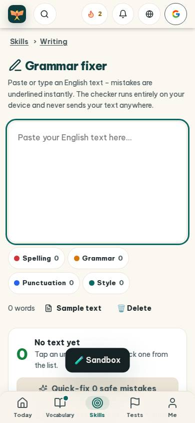
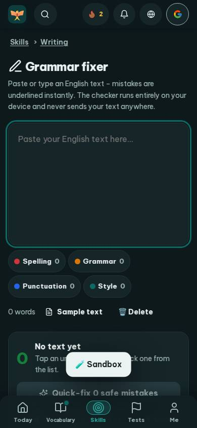
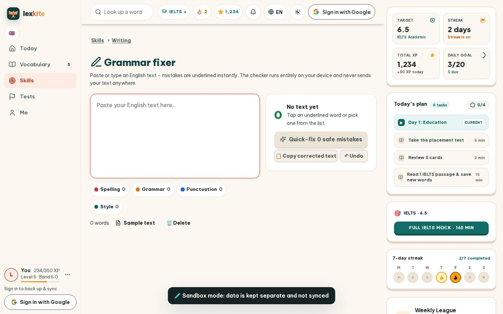
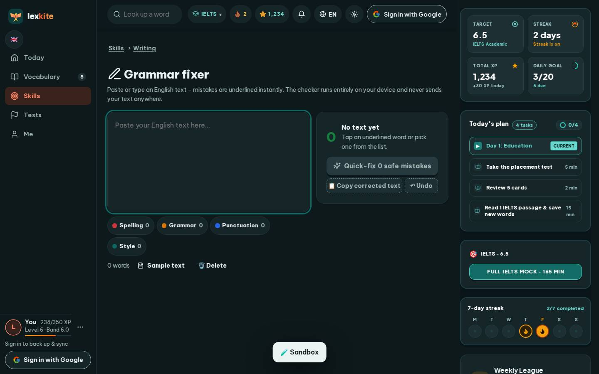

# #/fix

Điểm: **92** · độ phủ 86 % · /fix

- Chức năng: 100
- Lỗi JS: 100
- Rỗng/lỗi/tải: 100
- Back/Thoát: –
- Tương phản: 100
- Chạm ≥44: 68
- Bố cục: 85
- i18n 15: 100
- Hiệu năng: 57
- Độ đẹp: ∅

## Lỗi
- [tap] button#fxSample – "Sample text" vùng chạm 140×36 < 44px
- [tap] button#fxClear – "🗑️ Delete" vùng chạm 95×36 < 44px
- [tap] button#fxCopy – "📋 Copy corrected text" vùng chạm 181×36 < 44px
- [tap] button#fxUndo – "↶ Undo" vùng chạm 80×36 < 44px
- [layout] div#fxLg>button.fx-lg.fx-c-style – "Style 0" rớt xuống đứng một mình ở dòng cuối của div#fxLg
- [perf] LCP 5524 ms · CLS 0.0033 · TBT 49 ms

## Ảnh
390l 
390d 
1440l 
1440d 
