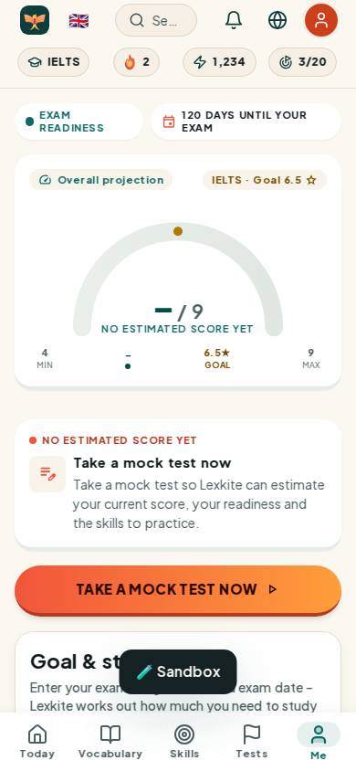
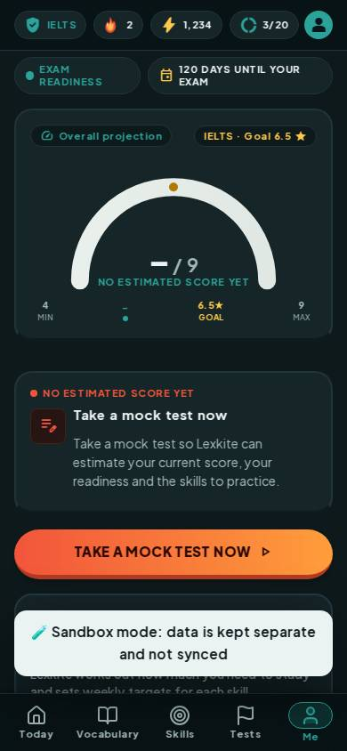
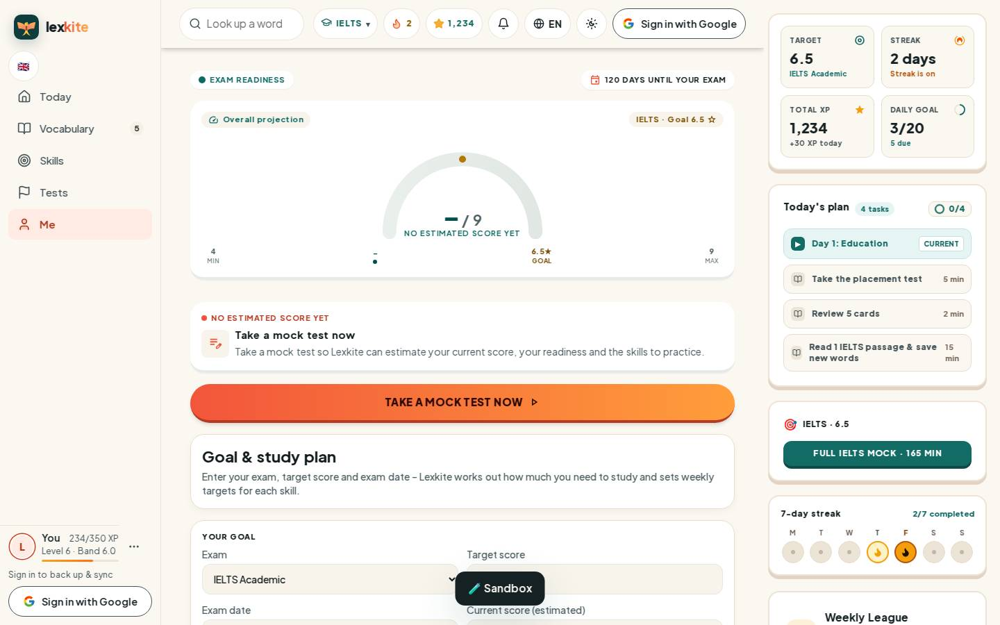

# #/goal

Điểm: **93** · độ phủ 100 % · /goal

- Chức năng: 100
- Lỗi JS: 100
- Rỗng/lỗi/tải: 100
- Back/Thoát: –
- Tương phản: 100
- Chạm ≥44: 100
- Bố cục: 100
- i18n 15: 100
- Hiệu năng: 48
- Độ đẹp: 85

## Lỗi
- [perf] LCP 8744 ms · CLS 0.0007 · TBT 260 ms
- [beauty] Dark toast notification obscures content and creates visual clutter.
- [beauty] Lacks Duolingo's signature character integration and playful illustration style.
- [beauty] Typography feels slightly generic compared to Duolingo's distinct brand voice.

## Ảnh
390l 
390d 
1440l 
1440d 
