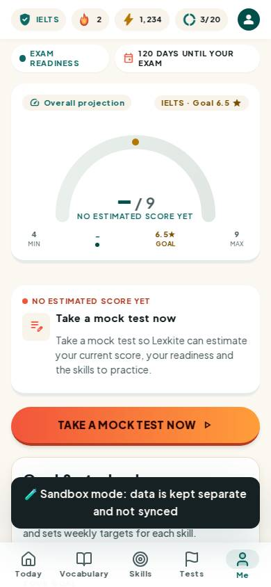
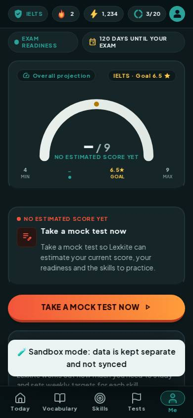
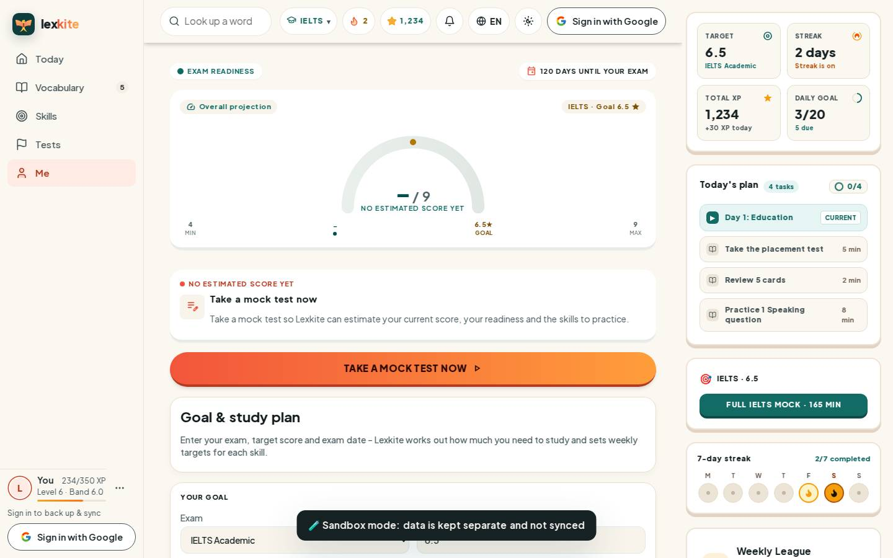
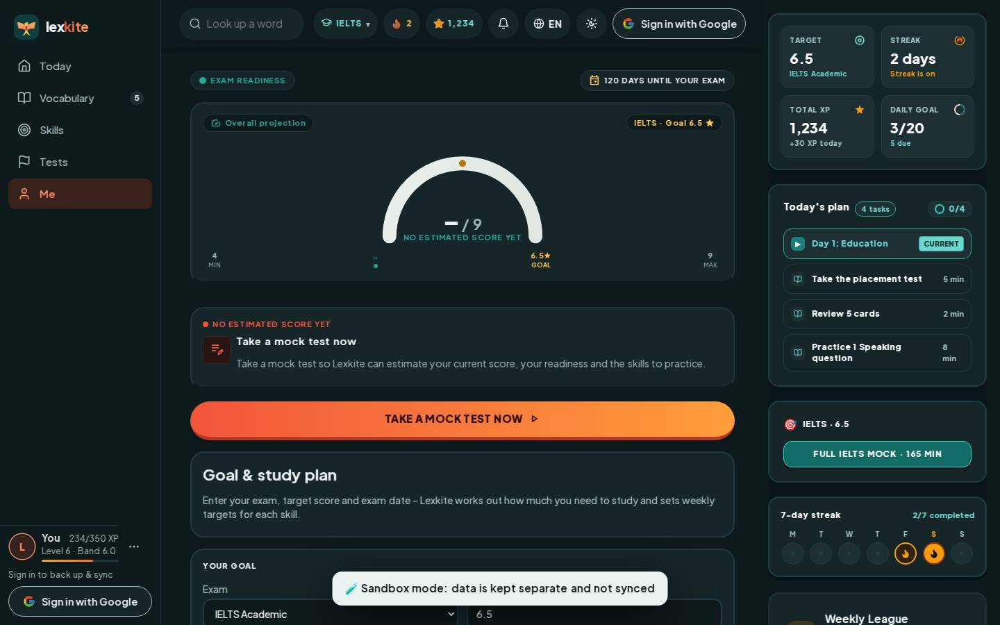

# #/goal

Điểm: **94** · độ phủ 100 % · /goal

- Chức năng: 100
- Lỗi JS: 100
- Rỗng/lỗi/tải: 100
- Back/Thoát: –
- Tương phản: 100
- Chạm ≥44: 100
- Bố cục: 100
- i18n 15: 100
- Hiệu năng: 62
- Độ đẹp: 83

## Lỗi
- [perf] LCP 5128 ms · CLS 0.0007 · TBT 187 ms
- [beauty] Dark toast notification obscures content and bottom navigation
- [beauty] Lack of character/illustration integration compared to Duolingo
- [beauty] Top status bar icons feel slightly cramped

## Ảnh
390l 
390d 
1440l 
1440d 
