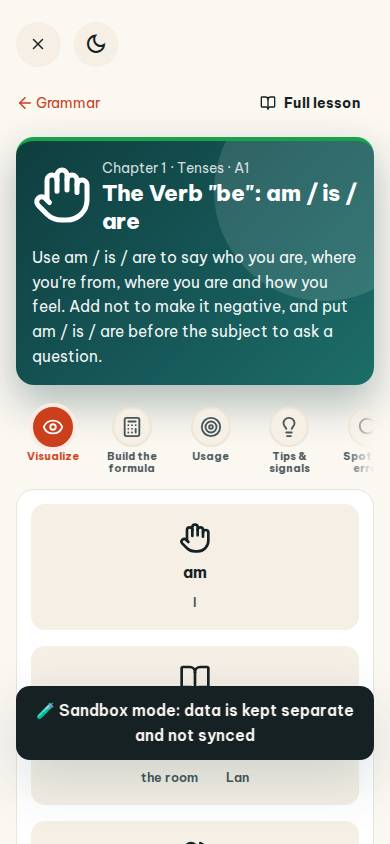
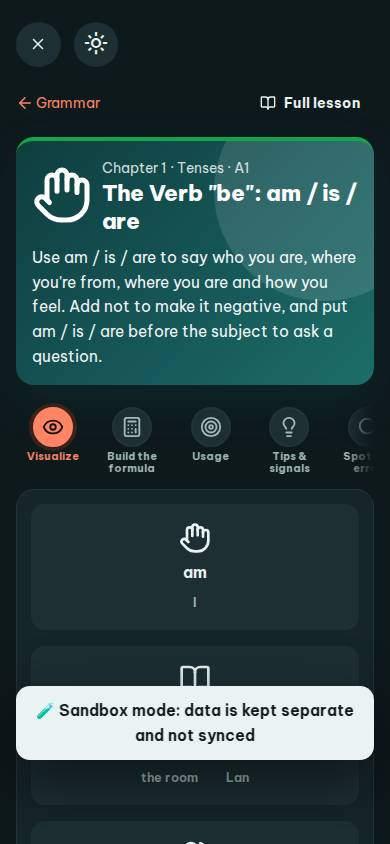
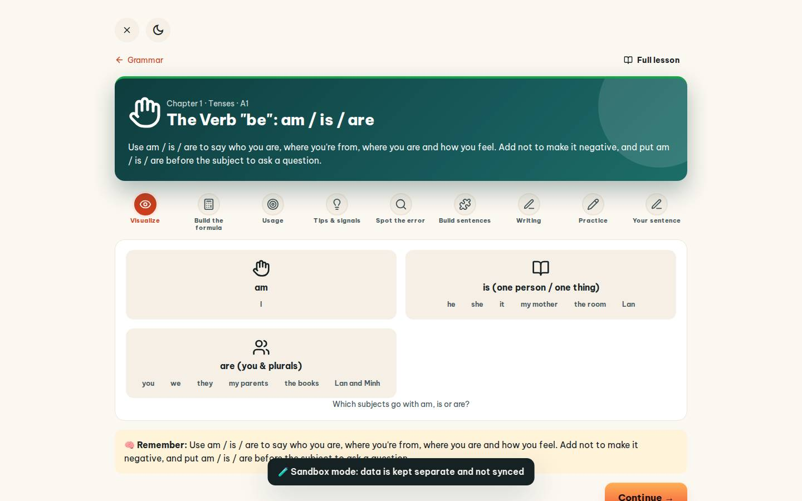
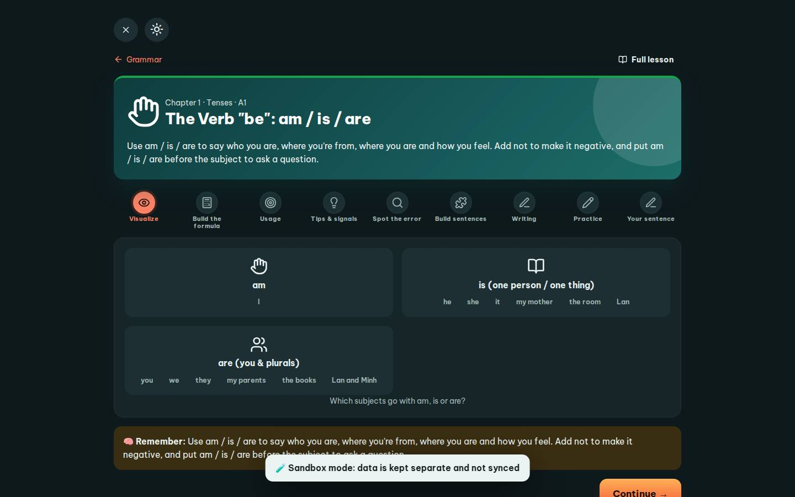

# #/grammar

Điểm: **86** · độ phủ 100 % · /grammar

- Chức năng: 100
- Lỗi JS: 100
- Rỗng/lỗi/tải: 100
- Back/Thoát: 100
- Tương phản: 100
- Chạm ≥44: 84
- Bố cục: 40
- i18n 15: 100
- Hiệu năng: 50
- Độ đẹp: 74

## Lỗi
- [tap] main#view>div.row.between>a.small – "Grammar" vùng chạm 87×22 < 44px
- [tap] main#view>div.row.between>a.btn.sm – "Full lesson" vùng chạm 127×36 < 44px
- [layout] main#view>div.card.hero-main – nội dung tràn ngang 60px bị cắt
- [layout] main#view>div.steps.fade-end – nội dung tràn ngang 346px bị cắt: "Spot the error", "div.steps.fade-end>button.stepdot>span", "span>svg.i>use
- [layout] main#view>div.steps.fade-end>button.stepdot – "Spot the error" nằm ngoài màn hình (x 331…405 / 390)
- [layout] div.sortbox>div.row.center>span.chip – nhãn "I" đứng trơ một mình cả hàng (khung 300px)
- [perf] LCP 7848 ms · CLS 0 · TBT 63 ms
- [beauty] Toast notification obscures primary content
- [beauty] Tab labels are truncated (e.g., 'Spot err')
- [beauty] Generic card styling lacks Duolingo's playful polish

## Ảnh
390l 
390d 
1440l 
1440d 
