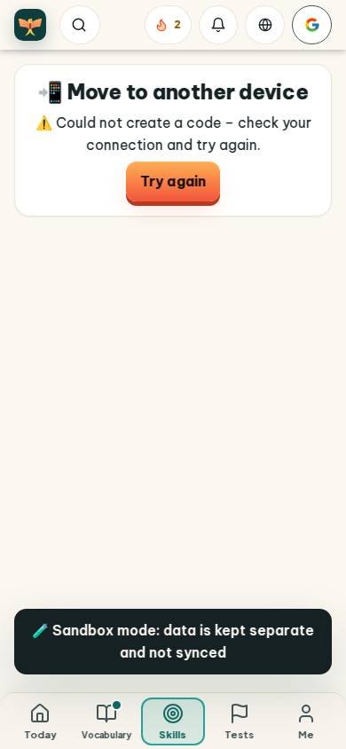
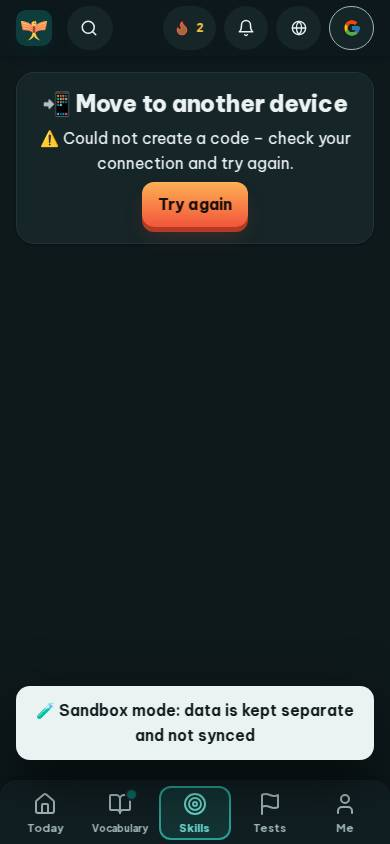
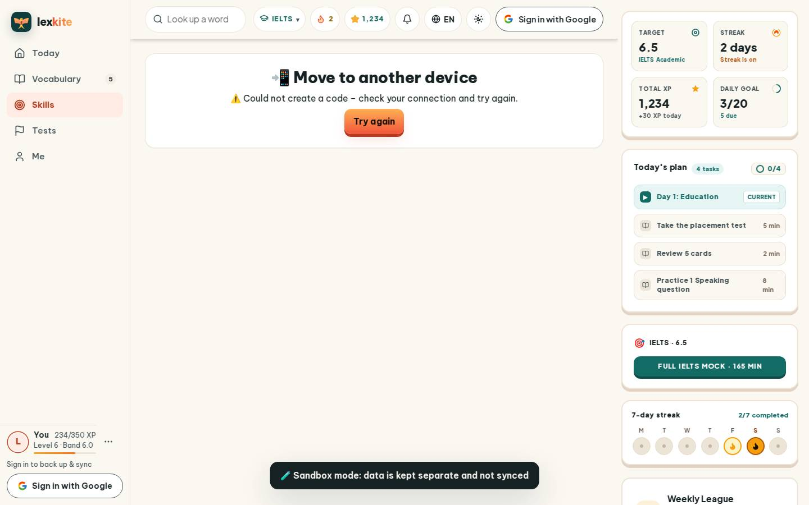
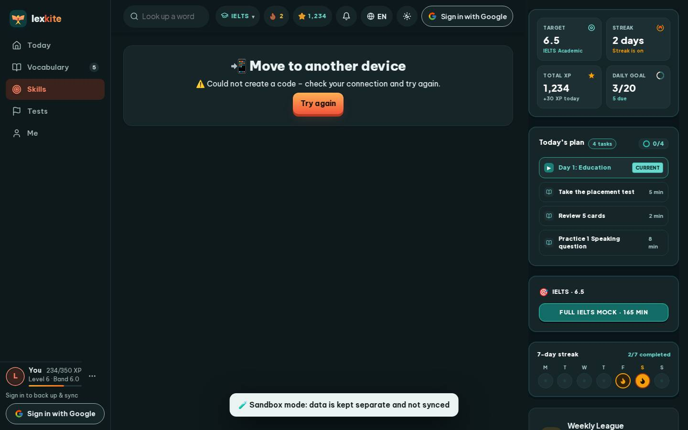

# #/handoff

Điểm: **95** · độ phủ 100 % · /handoff

- Chức năng: 100
- Lỗi JS: 100
- Rỗng/lỗi/tải: 100
- Back/Thoát: –
- Tương phản: 100
- Chạm ≥44: 100
- Bố cục: 100
- i18n 15: 100
- Hiệu năng: 78
- Độ đẹp: 77

## Lỗi
- [perf] LCP 4056 ms · CLS 0.0031 · TBT 0 ms
- [beauty] Large empty beige void dominates the screen
- [beauty] Generic emoji icons look unpolished vs Duolingo
- [beauty] No illustration or character integration

## Ảnh
390l 
390d 
1440l 
1440d 
