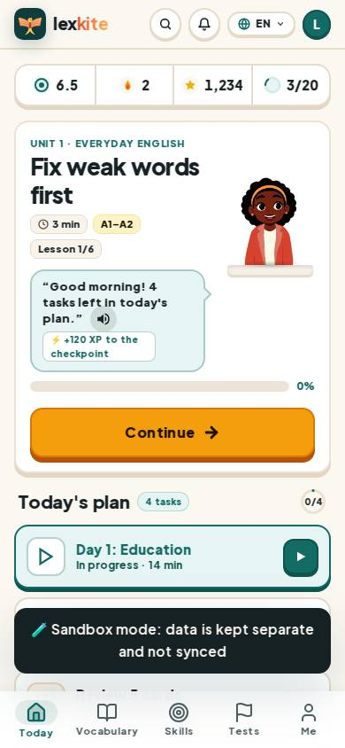
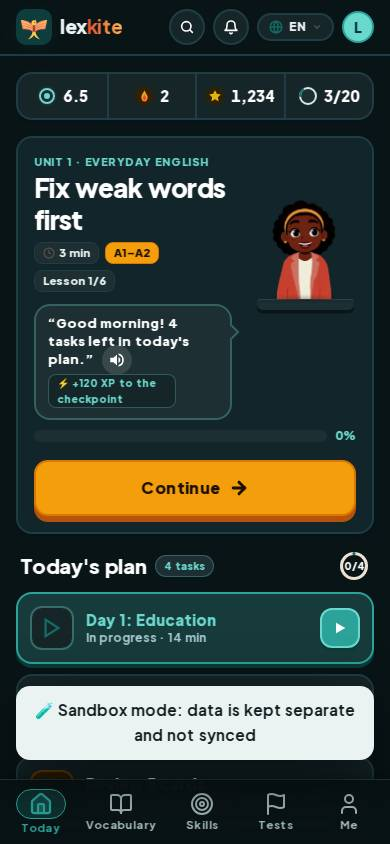
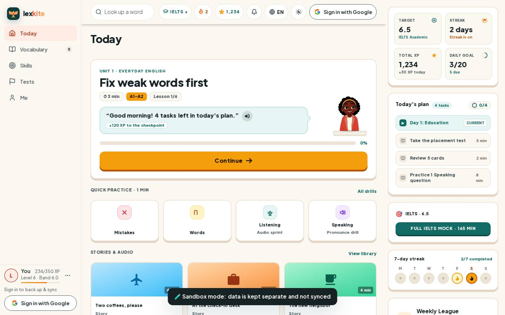
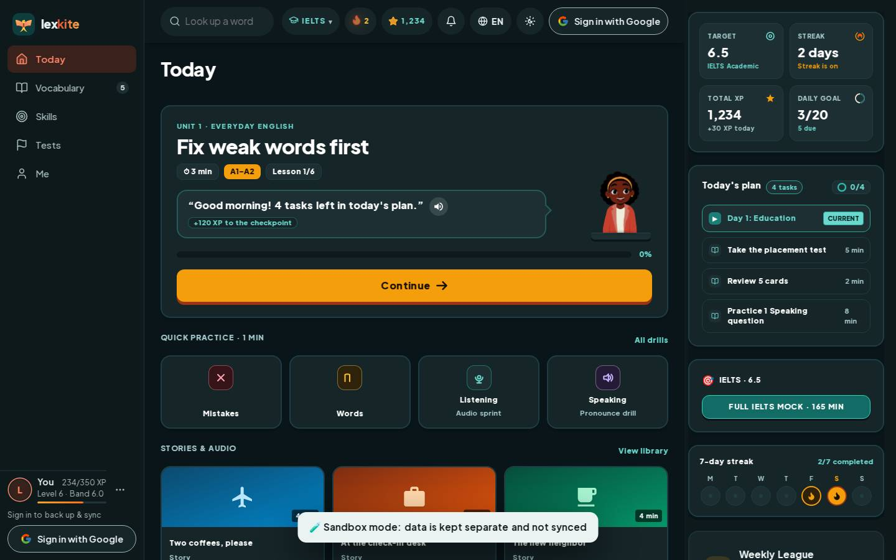

# #/home

Điểm: **90** · độ phủ 100 % · /home

- Chức năng: 100
- Lỗi JS: 100
- Rỗng/lỗi/tải: 100
- Back/Thoát: –
- Tương phản: 100
- Chạm ≥44: 100
- Bố cục: 43
- i18n 15: 100
- Hiệu năng: 75
- Độ đẹp: 84

## Lỗi
- [layout] main.w-full.min-h-screen>div.px-4.py-4>section.[border-radius:16px].p-4 – nội dung tràn ngang 12px bị cắt: "div.w-[116px].h-[156px]>span.tsl
- [layout] div#v2-pathlist>div.relative.w-full>div.absolute.start-[88px] – nội dung tràn ngang 24px bị cắt: "div.absolute.end-1>span.tslot.tslot-m>span
- [layout] span#xpPill – nội dung tràn ngang 120px bị cắt
- [layout] div.flex.items-center>div.flex.flex-col>span.truncate.text-xs – chữ bị cắt "…" (314>246px)
- [layout] div.grid.grid-cols-2>a.[border-radius:16px].p-2.5>h4.m-0.text-sm – chữ bị cắt "…" (154>150px)
- [perf] LCP 1056 ms · CLS 0.0664 · TBT 1427 ms
- [beauty] Character illustration feels pasted on rather than integrated
- [beauty] Sandbox mode banner is visually heavy and disrupts flow
- [beauty] Progress bar at 0% looks unfinished

## Ảnh
390l 
390d 
1440l 
1440d 
