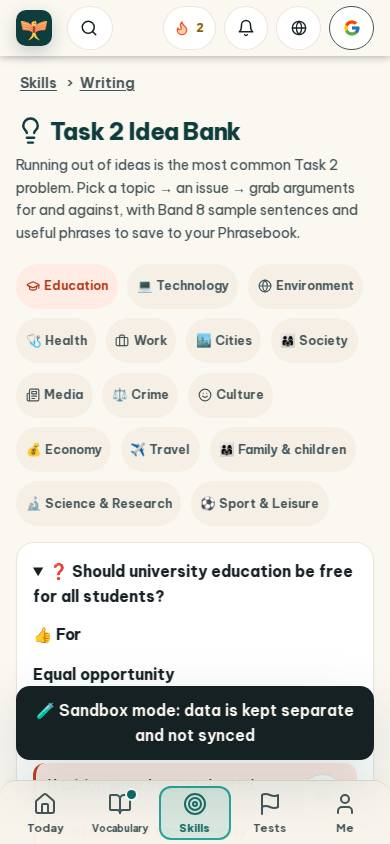
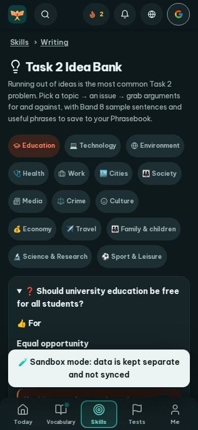
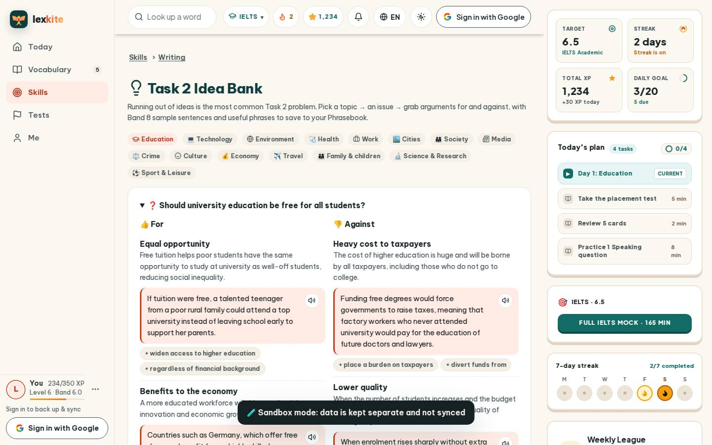
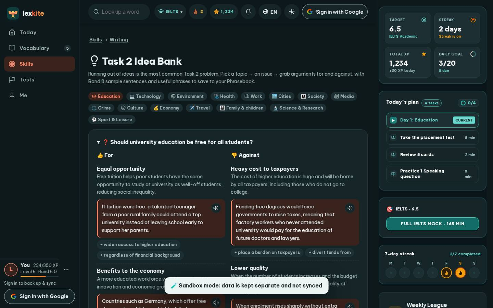

# #/ideas

Điểm: **88** · độ phủ 100 % · /ideas

- Chức năng: 100
- Lỗi JS: 100
- Rỗng/lỗi/tải: 100
- Back/Thoát: –
- Tương phản: 90
- Chạm ≥44: 68
- Bố cục: 85
- i18n 15: 100
- Hiệu năng: 50
- Độ đẹp: 77

## Lỗi
- [contrast] a[data-ext-cta="rail"]
- [tap] main#view>div.row>a.chip.lv – "Education" vùng chạm 102×24 < 44px
- [tap] main#view>div.row>a.chip – "💻 Technology" vùng chạm 111×24 < 44px
- [tap] div.stack>details.card.idea>summary – "❓ Should university education be free fo" vùng chạm 767×25 < 44px
- [tap] div.idea-it>div.row>button.chip.idea-ch – "+ widen access to higher education" vùng chạm 244×26 < 44px
- [layout] main#view>div.row>a.chip – "⚽ Sport & Leisure" rớt xuống đứng một mình ở dòng cuối của main#view>div.row
- [perf] LCP 7140 ms · CLS 0.0031 · TBT 167 ms
- [beauty] Dark toast banner obscures content and breaks visual flow
- [beauty] Emoji icons feel less polished than custom Duolingo-style assets
- [beauty] No clear primary CTA; topic chips compete for attention

## Ảnh
390l 
390d 
1440l 
1440d 
