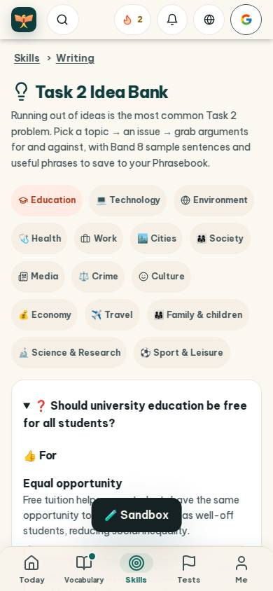
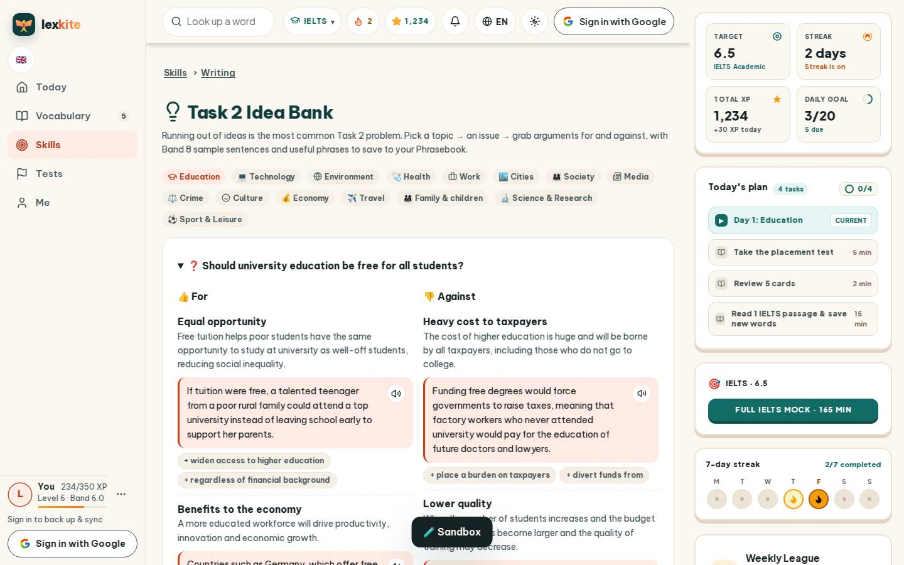
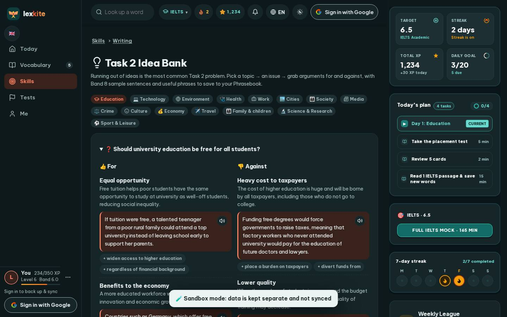

# #/ideas

Điểm: **91** · độ phủ 86 % · /ideas

- Chức năng: 100
- Lỗi JS: 100
- Rỗng/lỗi/tải: 100
- Back/Thoát: –
- Tương phản: 100
- Chạm ≥44: 76
- Bố cục: 85
- i18n 15: 100
- Hiệu năng: 50
- Độ đẹp: ∅

## Lỗi
- [tap] main#view>div.row>a.chip.lv – "Education" vùng chạm 102×24 < 44px
- [tap] main#view>div.row>a.chip – "💻 Technology" vùng chạm 111×24 < 44px
- [tap] div.idea-it>div.row>button.chip.idea-ch – "+ widen access to higher education" vùng chạm 244×26 < 44px
- [layout] main#view>div.row>a.chip – "⚽ Sport & Leisure" rớt xuống đứng một mình ở dòng cuối của main#view>div.row
- [perf] LCP 7332 ms · CLS 0.0033 · TBT 37 ms

## Ảnh
390l 
390d 
1440l 
1440d 
