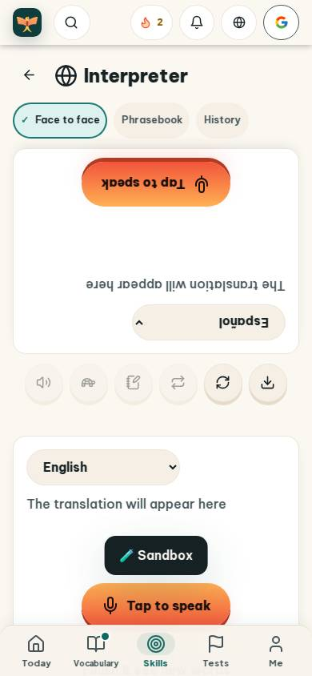
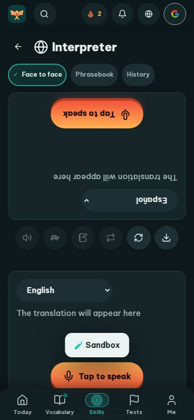
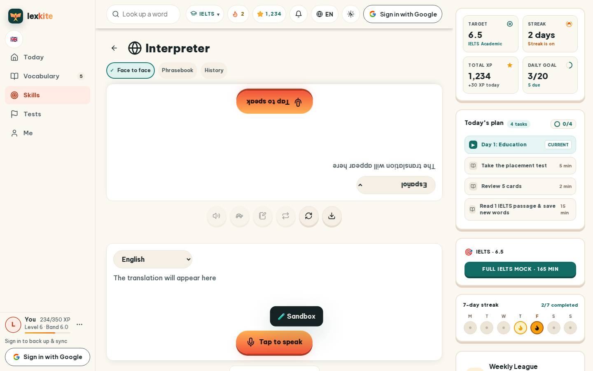
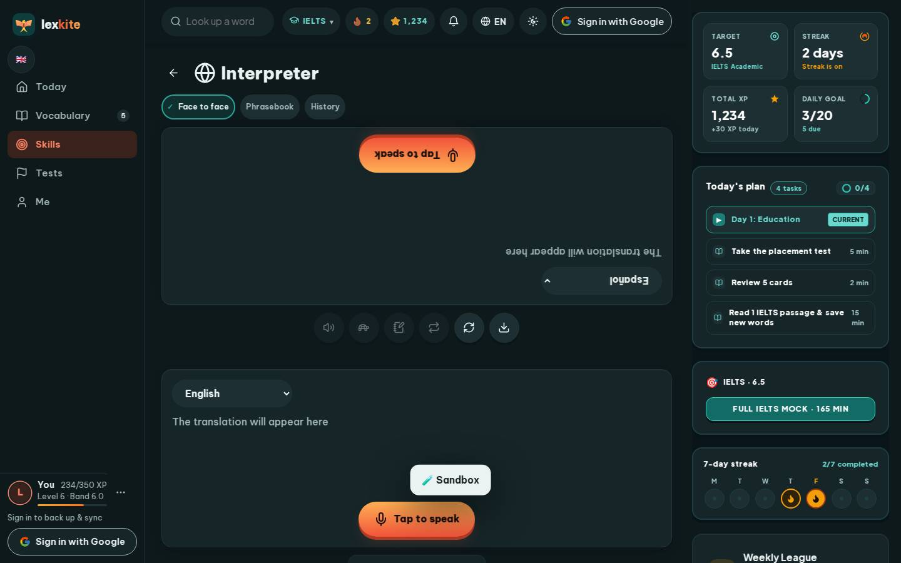

# #/interpret

Điểm: **92** · độ phủ 86 % · /interpret

- Chức năng: 100
- Lỗi JS: 100
- Rỗng/lỗi/tải: 100
- Back/Thoát: –
- Tương phản: 100
- Chạm ≥44: 92
- Bố cục: 70
- i18n 15: 100
- Hiệu năng: 62
- Độ đẹp: ∅

## Lỗi
- [tap] div.ip>nav.ip-tabs>a.chip – "Face to face" vùng chạm 118×40 < 44px
- [layout] section.ip-half.ip-b>div.ip-hd>select.ip-lang – select "Español" không có nhãn nhìn thấy – người học không biết ô này để làm gì
- [layout] section.ip-half.ip-a>div.ip-hd>select.ip-lang – select "English" không có nhãn nhìn thấy – người học không biết ô này để làm gì
- [perf] LCP 5180 ms · CLS 0.0035 · TBT 36 ms

## Ảnh
390l 
390d 
1440l 
1440d 
