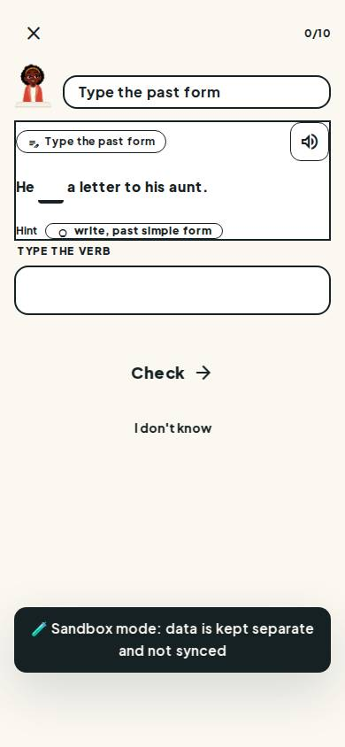
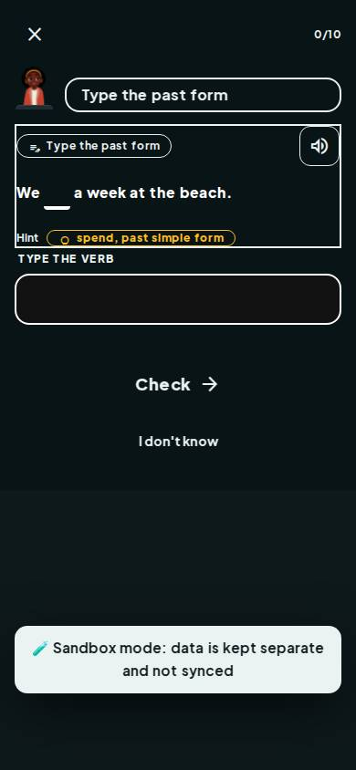
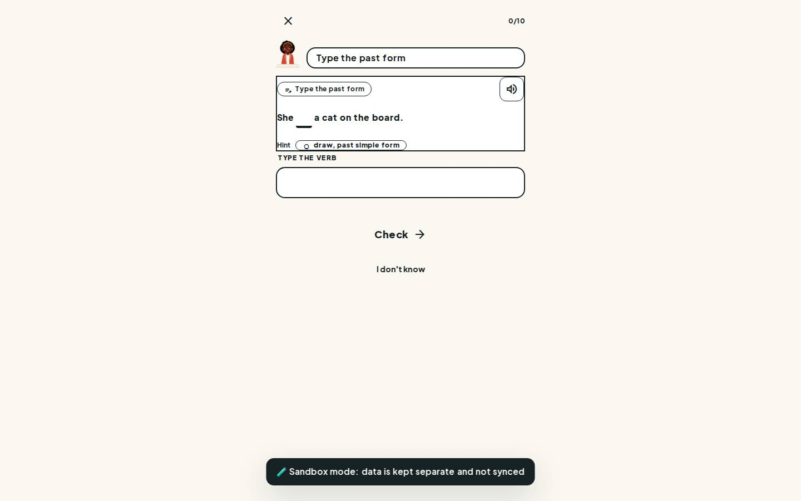
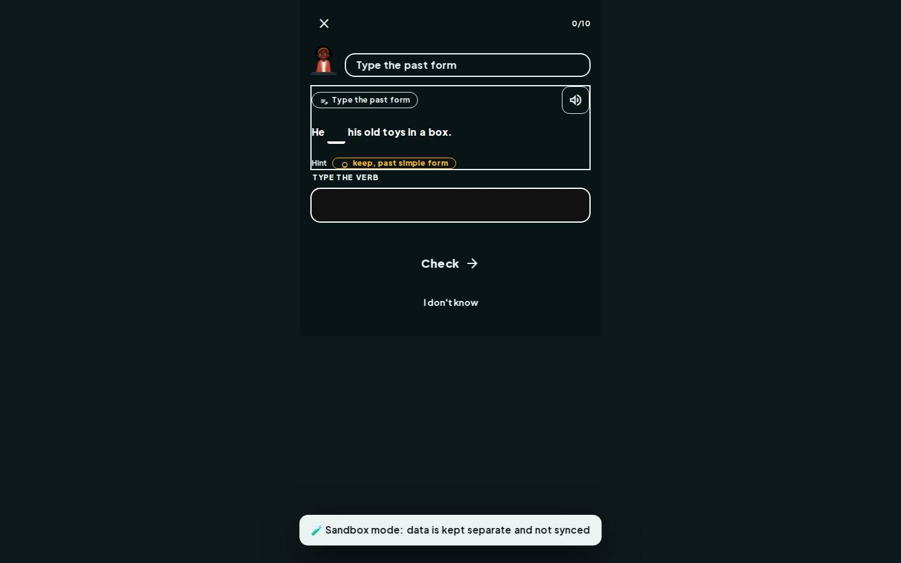

# #/irregular

Điểm: **93** · độ phủ 100 % · /irregular/practice

- Chức năng: 100
- Lỗi JS: 100
- Rỗng/lỗi/tải: 100
- Back/Thoát: 100
- Tương phản: 100
- Chạm ≥44: 100
- Bố cục: 85
- i18n 15: 100
- Hiệu năng: 85
- Độ đẹp: 65

## Lỗi
- [layout] div#irvTch – nội dung tràn ngang 12px bị cắt: "div#irvTch>span.tslot.tslot-xs>span.tslot-fig", "span.tslot.tslot-xs>span.tslot-fig>img.tslot
- [perf] LCP 3568 ms · CLS 0.0007 · TBT 135 ms
- [beauty] Sandbox mode toast banner is intrusive and breaks immersion
- [beauty] Character avatar is small and poorly integrated
- [beauty] Excessive empty space between input and action buttons

## Ảnh
390l 
390d 
1440l 
1440d 
