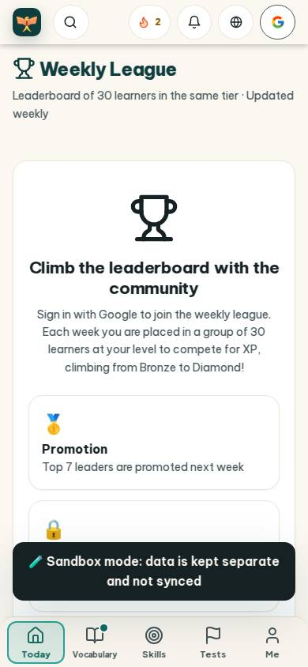
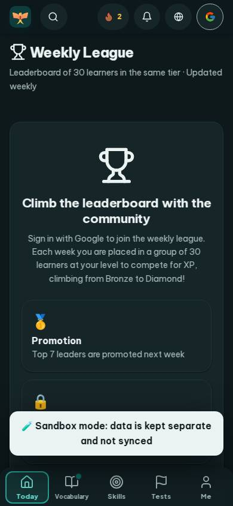
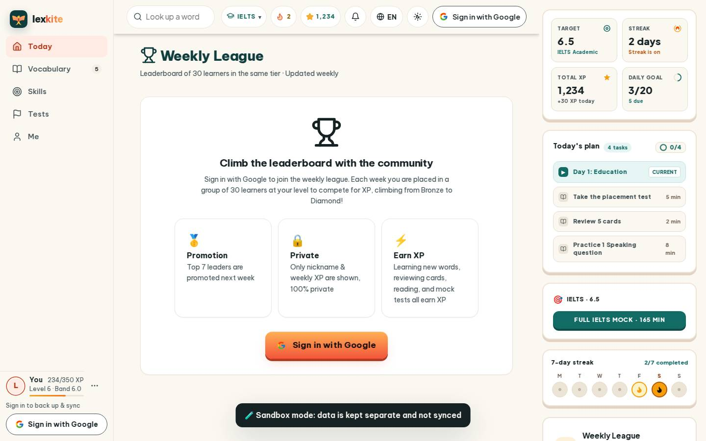
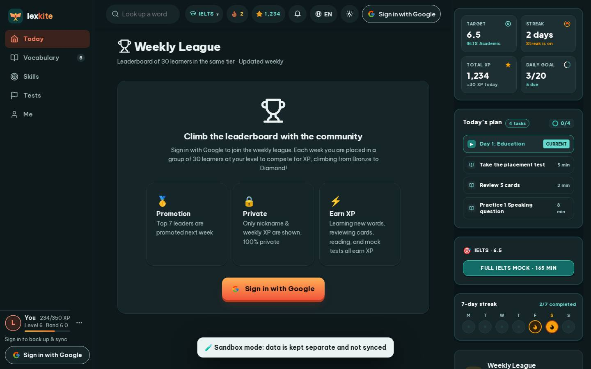

# #/league

Điểm: **93** · độ phủ 100 % · /league

- Chức năng: 100
- Lỗi JS: 100
- Rỗng/lỗi/tải: 100
- Back/Thoát: –
- Tương phản: 100
- Chạm ≥44: 100
- Bố cục: 100
- i18n 15: 100
- Hiệu năng: 63
- Độ đẹp: 75

## Lỗi
- [perf] LCP 5068 ms · CLS 0.0031 · TBT 0 ms
- [beauty] Generic flat icons lack Duolingo's playful character integration
- [beauty] Dark toast banner obscures content and breaks visual flow
- [beauty] Top nav bar feels cluttered with mixed icon styles

## Ảnh
390l 
390d 
1440l 
1440d 
