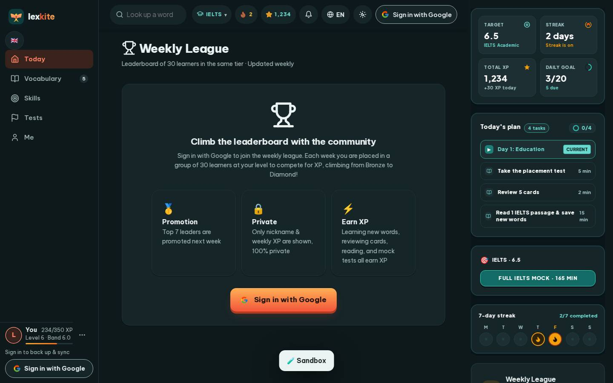

# #/league

Điểm: **92** · độ phủ 100 % · /league

- Chức năng: 100
- Lỗi JS: 100
- Rỗng/lỗi/tải: 100
- Back/Thoát: –
- Tương phản: 100
- Chạm ≥44: 100
- Bố cục: 100
- i18n 15: 100
- Hiệu năng: 58
- Độ đẹp: 75

## Lỗi
- [perf] LCP 5424 ms · CLS 0.004 · TBT 94 ms
- [beauty] Generic flat icons lack Duolingo's playful character integration
- [beauty] Dark toast banner obscures content, creating visual clutter
- [beauty] Plain white cards feel generic and lack polish

## Ảnh
390l 
390d 
1440l 
1440d 
