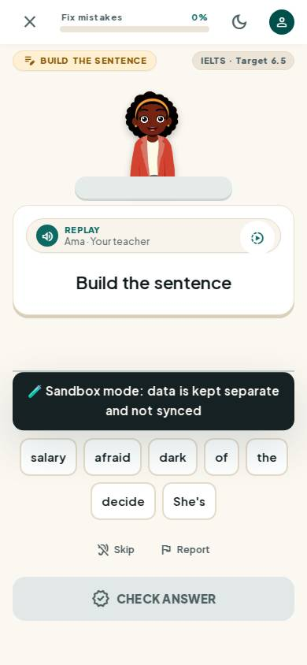
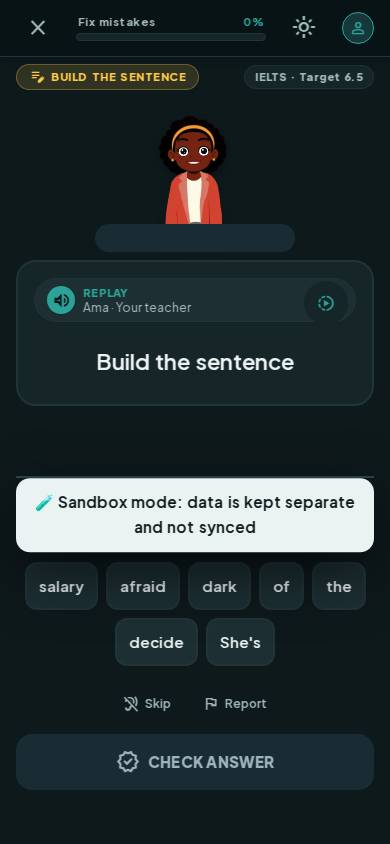
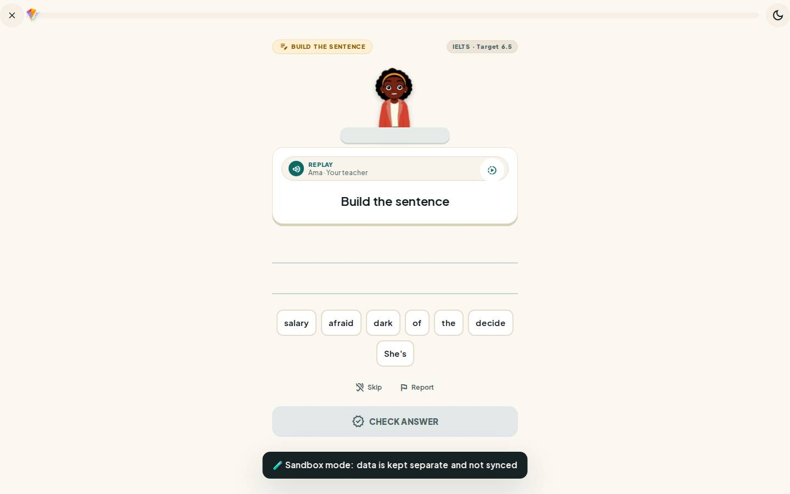
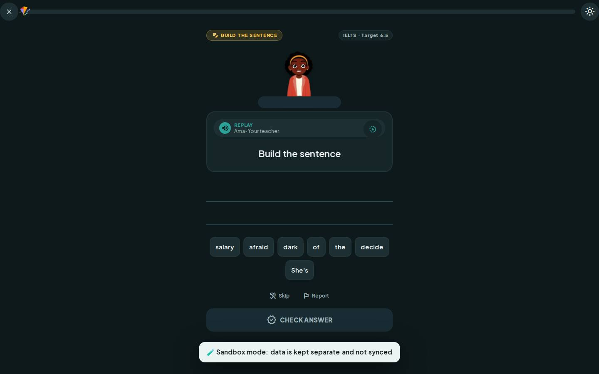

# #/lesson

Điểm: **93** · độ phủ 100 % · /lesson/go?demo=1

- Chức năng: 100
- Lỗi JS: 100
- Rỗng/lỗi/tải: 100
- Back/Thoát: 100
- Tương phản: 100
- Chạm ≥44: 100
- Bố cục: 85
- i18n 15: 100
- Hiệu năng: 70
- Độ đẹp: 79

## Lỗi
- [layout] div#lsnBank>button.lsn-tile.min-h-[44px] – "She's" rớt xuống đứng một mình ở dòng cuối của div#lsnBank
- [perf] LCP 3916 ms · CLS 0.0007 · TBT 514 ms
- [beauty] Dark 'Sandbox mode' banner looks like a raw debug overlay, breaking immersion.
- [beauty] Primary 'Check Answer' button is greyed out, weakening the call to action.
- [beauty] Character illustration feels slightly pasted on rather than integrated into the scene.

## Ảnh
390l 
390d 
1440l 
1440d 
