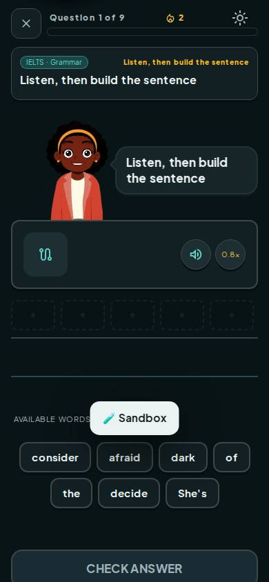
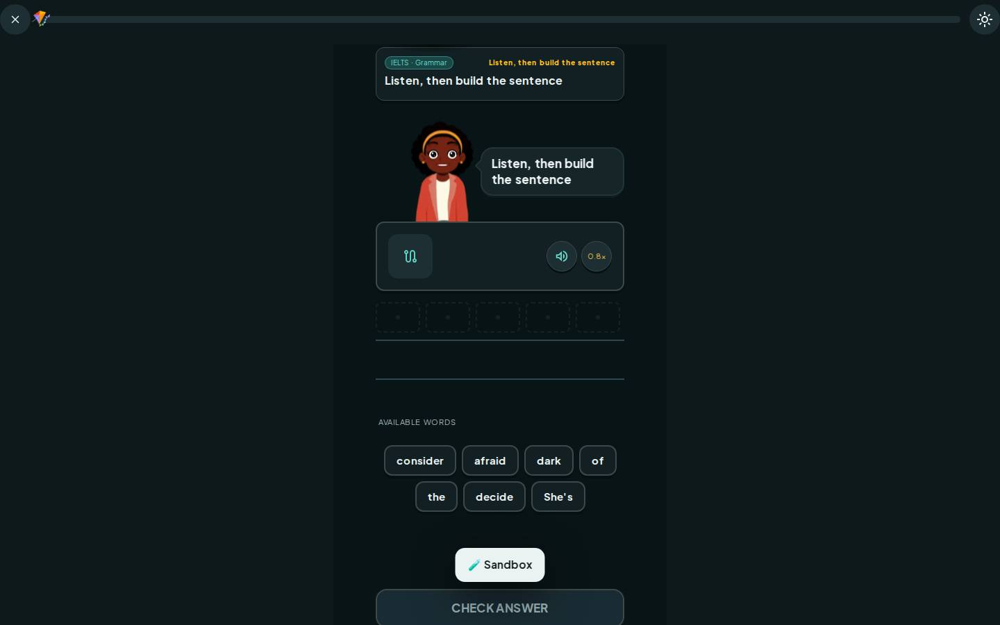

# #/lesson

Điểm: **86** · độ phủ 100 % · /lesson/go?demo=1

- Chức năng: 100
- Lỗi JS: 100
- Rỗng/lỗi/tải: 100
- Back/Thoát: 100
- Tương phản: 100
- Chạm ≥44: 100
- Bố cục: 85
- i18n 15: 13
- Hiệu năng: 79
- Độ đẹp: 81

## Lỗi
- [layout] div#lsnBank>button.lsn-tile.min-h-[44px] – "afraid" rớt xuống đứng một mình ở dòng cuối của div#lsnBank
- [i18n] ar: chữ Việt «Nghe rồi xếp thành câu»
- [i18n] de: chữ Việt «Nghe rồi xếp thành câu»
- [i18n] es: chữ Việt «Nghe rồi xếp thành câu»
- [i18n] fr: chữ Việt «Nghe rồi xếp thành câu»
- [perf] LCP 3668 ms · CLS 0.0007 · TBT 335 ms
- [beauty] Dark 'Sandbox mode' banner looks like a raw debug overlay, breaking immersion.
- [beauty] Primary 'CHECK ANSWER' button is greyed out, weakening the visual hierarchy.
- [beauty] Word tiles have uneven widths, disrupting the spacing rhythm.

## Ảnh
390l 
390d 
1440l 
1440d 
