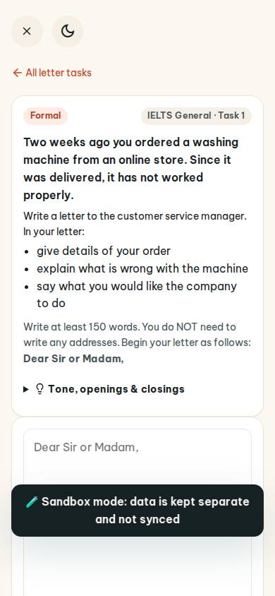
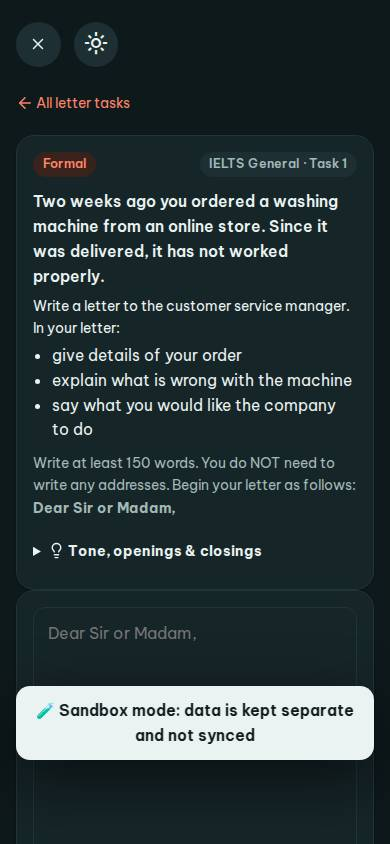
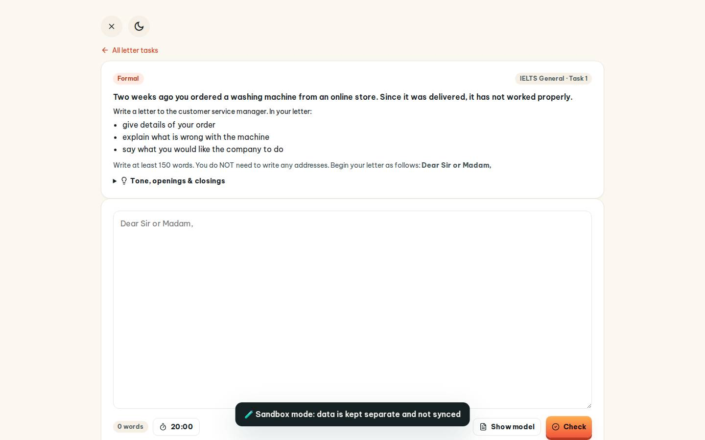
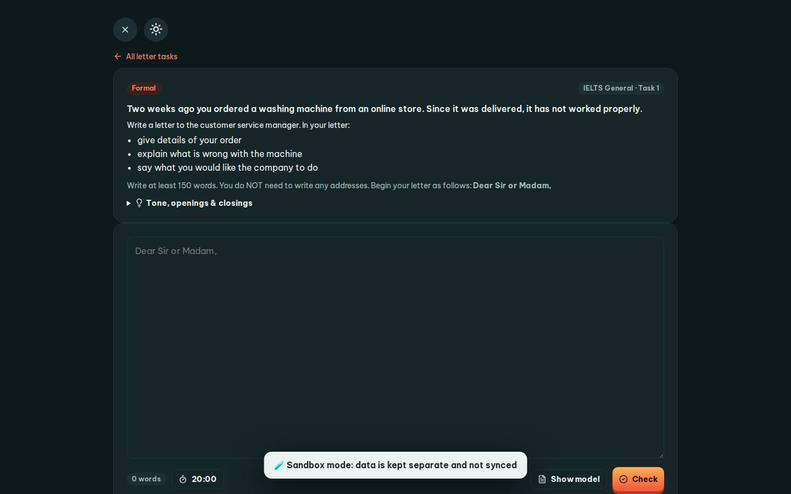

# #/letters

Điểm: **90** · độ phủ 100 % · /letters

- Chức năng: 100
- Lỗi JS: 100
- Rỗng/lỗi/tải: 100
- Back/Thoát: 100
- Tương phản: 100
- Chạm ≥44: 68
- Bố cục: 100
- i18n 15: 100
- Hiệu năng: 50
- Độ đẹp: 72

## Lỗi
- [tap] main#view>a.small – "All letter tasks" vùng chạm 117×18 < 44px
- [tap] div.card>details>summary.small – "Tone, openings & closings" vùng chạm 979×22 < 44px
- [tap] button#ltTimer – "20:00" vùng chạm 96×36 < 44px
- [tap] div.row.between>div.row>a.btn.sm – "Show model" vùng chạm 139×36 < 44px
- [perf] LCP 7280 ms · CLS 0 · TBT 82 ms
- [beauty] Lacks Duolingo's playful character/illustration integration
- [beauty] Dark toast banner feels heavy and intrusive
- [beauty] Generic card styling, low visual distinctiveness

## Ảnh
390l 
390d 
1440l 
1440d 
