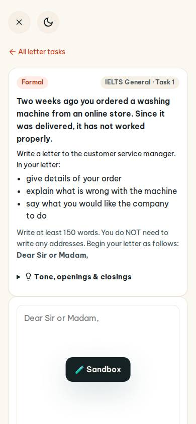
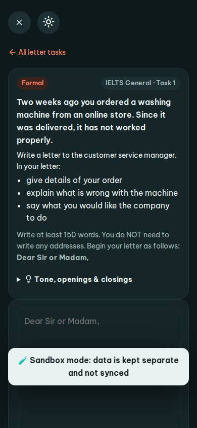
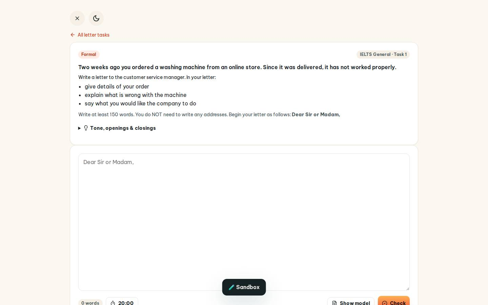
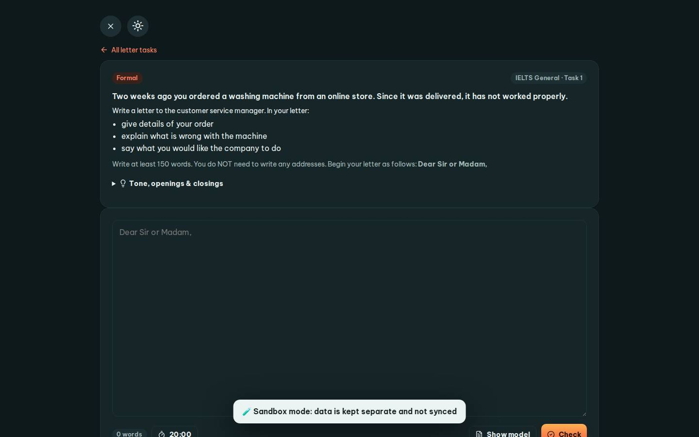

# #/letters

Điểm: **94** · độ phủ 100 % · /letters

- Chức năng: 100
- Lỗi JS: 100
- Rỗng/lỗi/tải: 100
- Back/Thoát: 100
- Tương phản: 100
- Chạm ≥44: 84
- Bố cục: 100
- i18n 15: 100
- Hiệu năng: 84
- Độ đẹp: 72

## Lỗi
- [tap] button#ltTimer – "20:00" vùng chạm 96×36 < 44px
- [tap] div.row.between>div.row>a.btn.sm – "Show model" vùng chạm 139×36 < 44px
- [perf] LCP 3608 ms · CLS 0.0007 · TBT 38 ms
- [beauty] Lacks Duolingo's vibrant brand colors and character illustrations
- [beauty] Dark toast notification obscures the primary input area
- [beauty] Generic UI feels utilitarian rather than engaging or gamified

## Ảnh
390l 
390d 
1440l 
1440d 
