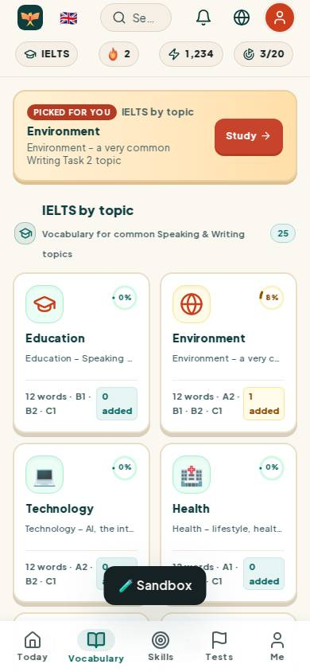
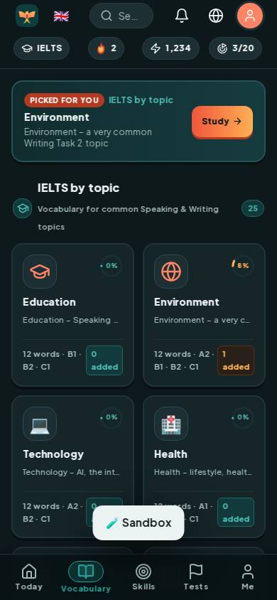
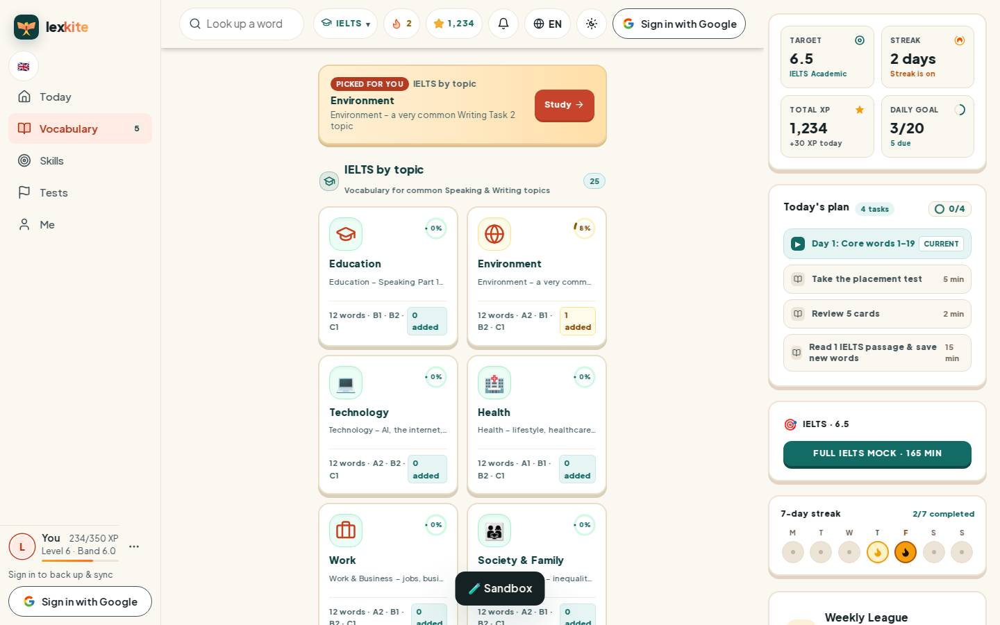
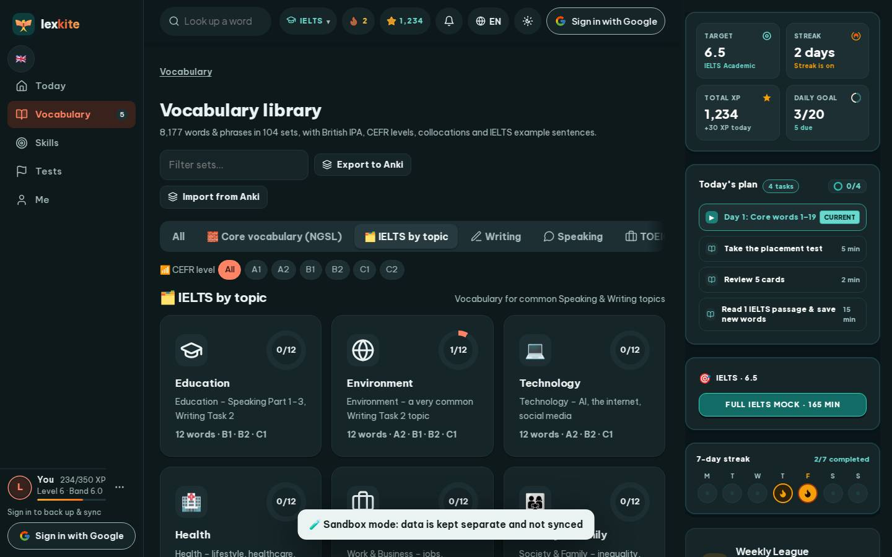

# #/library

Điểm: **93** · độ phủ 86 % · /library

- Chức năng: 100
- Lỗi JS: 100
- Rỗng/lỗi/tải: 100
- Back/Thoát: –
- Tương phản: 100
- Chạm ≥44: 100
- Bố cục: 92
- i18n 15: 100
- Hiệu năng: 45
- Độ đẹp: ∅

## Lỗi
- [layout] button.hb-s>span>em – chữ bị cắt "…" (100>34px)
- [layout] a.tactile-card.group>div>p.text-[11px].font-medium – chữ bị cắt "…" (256>141px)
- [perf] LCP 9508 ms · CLS 0.0001 · TBT 376 ms

## Ảnh
390l 
390d 
1440l 
1440d 
