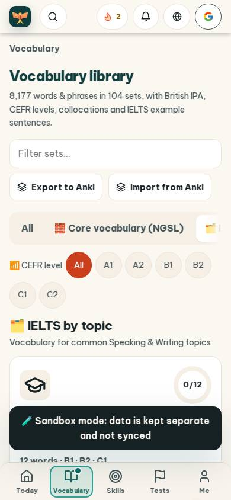
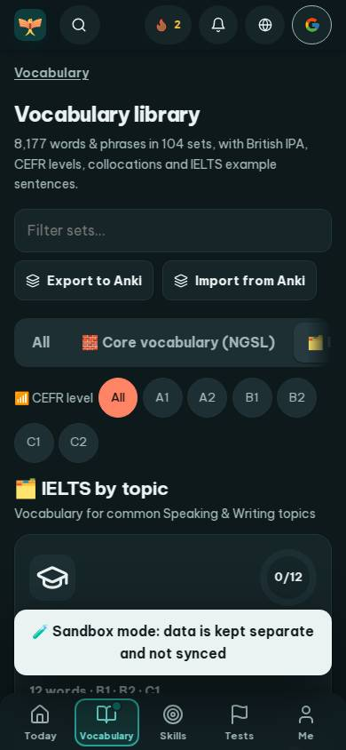
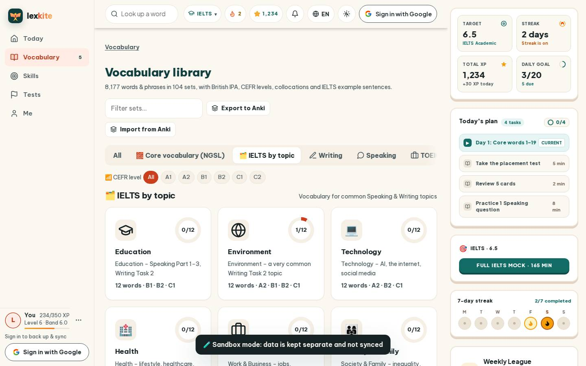
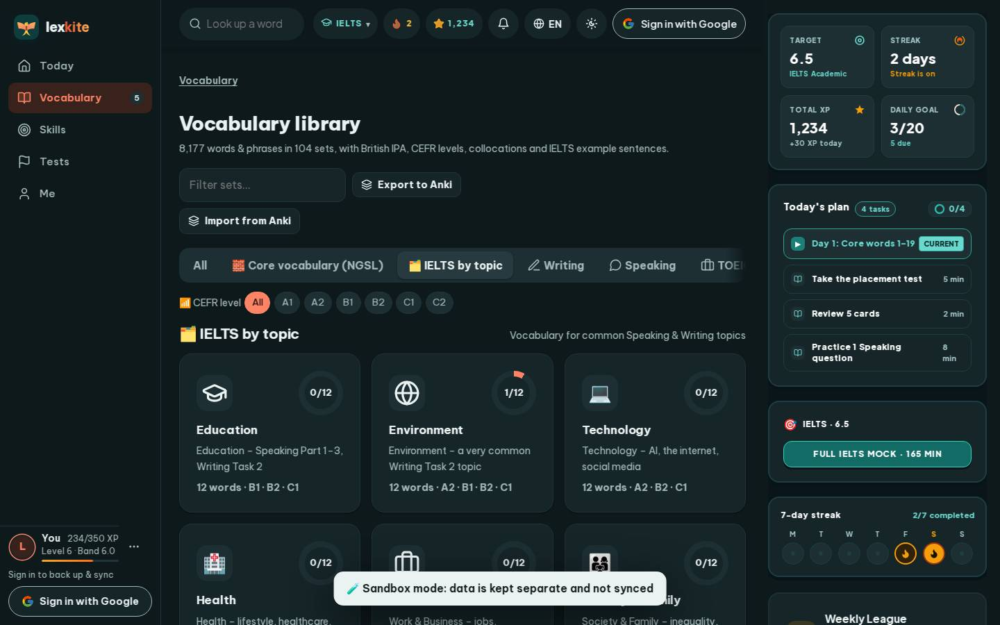

# #/library

Điểm: **81** · độ phủ 100 % · /library

- Chức năng: 100
- Lỗi JS: 100
- Rỗng/lỗi/tải: 100
- Back/Thoát: –
- Tương phản: 90
- Chạm ≥44: 68
- Bố cục: 100
- i18n 15: 13
- Hiệu năng: 50
- Độ đẹp: 75

## Lỗi
- [contrast] a[data-ext-cta="rail"]
- [tap] button#libAnkiOut – "Export to Anki" vùng chạm 157×36 < 44px
- [tap] button#libAnkiIn – "Import from Anki" vùng chạm 174×36 < 44px
- [tap] div#libTabs>button – "All" vùng chạm 50×41 < 44px
- [tap] main#view>div.lv-filter>button.chip – "All" vùng chạm 37×32 < 44px
- [i18n] ar: thiếu dịch «Writing» · thiếu dịch «Speaking»
- [i18n] de: thiếu dịch «Writing» · thiếu dịch «Speaking»
- [i18n] es: thiếu dịch «Writing» · thiếu dịch «Speaking»
- [i18n] fr: thiếu dịch «Writing» · thiếu dịch «Speaking»
- [perf] LCP 9972 ms · CLS 0.0031 · TBT 69 ms
- [beauty] Dark toast banner obscures content and breaks visual flow
- [beauty] Generic icons and flat cards lack Duolingo's playful polish
- [beauty] Uneven spacing between filter chips and section headers

## Ảnh
390l 
390d 
1440l 
1440d 
