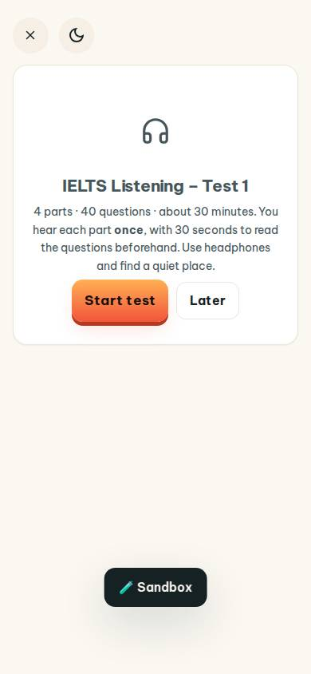
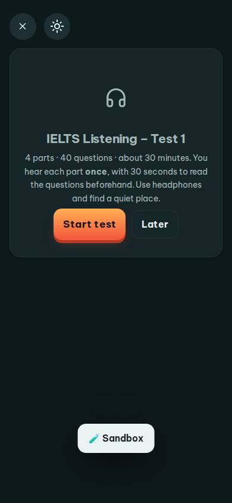
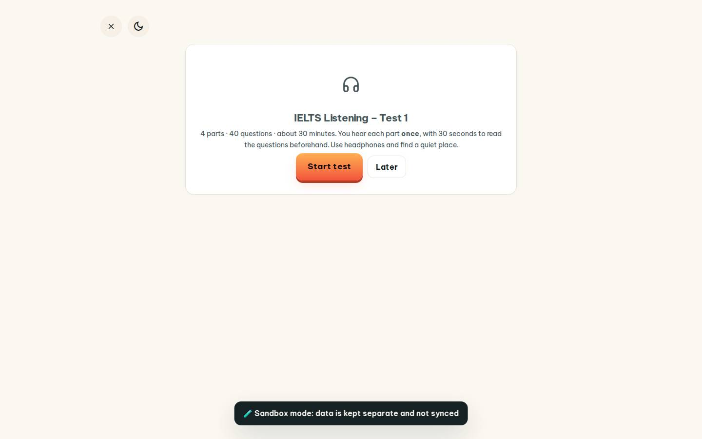
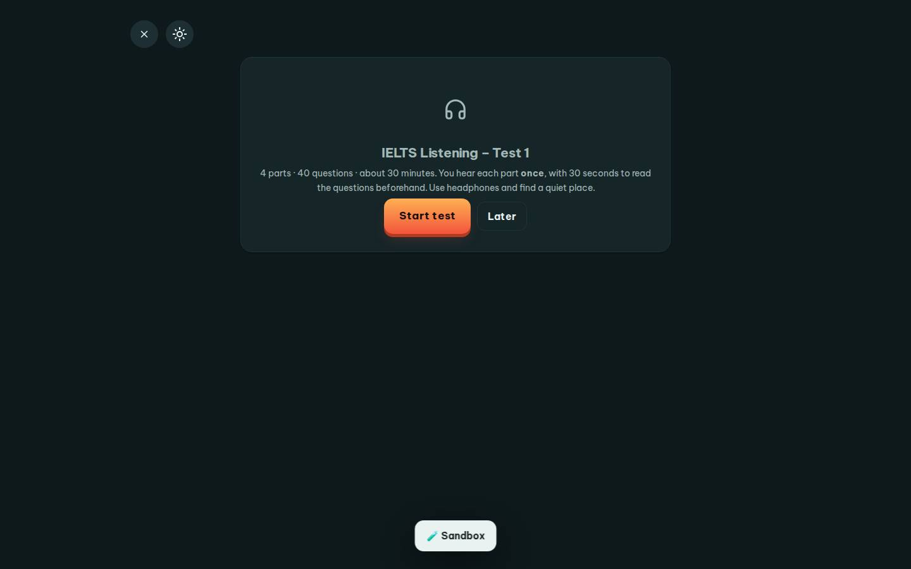

# #/listen-test

Điểm: **95** · độ phủ 100 % · /listen-test

- Chức năng: 100
- Lỗi JS: 100
- Rỗng/lỗi/tải: 100
- Back/Thoát: 100
- Tương phản: 100
- Chạm ≥44: 100
- Bố cục: 100
- i18n 15: 100
- Hiệu năng: 82
- Độ đẹp: 75

## Lỗi
- [perf] LCP 3736 ms · CLS 0.0007 · TBT 126 ms
- [beauty] Large empty space below the card feels unbalanced.
- [beauty] Sandbox mode toast looks like a raw debug element.
- [beauty] No character or illustration to match Duolingo's playful tone.

## Ảnh
390l 
390d 
1440l 
1440d 
