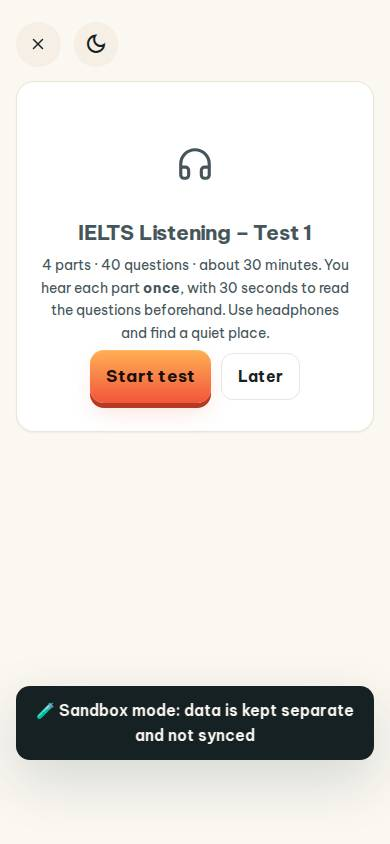
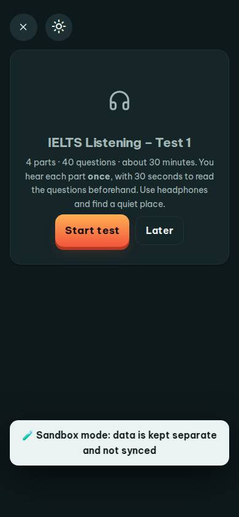
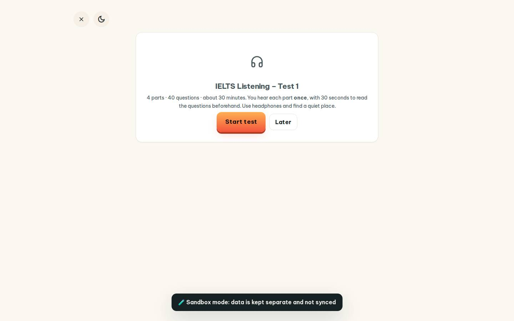
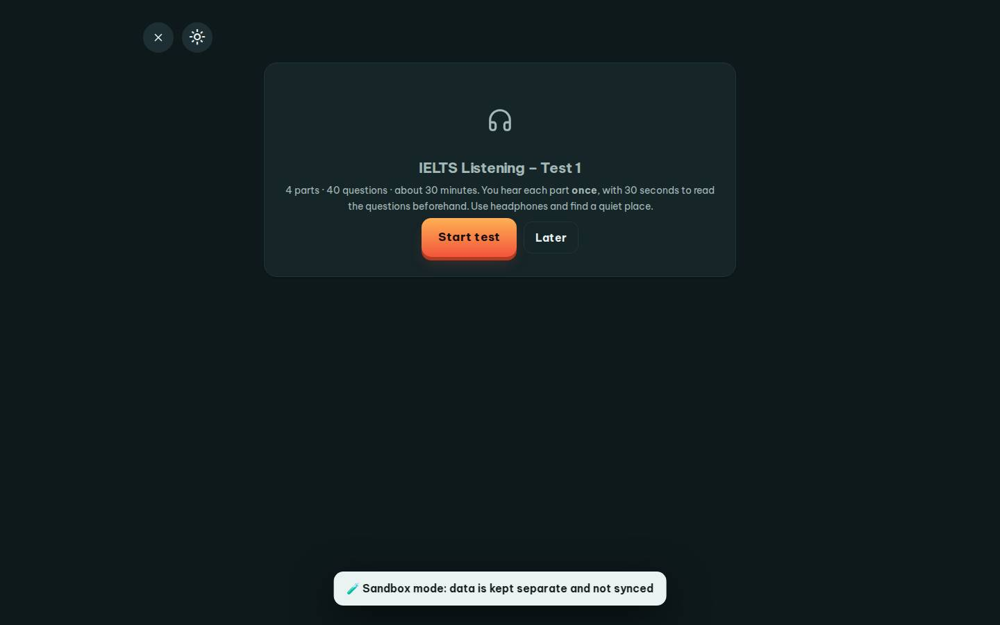

# #/listen-test

Điểm: **91** · độ phủ 100 % · /listen-test

- Chức năng: 100
- Lỗi JS: 100
- Rỗng/lỗi/tải: 100
- Back/Thoát: 100
- Tương phản: 100
- Chạm ≥44: 100
- Bố cục: 100
- i18n 15: 100
- Hiệu năng: 50
- Độ đẹp: 67

## Lỗi
- [perf] LCP 9068 ms · CLS 0 · TBT 10 ms
- [beauty] Large empty space below the card feels unbalanced.
- [beauty] Sandbox mode toast looks like a debug overlay, not polished UI.
- [beauty] No character or illustration integration, feels generic.

## Ảnh
390l 
390d 
1440l 
1440d 
