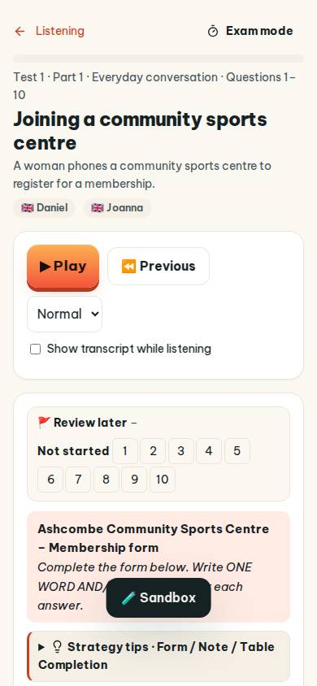
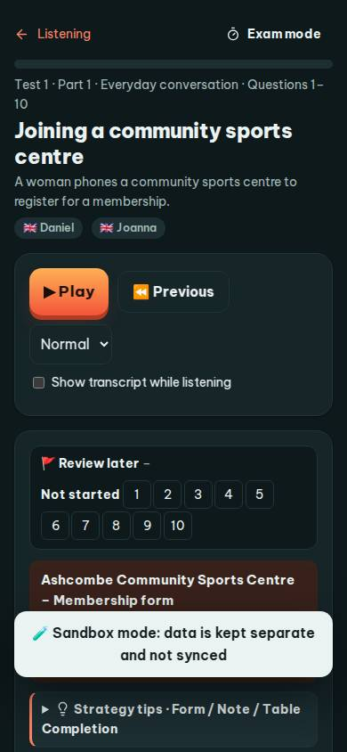
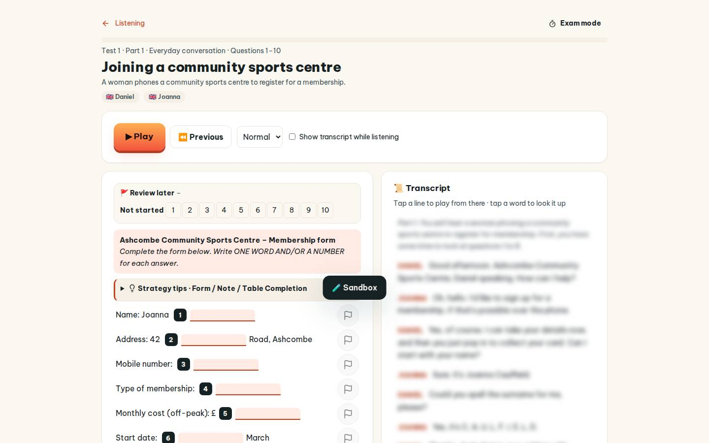
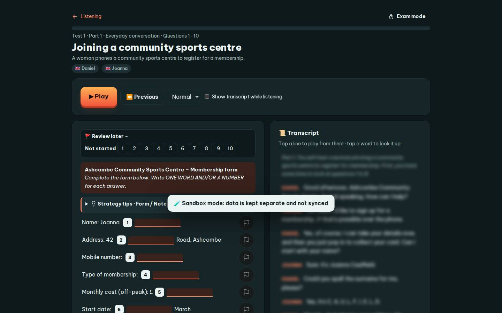

# #/listen

Điểm: **82** · độ phủ 86 % · /listen

- Chức năng: 100
- Lỗi JS: 100
- Rỗng/lỗi/tải: 100
- Back/Thoát: 100
- Tương phản: 100
- Chạm ≥44: 84
- Bố cục: 70
- i18n 15: 13
- Hiệu năng: 50
- Độ đẹp: ∅

## Lỗi
- [tap] div.lq-notes>div.lq-item.lq-gap>input.gap – "" vùng chạm 132×25 < 44px
- [tap] main#view>div.row.between>a.btn.sm – "Exam mode" vùng chạm 133×36 < 44px
- [layout] select#lRate – select "Normal" không có nhãn nhìn thấy – người học không biết ô này để làm gì
- [layout] div.lq-notes>div.lq-item.lq-gap>input.gap – input "" không có nhãn nhìn thấy – người học không biết ô này để làm gì
- [i18n] ar: thiếu dịch «Good» · thiếu dịch «to»
- [i18n] de: thiếu dịch «Good» · thiếu dịch «to»
- [i18n] es: thiếu dịch «Good» · thiếu dịch «to»
- [i18n] fr: thiếu dịch «Good» · thiếu dịch «to»
- [perf] LCP 13140 ms · CLS 0 · TBT 192 ms

## Ảnh
390l 
390d 
1440l 
1440d 
