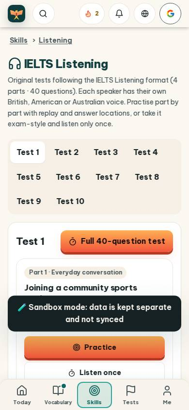
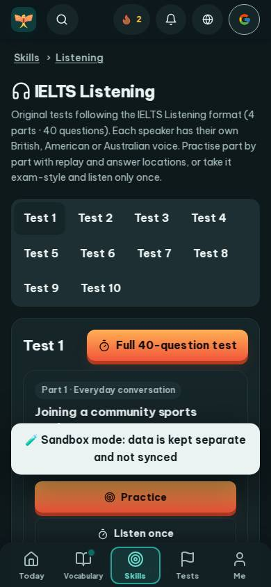
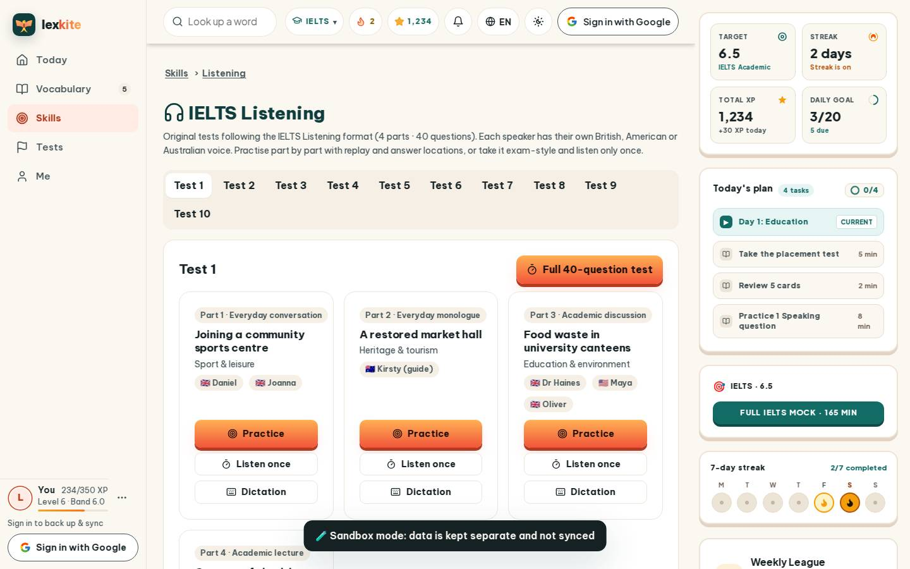
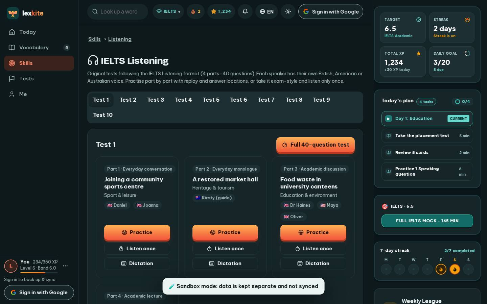

# #/listening

Điểm: **89** · độ phủ 100 % · /listening

- Chức năng: 100
- Lỗi JS: 100
- Rỗng/lỗi/tải: 100
- Back/Thoát: –
- Tương phản: 100
- Chạm ≥44: 84
- Bố cục: 85
- i18n 15: 100
- Hiệu năng: 50
- Độ đẹp: 75

## Lỗi
- [tap] main#view>div.tabs>a – "Test 1" vùng chạm 73×39 < 44px
- [tap] div.card>div.card-acts>a.btn.sm – "Listen once" vùng chạm 195×36 < 44px
- [layout] main#view>div.tabs>a – "Test 10" rớt xuống đứng một mình ở dòng cuối của main#view>div.tabs
- [perf] LCP 8172 ms · CLS 0.0031 · TBT 47 ms
- [beauty] Dark 'Sandbox mode' banner looks like a raw debug overlay, not a polished UI element.
- [beauty] Top nav bar mixes app icons with a Google 'G' logo, breaking visual coherence.
- [beauty] Generic sans-serif typography and flat cards feel less branded than Duolingo's playful style.

## Ảnh
390l 
390d 
1440l 
1440d 
