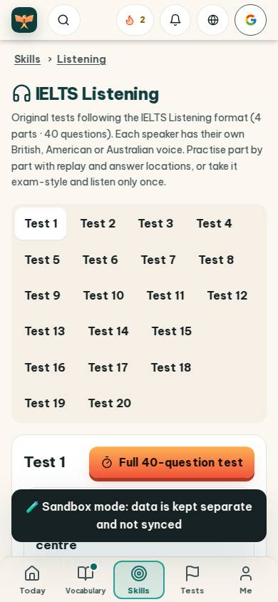
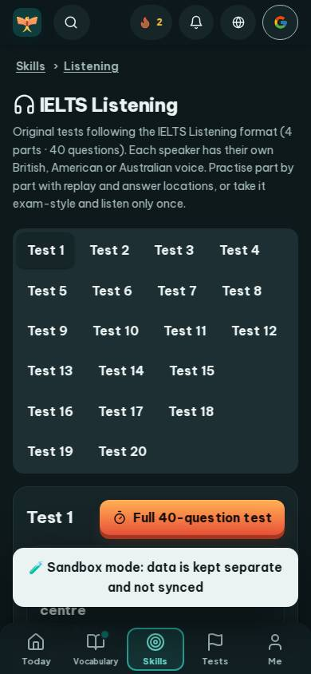
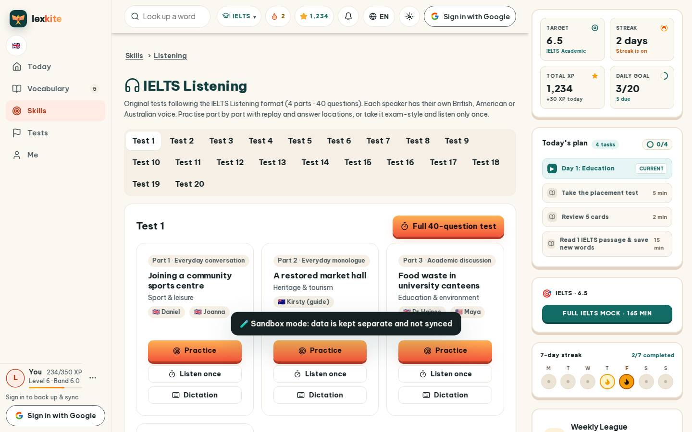

# #/listening

Điểm: **90** · độ phủ 100 % · /listening

- Chức năng: 100
- Lỗi JS: 100
- Rỗng/lỗi/tải: 100
- Back/Thoát: –
- Tương phản: 100
- Chạm ≥44: 84
- Bố cục: 100
- i18n 15: 100
- Hiệu năng: 50
- Độ đẹp: 72

## Lỗi
- [tap] main#view>div.tabs>a – "Test 1" vùng chạm 73×39 < 44px
- [tap] div.card>div.card-acts>a.btn.sm – "Listen once" vùng chạm 195×36 < 44px
- [perf] LCP 9848 ms · CLS 0.0039 · TBT 90 ms
- [beauty] Dark toast notification obscures content and breaks layout flow
- [beauty] Generic grid of text buttons lacks visual hierarchy or polish
- [beauty] No character or illustration integration, feels like a basic list

## Ảnh
390l 
390d 
1440l 
1440d 
