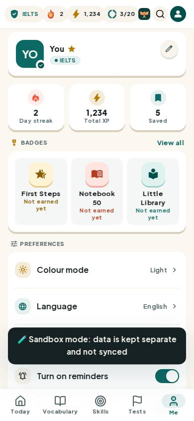
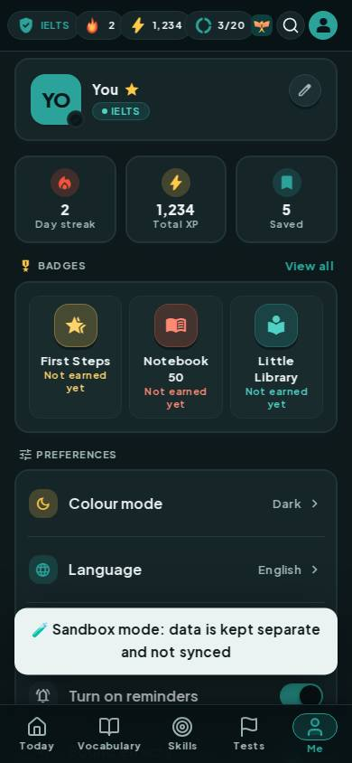
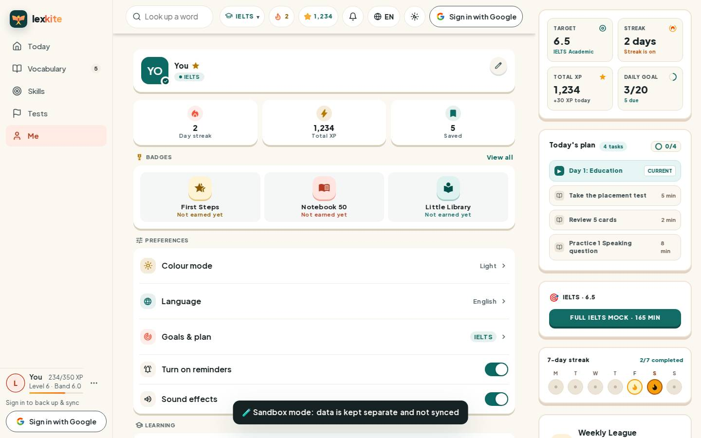
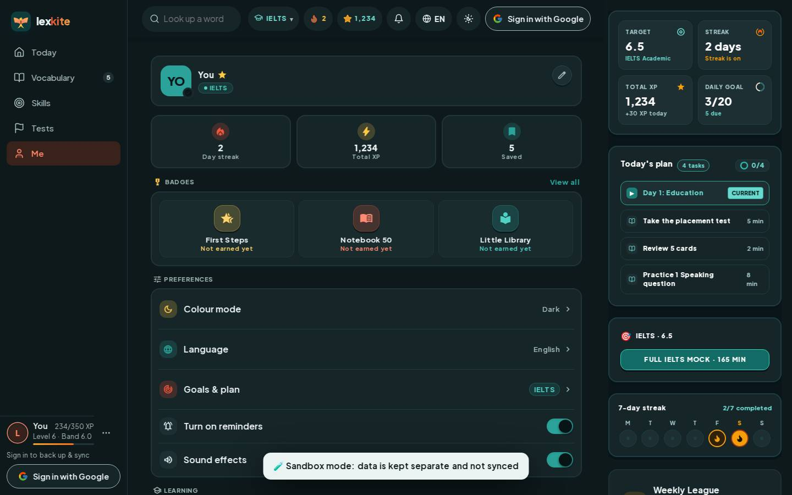

# #/me

Điểm: **96** · độ phủ 100 % · /me

- Chức năng: 100
- Lỗi JS: 100
- Rỗng/lỗi/tải: 100
- Back/Thoát: –
- Tương phản: 100
- Chạm ≥44: 100
- Bố cục: 100
- i18n 15: 100
- Hiệu năng: 82
- Độ đẹp: 86

## Lỗi
- [perf] LCP 3756 ms · CLS 0 · TBT 161 ms
- [beauty] Sandbox mode banner is a harsh, dark block that breaks the light theme harmony.
- [beauty] Top status bar is dense with small icons, reducing visual clarity.
- [beauty] Lacks the playful character integration expected at the Duolingo level.

## Ảnh
390l 
390d 
1440l 
1440d 
