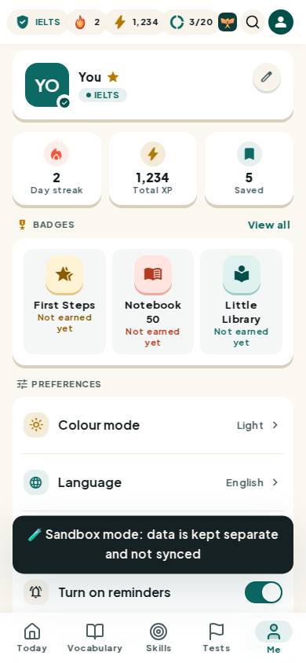
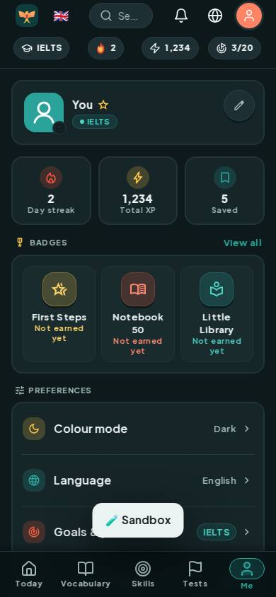
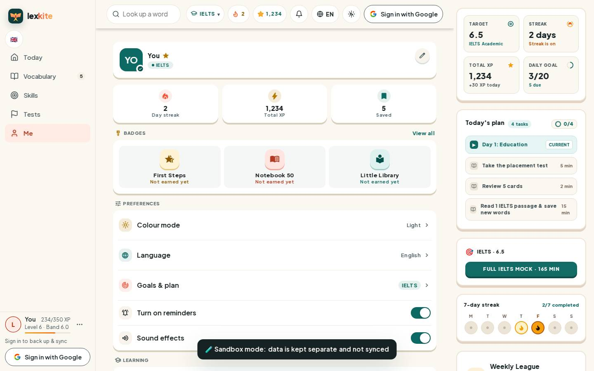
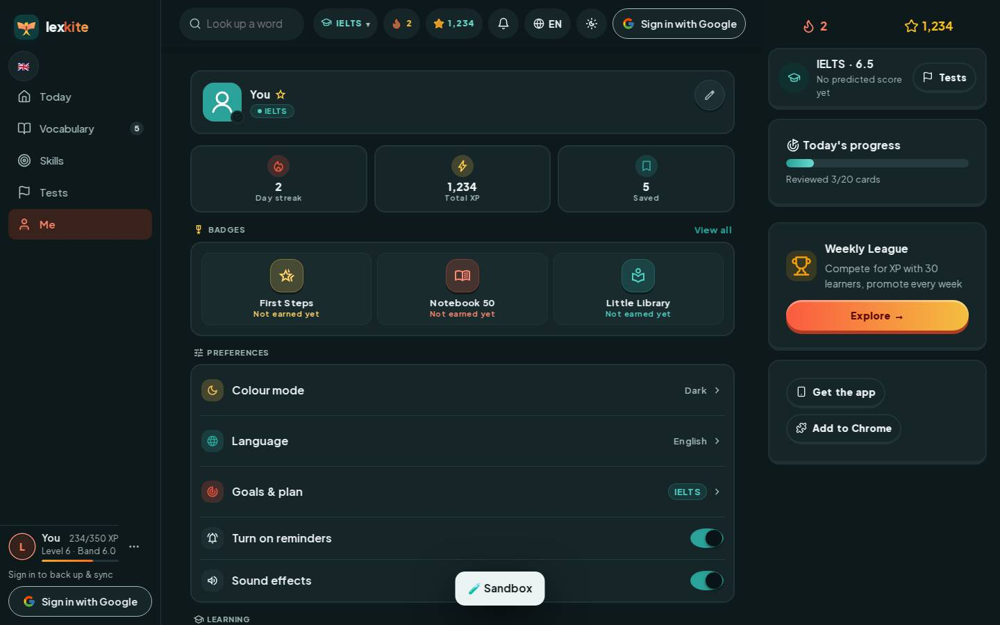

# #/me

Điểm: **93** · độ phủ 100 % · /me

- Chức năng: 100
- Lỗi JS: 100
- Rỗng/lỗi/tải: 100
- Back/Thoát: –
- Tương phản: 100
- Chạm ≥44: 100
- Bố cục: 100
- i18n 15: 100
- Hiệu năng: 48
- Độ đẹp: 86

## Lỗi
- [perf] LCP 6468 ms · CLS 0.0007 · TBT 277 ms
- [beauty] Dark sandbox banner clashes with light theme
- [beauty] Top stat bar feels cramped and cluttered
- [beauty] No character integration, feels generic

## Ảnh
390l 
390d 
1440l 
1440d 
